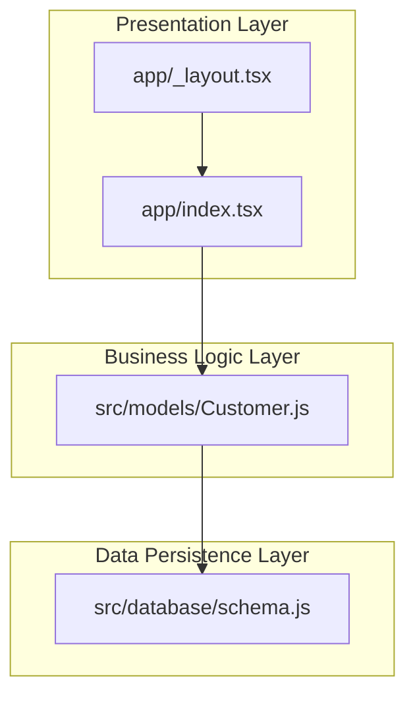
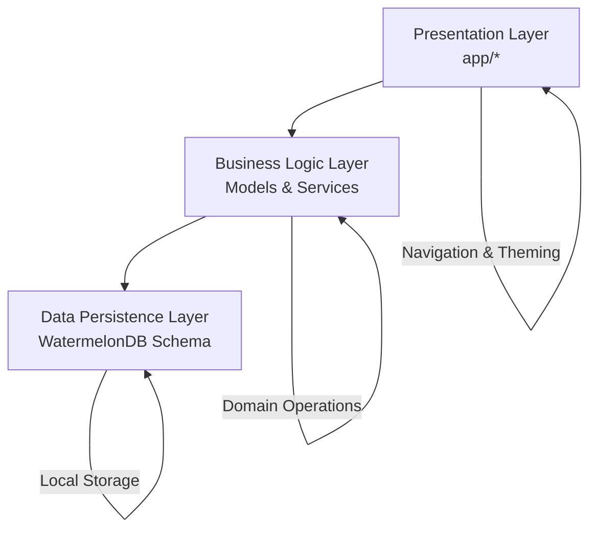
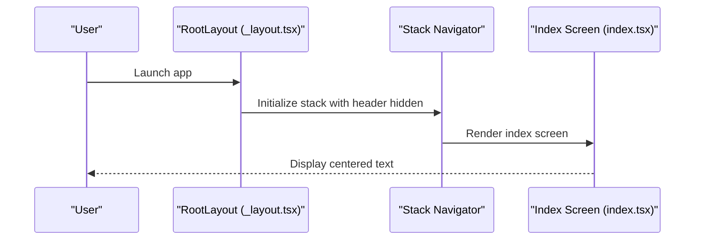
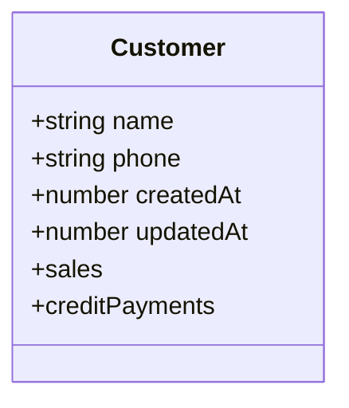
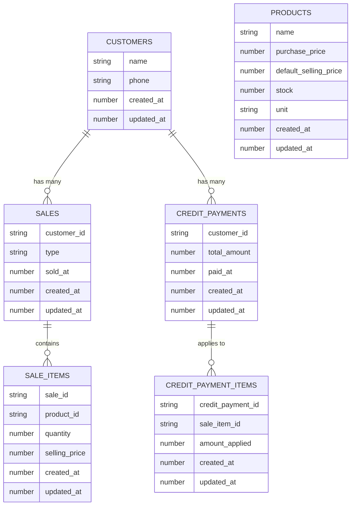
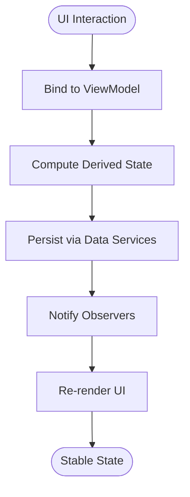
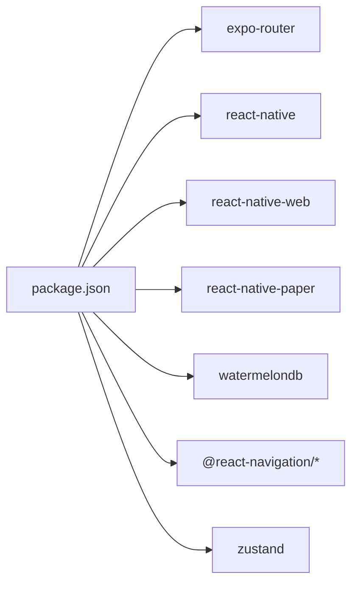

# Application Architecture

<cite>
**Referenced Files in This Document**
- [README.md](file://README.md)
- [package.json](file://package.json)
- [app/_layout.tsx](file://app/_layout.tsx)
- [app/index.tsx](file://app/index.tsx)
- [src/models/Customer.js](file://src/models/Customer.js)
- [src/database/schema.js](file://src/database/schema.js)
</cite>

## Table of Contents
1. [Introduction](#introduction)
2. [Project Structure](#project-structure)
3. [Core Components](#core-components)
4. [Architecture Overview](#architecture-overview)
5. [Detailed Component Analysis](#detailed-component-analysis)
6. [Dependency Analysis](#dependency-analysis)
7. [Performance Considerations](#performance-considerations)
8. [Troubleshooting Guide](#troubleshooting-guide)
9. [Conclusion](#conclusion)

## Introduction
This document describes the system architecture of ZemenawiDefter, focusing on how the React Native application is structured around an MVVM-inspired pattern, how navigation is handled via Expo Router, and how data persistence is implemented with WatermelonDB. It also outlines the separation of concerns across the presentation layer (React Native components), the business logic layer (models and services), and the data persistence layer (SQLite via WatermelonDB). The document explains the offline-first strategy, file-based routing, and integration patterns, along with architectural decisions, trade-offs, and constraints.

## Project Structure
The project follows a file-based routing convention with a minimal UI scaffold and a dedicated data layer under src/. The application is bootstrapped with Expo Router and uses React Native Paper theming. WatermelonDB is configured with a multi-table schema covering customers, products, sales, sale items, credit payments, and credit payment items.

**Diagram sources**
- [app/_layout.tsx](file://app/_layout.tsx#L1-L9)
- [app/index.tsx](file://app/index.tsx#L1-L16)
- [src/models/Customer.js](file://src/models/Customer.js#L1-L20)
- [src/database/schema.js](file://src/database/schema.js#L1-L90)

**Section sources**
- [README.md](file://README.md#L26-L26)
- [package.json](file://package.json#L1-L55)
- [app/_layout.tsx](file://app/_layout.tsx#L1-L9)
- [app/index.tsx](file://app/index.tsx#L1-L16)
- [src/models/Customer.js](file://src/models/Customer.js#L1-L20)
- [src/database/schema.js](file://src/database/schema.js#L1-L90)

## Core Components
- Presentation Layer
  - Root layout container with theme provider and stack navigator.
  - Minimal home screen component.
- Business Logic Layer
  - Domain model representing a customer entity with typed fields and relationships.
- Data Persistence Layer
  - Application schema defining tables, columns, and indexes for offline-first storage.

Key architectural characteristics:
- MVVM alignment: The UI (React components) binds to observable models and services, while models encapsulate domain data and relationships.
- Offline-first: WatermelonDB persists data locally; schema design emphasizes timestamps and indexes for efficient queries.
- File-based routing: Navigation is configured via file-based routes under app/.

**Section sources**
- [app/_layout.tsx](file://app/_layout.tsx#L1-L9)
- [app/index.tsx](file://app/index.tsx#L1-L16)
- [src/models/Customer.js](file://src/models/Customer.js#L1-L20)
- [src/database/schema.js](file://src/database/schema.js#L1-L90)
- [README.md](file://README.md#L26-L26)

## Architecture Overview
The system is organized into three primary layers with clear boundaries and unidirectional data flow:

- Presentation Layer
  - Responsible for rendering views and handling user interactions.
  - Uses Expo Router for navigation and React Native Paper for theming.
- Business Logic Layer
  - Encapsulates domain entities (e.g., Customer) and relationships.
  - Coordinates with data services to fetch, transform, and persist data.
- Data Persistence Layer
  - Defines the schema and manages local SQLite storage via WatermelonDB.
  - Supports indexing and timestamp fields to optimize offline queries.

**Diagram sources**
- [app/_layout.tsx](file://app/_layout.tsx#L1-L9)
- [src/models/Customer.js](file://src/models/Customer.js#L1-L20)
- [src/database/schema.js](file://src/database/schema.js#L1-L90)

## Detailed Component Analysis

### Presentation Layer: Navigation and UI
- Root layout sets up the theme provider and stack navigator with headerless screens.
- The index route renders a placeholder screen indicating where to edit the UI.

**Diagram sources**
- [app/_layout.tsx](file://app/_layout.tsx#L1-L9)
- [app/index.tsx](file://app/index.tsx#L1-L16)

**Section sources**
- [app/_layout.tsx](file://app/_layout.tsx#L1-L9)
- [app/index.tsx](file://app/index.tsx#L1-L16)
- [README.md](file://README.md#L26-L26)

### Business Logic Layer: Models and Relationships
- The Customer model defines typed fields and establishes relationships to related collections (sales and credit payments).
- This aligns with MVVM’s ViewModel role by encapsulating domain data and exposing observable properties.

**Diagram sources**
- [src/models/Customer.js](file://src/models/Customer.js#L1-L20)

**Section sources**
- [src/models/Customer.js](file://src/models/Customer.js#L1-L20)

### Data Persistence Layer: WatermelonDB Schema
- The schema defines tables for customers, products, sales, sale items, credit payments, and credit payment items.
- Columns include timestamps and indexed foreign keys to support offline-first querying and relationships.

**Diagram sources**
- [src/database/schema.js](file://src/database/schema.js#L1-L90)

**Section sources**
- [src/database/schema.js](file://src/database/schema.js#L1-L90)

### MVVM Implementation Pattern
- Model: WatermelonDB-backed entities (e.g., Customer) define typed fields and relationships.
- ViewModel: Business logic orchestrates model operations and exposes observable state to the UI.
- View: React components render UI and bind to ViewModel state.

[No sources needed since this diagram shows conceptual workflow, not actual code structure]

## Dependency Analysis
The project relies on Expo Router for navigation and React Native Paper for theming. WatermelonDB provides the ORM and SQLite abstraction. Additional libraries include React Navigation for native navigation primitives and Zustand for lightweight state management.

**Diagram sources**
- [package.json](file://package.json#L1-L55)

**Section sources**
- [package.json](file://package.json#L1-L55)

## Performance Considerations
- Indexed columns: Foreign keys and timestamps are indexed to accelerate offline queries.
- Timestamp consistency: Separate created_at and updated_at fields enable efficient sorting and filtering.
- Observable models: WatermelonDB’s reactive streams minimize unnecessary re-renders by updating only affected parts of the UI.
- Local-first design: SQLite-backed storage reduces network latency and improves responsiveness in offline scenarios.

[No sources needed since this section provides general guidance]

## Troubleshooting Guide
- Navigation issues: Verify that the root layout initializes the stack navigator and that the index route exists.
- Theme provider errors: Ensure the theme provider wraps the stack navigator.
- WatermelonDB schema mismatches: Increment the schema version and apply migrations when changing table/column definitions.
- Missing dependencies: Confirm that WatermelonDB and related packages are installed per the dependency list.

**Section sources**
- [app/_layout.tsx](file://app/_layout.tsx#L1-L9)
- [src/database/schema.js](file://src/database/schema.js#L1-L90)
- [package.json](file://package.json#L1-L55)

## Conclusion
ZemenawiDefter adopts an MVVM-aligned architecture with a clear separation of concerns. The presentation layer focuses on UI and navigation, the business logic layer encapsulates domain models and relationships, and the data persistence layer leverages WatermelonDB for offline-first storage. File-based routing via Expo Router simplifies navigation setup, while the schema supports efficient querying and indexing. This design balances maintainability, performance, and offline resilience.