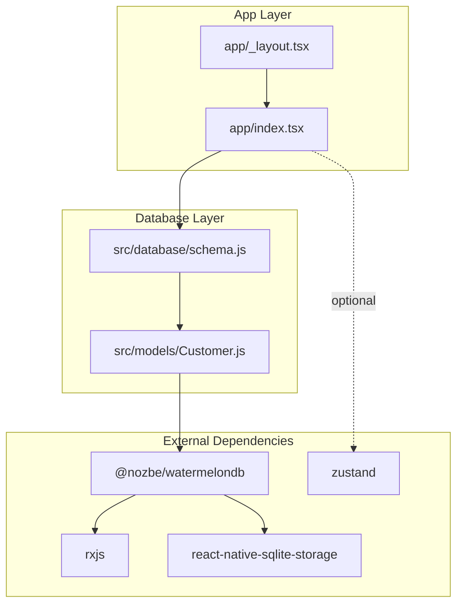
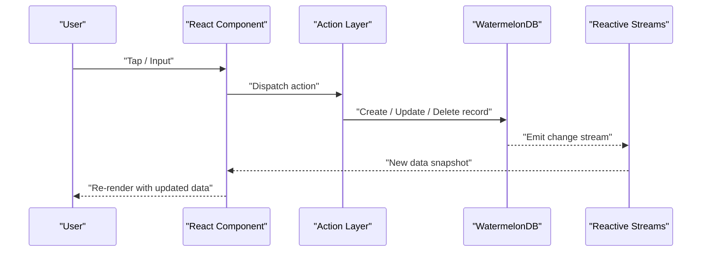
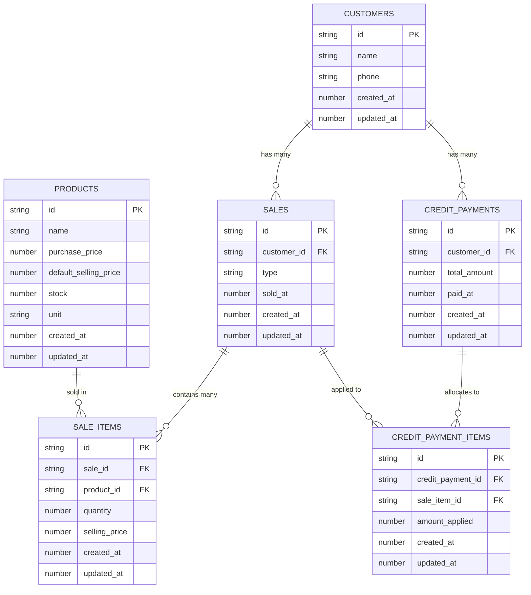
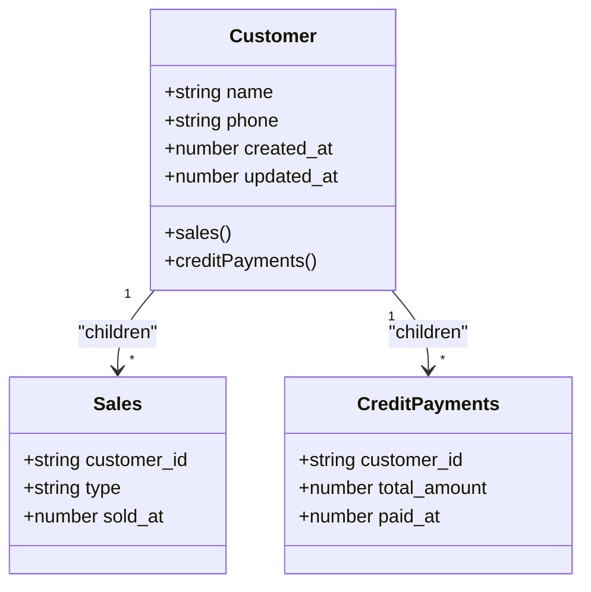
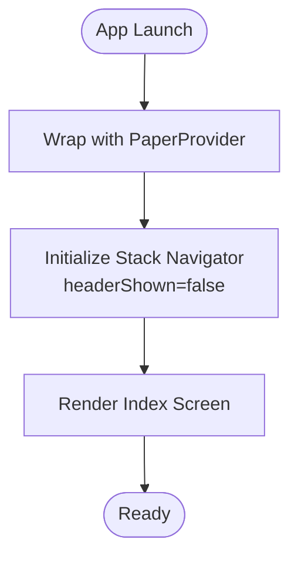
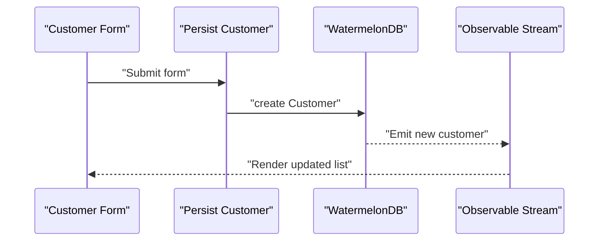
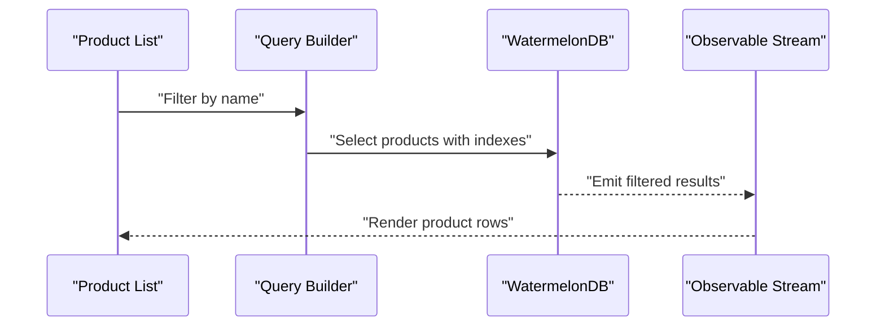
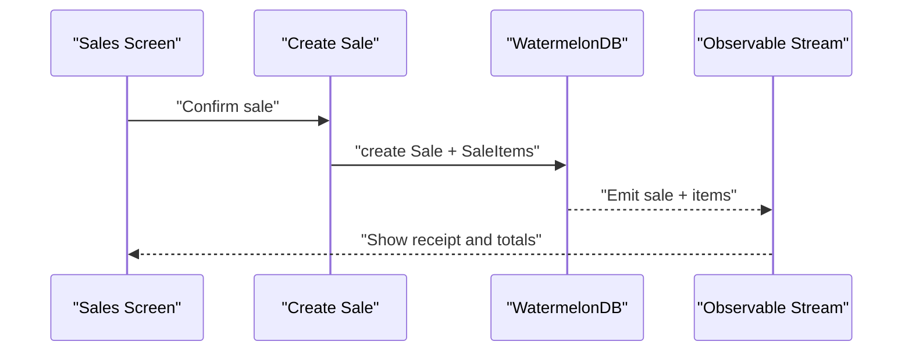
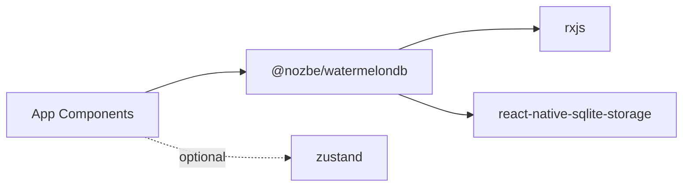

# Data Flow and State Management

<cite>
**Referenced Files in This Document**
- [README.md](file://README.md)
- [package.json](file://package.json)
- [schema.js](file://src/database/schema.js)
- [Customer.js](file://src/models/Customer.js)
- [_layout.tsx](file://app/_layout.tsx)
- [index.tsx](file://app/index.tsx)
</cite>

## Table of Contents
1. [Introduction](#introduction)
2. [Project Structure](#project-structure)
3. [Core Components](#core-components)
4. [Architecture Overview](#architecture-overview)
5. [Detailed Component Analysis](#detailed-component-analysis)
6. [Dependency Analysis](#dependency-analysis)
7. [Performance Considerations](#performance-considerations)
8. [Troubleshooting Guide](#troubleshooting-guide)
9. [Conclusion](#conclusion)

## Introduction
This document explains ZemenawiDefter’s data flow patterns and state management architecture with a focus on unidirectional data flow from user interactions through UI components to data persistence. It documents how WatermelonDB observables integrate with React component re-rendering, how local state is managed alongside persistent data, and the reactive programming model that drives UI updates. It also covers performance implications of different data access patterns and illustrates common scenarios such as customer registration, product lookup, and sales processing.

## Project Structure
The project follows a minimal React Native + Expo structure with a dedicated database schema and a single WatermelonDB model defined. The application uses:
- Expo Router for navigation
- React Native Paper for theming
- WatermelonDB for local reactive persistence
- Zustand for potential application-wide state management

**Diagram sources**
- [_layout.tsx](file://app/_layout.tsx#L1-L9)
- [index.tsx](file://app/index.tsx#L1-L16)
- [schema.js](file://src/database/schema.js#L1-L90)
- [Customer.js](file://src/models/Customer.js#L1-L20)
- [package.json](file://package.json#L13-L46)

**Section sources**
- [README.md](file://README.md#L1-L51)
- [package.json](file://package.json#L1-L55)
- [_layout.tsx](file://app/_layout.tsx#L1-L9)
- [index.tsx](file://app/index.tsx#L1-L16)
- [schema.js](file://src/database/schema.js#L1-L90)
- [Customer.js](file://src/models/Customer.js#L1-L20)

## Core Components
- WatermelonDB Schema: Defines tables and columns for customers, products, sales, sale items, credit payments, and credit payment items. Includes indexes on foreign keys and timestamps to optimize queries.
- Customer Model: Declares fields and relationships (children) for sales and credit payments.
- UI Layout: Provides a PaperProvider wrapper and a Stack navigator with header hidden.
- Navigation Entry: A basic index screen that renders centered text.

Key implementation references:
- Schema definition and table/column/index declarations
- Customer model field and relationship decorators
- App layout provider and stack configuration
- Basic index screen rendering

**Section sources**
- [schema.js](file://src/database/schema.js#L1-L90)
- [Customer.js](file://src/models/Customer.js#L1-L20)
- [_layout.tsx](file://app/_layout.tsx#L1-L9)
- [index.tsx](file://app/index.tsx#L1-L16)

## Architecture Overview
ZemenawiDefter follows a unidirectional data flow:
- User interactions occur in UI components.
- UI components trigger actions that mutate WatermelonDB records via the model layer.
- WatermelonDB emits observable streams of data that drive React component re-rendering.
- Optional application state can be managed with Zustand for transient UI or cross-component state.

[No sources needed since this diagram shows conceptual workflow, not actual code structure]

## Detailed Component Analysis

### WatermelonDB Schema and Reactive Streams
The schema defines the domain model and indexing strategy:
- Tables: customers, products, sales, sale_items, credit_payments, credit_payment_items
- Indexed columns: customer_id, sold_at, product_id, sale_id, credit_payment_id, paid_at
- Timestamps: created_at and updated_at for consistency

These indexes enable efficient queries for:
- Customer sales and payments
- Product stock and pricing
- Sales by date range
- Payment allocations against sale items

**Diagram sources**
- [schema.js](file://src/database/schema.js#L1-L90)

**Section sources**
- [schema.js](file://src/database/schema.js#L1-L90)

### Customer Model and Relationships
The Customer model exposes:
- Fields: name, phone, created_at, updated_at
- Children relationships: sales and credit_payments

This enables:
- Fetching a customer and their related sales and payments
- Efficient joins via WatermelonDB’s query engine and indexes

**Diagram sources**
- [Customer.js](file://src/models/Customer.js#L1-L20)

**Section sources**
- [Customer.js](file://src/models/Customer.js#L1-L20)

### UI Layout and Navigation
The root layout wraps the app with a theme provider and sets up a Stack navigator. The index screen is a placeholder that centers text. While the current screens are minimal, they provide the foundation for integrating WatermelonDB observables and state management.

**Diagram sources**
- [_layout.tsx](file://app/_layout.tsx#L1-L9)
- [index.tsx](file://app/index.tsx#L1-L16)

**Section sources**
- [_layout.tsx](file://app/_layout.tsx#L1-L9)
- [index.tsx](file://app/index.tsx#L1-L16)

### Data Flow Scenarios

#### Customer Registration
End-to-end flow:
- UI collects customer name and phone
- Action layer persists a new Customer record
- WatermelonDB emits a change stream
- UI subscribes to the observable and re-renders the customer list

[No sources needed since this diagram shows conceptual workflow, not actual code structure]

#### Product Lookup
End-to-end flow:
- UI queries products by name or filters
- WatermelonDB executes indexed queries
- UI receives updated product lists reactively

[No sources needed since this diagram shows conceptual workflow, not actual code structure]

#### Sales Processing
End-to-end flow:
- UI composes a sale with items and customer selection
- Action layer creates a Sale and multiple SaleItems
- WatermelonDB emits updated sale snapshots
- UI re-renders totals and itemized view

[No sources needed since this diagram shows conceptual workflow, not actual code structure]

## Dependency Analysis
External libraries and their roles:
- WatermelonDB: Local reactive database with RxJS streams and SQLite-backed storage
- react-native-sqlite-storage: SQLite driver for persistence
- rxjs: Reactive streams powering observables
- zustand: Optional state management for transient UI state

**Diagram sources**
- [package.json](file://package.json#L13-L46)

**Section sources**
- [package.json](file://package.json#L13-L46)

## Performance Considerations
- Prefer indexed columns for foreign keys and frequently queried timestamps to minimize query cost.
- Use targeted queries with filters to reduce dataset size before rendering.
- Batch writes for related entities (e.g., create sale and items together) to reduce re-query cycles.
- Subscribe to narrow observables (e.g., a single customer’s sales) rather than global datasets to limit re-renders.
- Avoid unnecessary deep equality checks in UI; rely on WatermelonDB’s observable emissions to drive updates.
- For large lists, consider pagination or virtualization to keep render times low.

[No sources needed since this section provides general guidance]

## Troubleshooting Guide
Common issues and remedies:
- Observables not updating: Ensure subscriptions are active and queries target the correct tables/columns. Verify indexes exist for filtered columns.
- Stale data after mutation: Confirm mutations are performed within the same transactional context and that the UI observes the correct query.
- Performance regressions: Review query plans and add missing indexes; avoid overly broad queries.
- State conflicts: If mixing Zustand with WatermelonDB, isolate persistent state in WatermelonDB and transient UI state in Zustand.

[No sources needed since this section provides general guidance]

## Conclusion
ZemenawiDefter leverages WatermelonDB’s reactive model to enforce a clean, unidirectional data flow: user interactions update persistent records, which emit observable changes that drive precise UI re-renders. The schema and model definitions establish a solid foundation for customer, product, and sales domains. By combining WatermelonDB observables with optional state management (e.g., Zustand), the app can balance persistent data integrity with responsive UI behavior. Following the performance and troubleshooting guidance ensures scalable and maintainable data flows across common business scenarios.