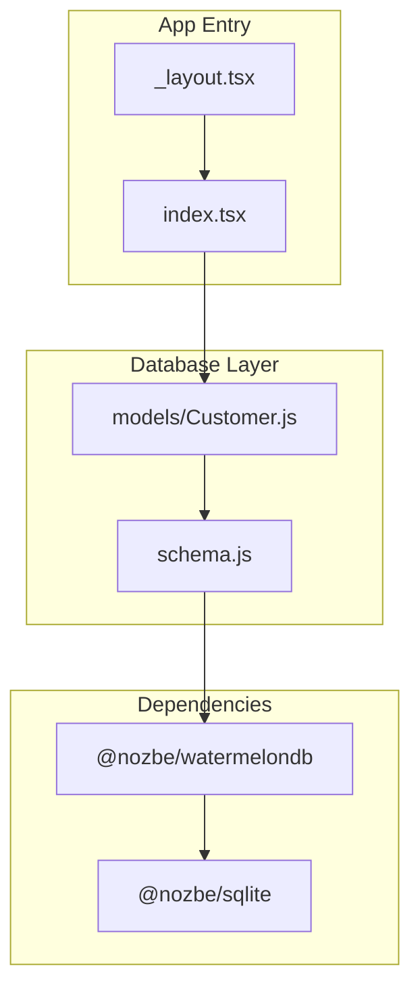
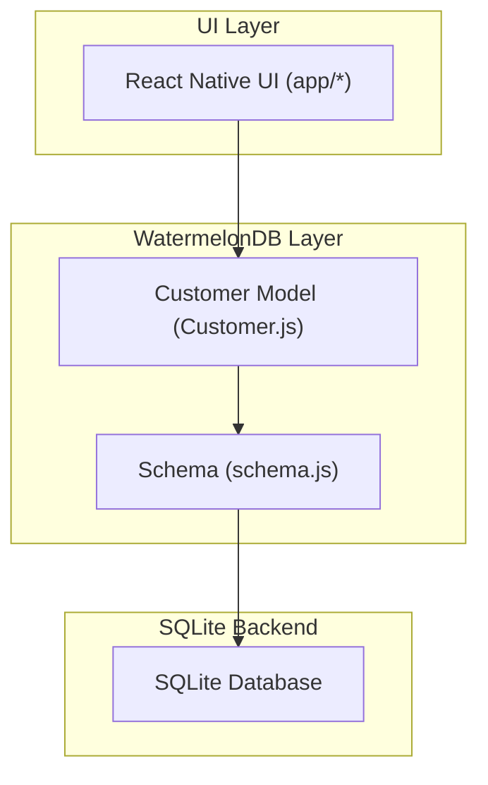
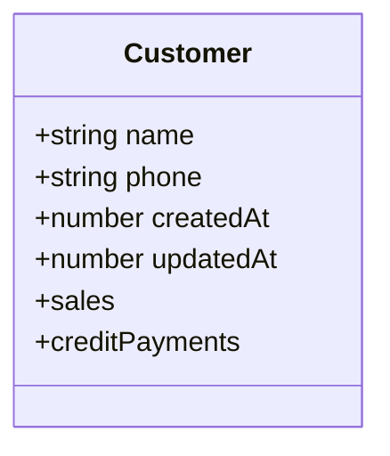
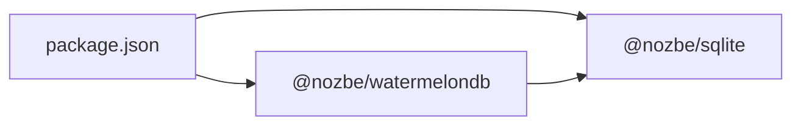

# Database Integration Architecture

<cite>
**Referenced Files in This Document**
- [schema.js](file://src/database/schema.js)
- [Customer.js](file://src/models/Customer.js)
- [package.json](file://package.json)
- [_layout.tsx](file://app/_layout.tsx)
- [index.tsx](file://app/index.tsx)
</cite>

## Table of Contents
1. [Introduction](#introduction)
2. [Project Structure](#project-structure)
3. [Core Components](#core-components)
4. [Architecture Overview](#architecture-overview)
5. [Detailed Component Analysis](#detailed-component-analysis)
6. [Dependency Analysis](#dependency-analysis)
7. [Performance Considerations](#performance-considerations)
8. [Troubleshooting Guide](#troubleshooting-guide)
9. [Conclusion](#conclusion)

## Introduction
This document explains the database integration architecture of ZemenawiDefter using WatermelonDB as the offline-first persistence layer backed by SQLite. It covers the schema design, model system with decorators and relationships, indexing strategies, and how the database layer abstracts persistence from UI components. It also outlines synchronization patterns, conflict resolution approaches, and performance optimizations grounded in the repository’s current implementation.

## Project Structure
The database layer is organized around a compact schema definition and a minimal model class for the Customer domain entity. The application entry points are present but do not include explicit database initialization code in the provided files.

**Diagram sources**
- [_layout.tsx](file://app/_layout.tsx#L1-L9)
- [index.tsx](file://app/index.tsx#L1-L16)
- [schema.js](file://src/database/schema.js#L1-L90)
- [Customer.js](file://src/models/Customer.js#L1-L20)
- [package.json](file://package.json#L13-L45)

**Section sources**
- [_layout.tsx](file://app/_layout.tsx#L1-L9)
- [index.tsx](file://app/index.tsx#L1-L16)
- [schema.js](file://src/database/schema.js#L1-L90)
- [Customer.js](file://src/models/Customer.js#L1-L20)
- [package.json](file://package.json#L13-L45)

## Core Components
- WatermelonDB schema: Defines the app-wide schema version and table/column definitions, including indexed columns for efficient queries.
- Customer model: Declares fields and relationships using WatermelonDB decorators.
- Dependencies: WatermelonDB and SQLite adapter are declared in the project dependencies.

Key implementation references:
- Schema definition and table/column metadata: [schema.js](file://src/database/schema.js#L5-L87)
- Customer model with field decorators and relationships: [Customer.js](file://src/models/Customer.js#L4-L17)
- WatermelonDB and SQLite adapter dependencies: [package.json](file://package.json#L13-L45)

**Section sources**
- [schema.js](file://src/database/schema.js#L5-L87)
- [Customer.js](file://src/models/Customer.js#L4-L17)
- [package.json](file://package.json#L13-L45)

## Architecture Overview
ZemenawiDefter adopts an offline-first architecture via WatermelonDB with SQLite as the backend. The schema defines normalized tables for customers, products, sales, sale items, credit payments, and credit payment items. Indexed columns support fast lookups for foreign keys and timestamps. The Customer model exposes typed fields and child relationships to related entities.

**Diagram sources**
- [schema.js](file://src/database/schema.js#L5-L87)
- [Customer.js](file://src/models/Customer.js#L4-L17)
- [_layout.tsx](file://app/_layout.tsx#L1-L9)
- [index.tsx](file://app/index.tsx#L1-L16)

## Detailed Component Analysis

### WatermelonDB Schema Design
The schema defines six tables with carefully chosen columns and indexes:
- customers: name, phone, created_at, updated_at
- products: name, purchase_price, default_selling_price, stock, unit, created_at, updated_at
- sales: customer_id (indexed), type, sold_at (indexed), created_at, updated_at
- sale_items: sale_id (indexed), product_id (indexed), quantity, selling_price, created_at, updated_at
- credit_payments: customer_id (indexed), total_amount, paid_at (indexed), created_at, updated_at
- credit_payment_items: credit_payment_id (indexed), sale_item_id (indexed), amount_applied, created_at, updated_at

Indexing strategy rationale:
- Foreign keys (customer_id, sale_id, product_id, credit_payment_id) are indexed to accelerate joins and reverse lookups.
- Timestamps (sold_at, paid_at) are indexed to enable efficient chronological queries.

Versioning:
- The schema includes a version field to support migrations when extending the schema in the future.

References:
- [schema.js](file://src/database/schema.js#L5-L87)

**Section sources**
- [schema.js](file://src/database/schema.js#L5-L87)

### Customer Model: Fields and Relationships
The Customer model uses decorators to define:
- Field decorators mapping to table columns: name, phone, created_at, updated_at
- Relationship decorators for children collections: sales, creditPayments

This design enables:
- Strongly typed accessors for customer attributes
- Lazy loading of related collections (sales and creditPayments)

References:
- [Customer.js](file://src/models/Customer.js#L4-L17)

**Diagram sources**
- [Customer.js](file://src/models/Customer.js#L4-L17)

**Section sources**
- [Customer.js](file://src/models/Customer.js#L4-L17)

### Data Access Patterns and Abstractions
The UI components remain decoupled from persistence details by interacting with WatermelonDB models and collections. Typical patterns include:
- Fetching a customer and observing related collections (sales, creditPayments) reactively
- Creating/updating/deleting records through model instances
- Using queries on indexed columns (e.g., customer_id, timestamps) for efficient filtering

References:
- [Customer.js](file://src/models/Customer.js#L4-L17)
- [_layout.tsx](file://app/_layout.tsx#L1-L9)
- [index.tsx](file://app/index.tsx#L1-L16)

**Section sources**
- [Customer.js](file://src/models/Customer.js#L4-L17)
- [_layout.tsx](file://app/_layout.tsx#L1-L9)
- [index.tsx](file://app/index.tsx#L1-L16)

### Offline Data Management and Consistency
Offline-first behavior is achieved by:
- Persisting all changes locally in SQLite via WatermelonDB
- Maintaining updated_at timestamps for consistency checks
- Using indexed timestamps (sold_at, paid_at) to support local sorting and filtering

References:
- [schema.js](file://src/database/schema.js#L14-L15)
- [schema.js](file://src/database/schema.js#L44-L46)
- [schema.js](file://src/database/schema.js#L69-L71)

**Section sources**
- [schema.js](file://src/database/schema.js#L14-L15)
- [schema.js](file://src/database/schema.js#L44-L46)
- [schema.js](file://src/database/schema.js#L69-L71)

### Synchronization and Conflict Resolution
The repository does not include explicit synchronization code. Based on WatermelonDB’s documented capabilities, typical patterns involve:
- Using synchronize to push/pull changes to/from a remote server
- Tracking unsynced changes and applying conflict resolution strategies (e.g., last-update-wins, merge strategies)
- Logging and debugging sync operations

References:
- [package.json](file://package.json#L13-L45)

**Section sources**
- [package.json](file://package.json#L13-L45)

## Dependency Analysis
WatermelonDB depends on SQLite for storage. The project declares both packages as dependencies.

**Diagram sources**
- [package.json](file://package.json#L13-L45)

**Section sources**
- [package.json](file://package.json#L13-L45)

## Performance Considerations
- Indexed foreign keys: customer_id, sale_id, product_id, credit_payment_id reduce join costs and improve query performance.
- Indexed timestamps: sold_at and paid_at enable efficient chronological queries without scanning entire tables.
- Timestamps created_at and updated_at support change tracking and consistency checks.
- Minimizing writes and batching updates can further improve performance.

References:
- [schema.js](file://src/database/schema.js#L38-L41)
- [schema.js](file://src/database/schema.js#L44-L44)
- [schema.js](file://src/database/schema.js#L54-L55)
- [schema.js](file://src/database/schema.js#L67-L67)
- [schema.js](file://src/database/schema.js#L69-L69)
- [schema.js](file://src/database/schema.js#L79-L79)
- [schema.js](file://src/database/schema.js#L80-L80)

**Section sources**
- [schema.js](file://src/database/schema.js#L38-L41)
- [schema.js](file://src/database/schema.js#L44-L44)
- [schema.js](file://src/database/schema.js#L54-L55)
- [schema.js](file://src/database/schema.js#L67-L67)
- [schema.js](file://src/database/schema.js#L69-L69)
- [schema.js](file://src/database/schema.js#L79-L79)
- [schema.js](file://src/database/schema.js#L80-L80)

## Troubleshooting Guide
Common areas to inspect:
- Schema version mismatches: Ensure the schema version aligns with migrations if any were previously applied.
- Missing indexes: If queries on foreign keys or timestamps become slow, verify isIndexed flags in the schema.
- Model-field mismatches: Confirm that model decorators match column names defined in the schema.
- Dependency conflicts: Verify WatermelonDB and SQLite adapter versions are compatible with the React Native environment.

References:
- [schema.js](file://src/database/schema.js#L5-L87)
- [Customer.js](file://src/models/Customer.js#L4-L17)
- [package.json](file://package.json#L13-L45)

**Section sources**
- [schema.js](file://src/database/schema.js#L5-L87)
- [Customer.js](file://src/models/Customer.js#L4-L17)
- [package.json](file://package.json#L13-L45)

## Conclusion
ZemenawiDefter’s database integration leverages WatermelonDB with a well-structured schema and indexed columns to support offline-first operations. The Customer model demonstrates the use of decorators for fields and relationships, enabling clean separation between UI components and persistence logic. While explicit synchronization code is not present in the repository, the foundational schema and dependencies are aligned with WatermelonDB’s capabilities for offline-first data management and scalable query performance.