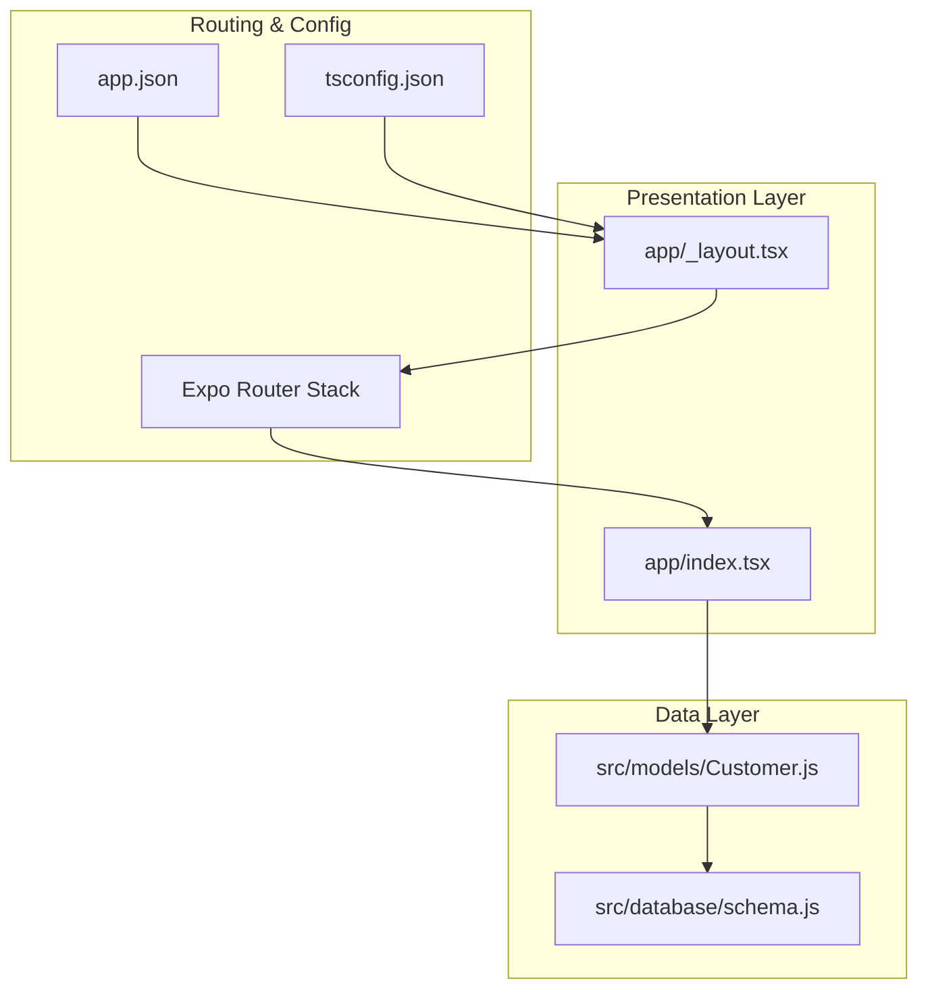
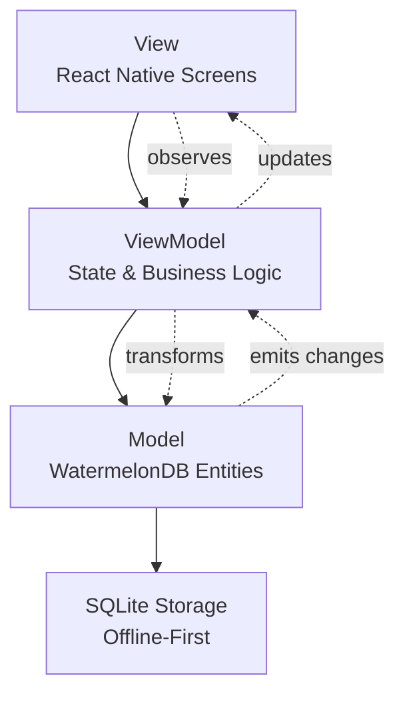
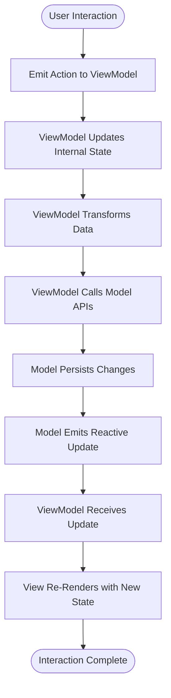
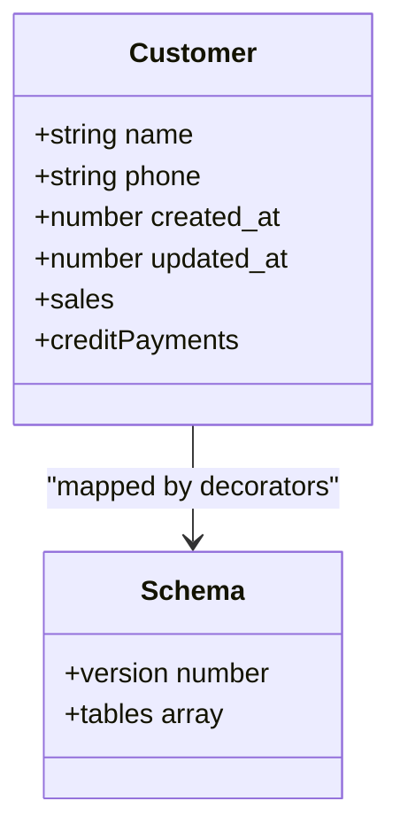
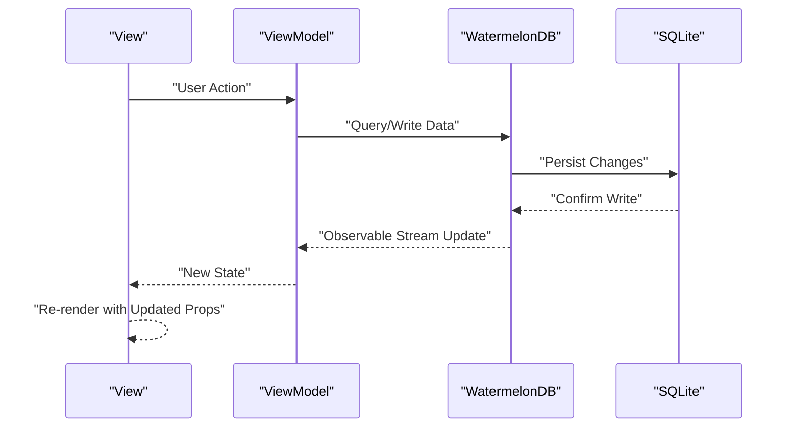
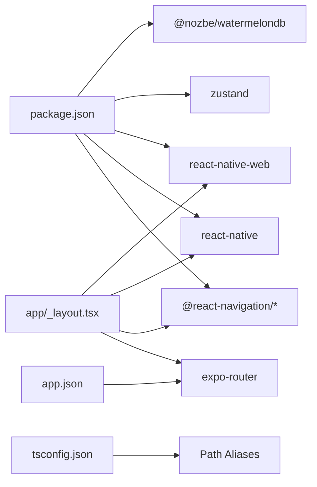

# MVVM Architecture Pattern

<cite>
**Referenced Files in This Document**
- [README.md](file://README.md)
- [package.json](file://package.json)
- [tsconfig.json](file://tsconfig.json)
- [app.json](file://app.json)
- [app/_layout.tsx](file://app/_layout.tsx)
- [app/index.tsx](file://app/index.tsx)
- [src/database/schema.js](file://src/database/schema.js)
- [src/models/Customer.js](file://src/models/Customer.js)
</cite>

## Table of Contents
1. [Introduction](#introduction)
2. [Project Structure](#project-structure)
3. [Core Components](#core-components)
4. [Architecture Overview](#architecture-overview)
5. [Detailed Component Analysis](#detailed-component-analysis)
6. [Dependency Analysis](#dependency-analysis)
7. [Performance Considerations](#performance-considerations)
8. [Troubleshooting Guide](#troubleshooting-guide)
9. [Conclusion](#conclusion)

## Introduction
This document explains how ZemenawiDefter implements an MVVM (Model-View-ViewModel) architecture in React Native. It focuses on how the presentation layer (UI components and screens) remains separate from business logic through view models, and how data binding connects UI updates to WatermelonDB models. The document also covers the offline-first approach, benefits for testing and maintainability, and how this pattern supports cross-platform development.

## Project Structure
The project follows a clear separation of concerns:
- Presentation layer: React Native UI components and screens under the app directory
- Data layer: WatermelonDB schema and model definitions under src
- Routing and navigation: Expo Router stack configuration
- Cross-platform configuration: Expo app.json and TypeScript path mapping

**Diagram sources**
- [app/_layout.tsx](file://app/_layout.tsx#L1-L9)
- [app/index.tsx](file://app/index.tsx#L1-L16)
- [src/database/schema.js](file://src/database/schema.js#L1-L90)
- [src/models/Customer.js](file://src/models/Customer.js#L1-L20)
- [app.json](file://app.json#L1-L50)
- [tsconfig.json](file://tsconfig.json#L1-L18)

**Section sources**
- [app/_layout.tsx](file://app/_layout.tsx#L1-L9)
- [app/index.tsx](file://app/index.tsx#L1-L16)
- [src/database/schema.js](file://src/database/schema.js#L1-L90)
- [src/models/Customer.js](file://src/models/Customer.js#L1-L20)
- [app.json](file://app.json#L1-L50)
- [tsconfig.json](file://tsconfig.json#L1-L18)

## Core Components
- View (UI components and screens)
  - The View layer consists of React Native components and screens. The root layout configures the navigation stack and theme provider. The home screen demonstrates a basic UI scaffold.
  - References:
    - [app/_layout.tsx](file://app/_layout.tsx#L1-L9)
    - [app/index.tsx](file://app/index.tsx#L1-L16)

- ViewModel (state management and business logic coordination)
  - The current codebase does not include explicit ViewModel implementations. In MVVM, the ViewModel would encapsulate UI-related state, handle user interactions, and coordinate with the Model layer while remaining independent of the View. This separation enables testability and reuse across platforms.

- Model (data persistence via WatermelonDB)
  - The Model layer defines database schema and entity models. The schema declares tables and columns, and the Customer model maps to the customers table with fields and relationships.
  - References:
    - [src/database/schema.js](file://src/database/schema.js#L1-L90)
    - [src/models/Customer.js](file://src/models/Customer.js#L1-L20)

Benefits of this separation:
- Testing: ViewModels can be unit-tested independently of UI frameworks; Models can be tested against database operations.
- Maintainability: Clear boundaries reduce coupling and simplify refactoring.
- Cross-platform: Shared business logic and data models work consistently across iOS, Android, and web.

**Section sources**
- [app/_layout.tsx](file://app/_layout.tsx#L1-L9)
- [app/index.tsx](file://app/index.tsx#L1-L16)
- [src/database/schema.js](file://src/database/schema.js#L1-L90)
- [src/models/Customer.js](file://src/models/Customer.js#L1-L20)

## Architecture Overview
The MVVM architecture in ZemenawiDefter can be visualized as follows:
- Views (screens) render UI and emit user actions
- ViewModels receive actions, manage state, and orchestrate data operations
- Models (WatermelonDB) persist and retrieve data, exposing observable streams for reactive updates
- The offline-first approach ensures data integrity and availability even without network connectivity

[No sources needed since this diagram shows conceptual workflow, not actual code structure]

## Detailed Component Analysis

### View Layer
- Purpose: Render UI and capture user interactions
- Implementation pattern: Stateless functional components with minimal logic
- Example references:
  - [app/_layout.tsx](file://app/_layout.tsx#L1-L9)
  - [app/index.tsx](file://app/index.tsx#L1-L16)

[No sources needed since this diagram shows conceptual workflow, not actual code structure]

**Section sources**
- [app/_layout.tsx](file://app/_layout.tsx#L1-L9)
- [app/index.tsx](file://app/index.tsx#L1-L16)

### ViewModel Layer
- Role: Encapsulates UI state, handles user actions, coordinates business logic, and manages data transformations
- Benefits:
  - Decouples UI from business logic
  - Enables unit testing of state transitions and data flows
  - Supports cross-platform reuse of business rules

[No sources needed since this section doesn't analyze specific source files]

### Model Layer (WatermelonDB)
- Purpose: Define schema and entity models for offline-first data persistence
- Schema definition: Declares tables, columns, and indexes for customers, products, sales, and related entities
- Entity mapping: Maps JavaScript classes to database tables and exposes relationships

**Diagram sources**
- [src/models/Customer.js](file://src/models/Customer.js#L1-L20)
- [src/database/schema.js](file://src/database/schema.js#L1-L90)

**Section sources**
- [src/database/schema.js](file://src/database/schema.js#L1-L90)
- [src/models/Customer.js](file://src/models/Customer.js#L1-L20)

### Data Binding and Reactive Updates
- WatermelonDB provides observable streams that enable reactive updates to the UI
- The ViewModel subscribes to these observables, transforming data into UI-ready state
- The View re-renders automatically when the ViewModel emits new state

[No sources needed since this diagram shows conceptual workflow, not actual code structure]

## Dependency Analysis
- Navigation and routing: Expo Router stack configuration
- UI framework: React Native Paper provider
- State management: Zustand for lightweight state orchestration
- Data persistence: WatermelonDB with SQLite backend
- Cross-platform: Expo app.json configuration and TypeScript path mapping

**Diagram sources**
- [package.json](file://package.json#L1-L55)
- [app.json](file://app.json#L1-L50)
- [tsconfig.json](file://tsconfig.json#L1-L18)
- [app/_layout.tsx](file://app/_layout.tsx#L1-L9)

**Section sources**
- [package.json](file://package.json#L1-L55)
- [app.json](file://app.json#L1-L50)
- [tsconfig.json](file://tsconfig.json#L1-L18)
- [app/_layout.tsx](file://app/_layout.tsx#L1-L9)

## Performance Considerations
- Offline-first reduces network latency and improves reliability
- WatermelonDB’s reactive streams minimize unnecessary re-renders by emitting only changed data
- Keep ViewModel logic lightweight and delegate heavy computations to worker threads or native modules when needed
- Use indexing strategically (as seen in the schema) to optimize query performance

[No sources needed since this section provides general guidance]

## Troubleshooting Guide
- Navigation issues: Verify stack configuration and route definitions in the layout
  - Reference: [app/_layout.tsx](file://app/_layout.tsx#L1-L9)
- Database schema mismatches: Ensure schema version and table/column definitions align with model decorators
  - Reference: [src/database/schema.js](file://src/database/schema.js#L1-L90)
- Model mapping errors: Confirm entity field names match schema column names
  - Reference: [src/models/Customer.js](file://src/models/Customer.js#L1-L20)
- Cross-platform build problems: Review Expo app.json settings and TypeScript path aliases
  - Reference: [app.json](file://app.json#L1-L50), [tsconfig.json](file://tsconfig.json#L1-L18)

**Section sources**
- [app/_layout.tsx](file://app/_layout.tsx#L1-L9)
- [src/database/schema.js](file://src/database/schema.js#L1-L90)
- [src/models/Customer.js](file://src/models/Customer.js#L1-L20)
- [app.json](file://app.json#L1-L50)
- [tsconfig.json](file://tsconfig.json#L1-L18)

## Conclusion
ZemenawiDefter establishes a solid foundation for MVVM by separating Views from Models through WatermelonDB. While explicit ViewModel implementations are not present in the current codebase, adopting MVVM will further enhance testability, maintainability, and cross-platform consistency. The offline-first approach, combined with reactive data binding, positions the app to deliver responsive experiences across platforms with reliable local storage.