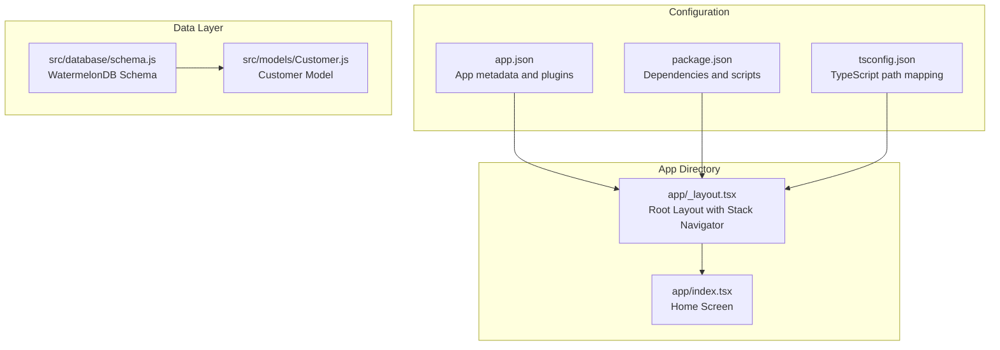
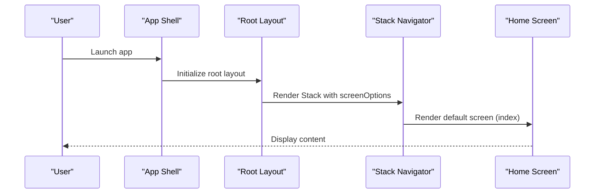
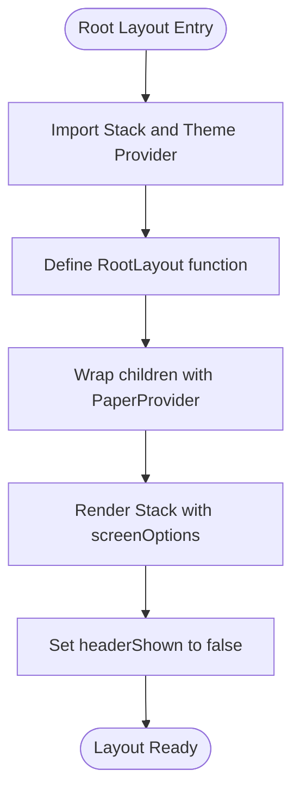
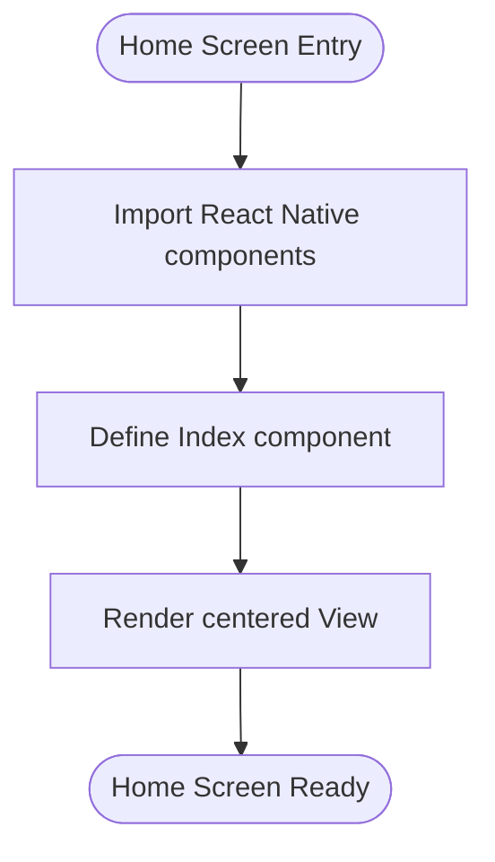
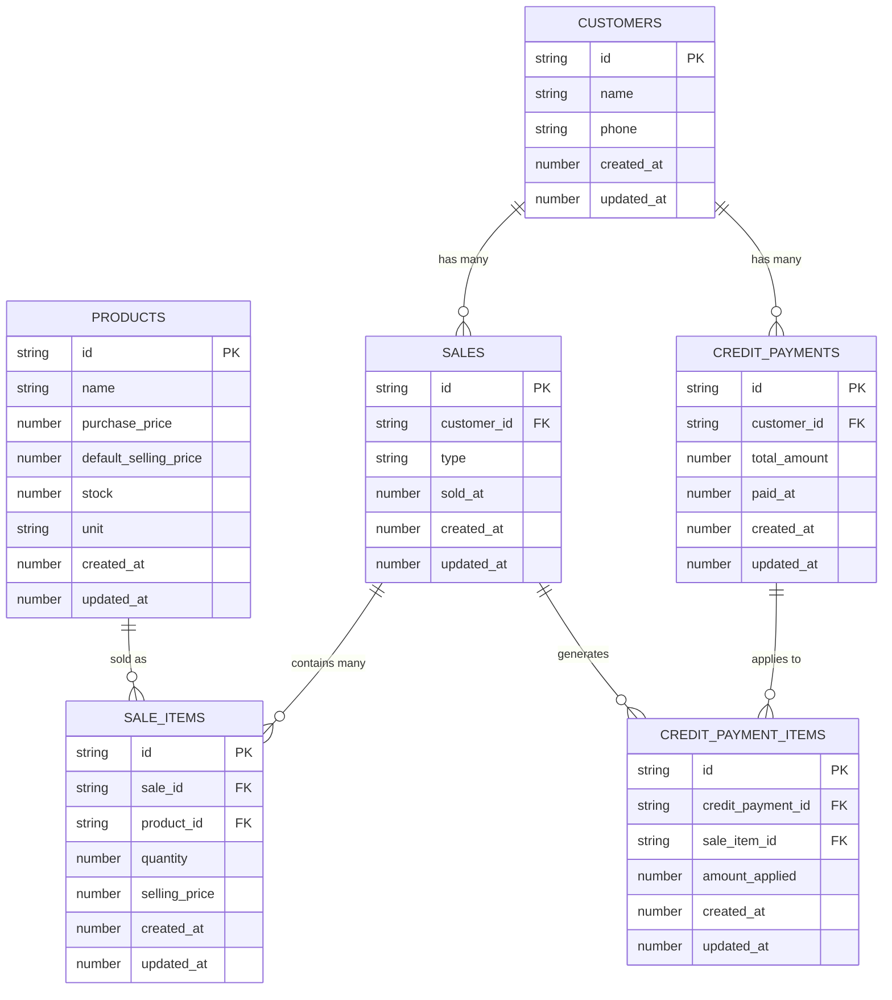
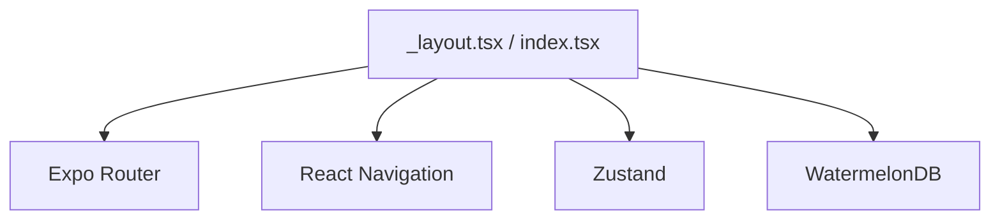

# Navigation and Routing Architecture

<cite>
**Referenced Files in This Document**
- [app/_layout.tsx](file://app/_layout.tsx)
- [app/index.tsx](file://app/index.tsx)
- [app.json](file://app.json)
- [package.json](file://package.json)
- [src/database/schema.js](file://src/database/schema.js)
- [src/models/Customer.js](file://src/models/Customer.js)
- [tsconfig.json](file://tsconfig.json)
</cite>

## Table of Contents
1. [Introduction](#introduction)
2. [Project Structure](#project-structure)
3. [Core Components](#core-components)
4. [Architecture Overview](#architecture-overview)
5. [Detailed Component Analysis](#detailed-component-analysis)
6. [Dependency Analysis](#dependency-analysis)
7. [Performance Considerations](#performance-considerations)
8. [Troubleshooting Guide](#troubleshooting-guide)
9. [Conclusion](#conclusion)

## Introduction
This document explains the navigation and routing architecture of ZemenawiDefter, built with Expo Router's file-based routing system. It covers how the Stack navigator is configured in the root layout, how screens are organized under the app directory, and how navigation flows between application sections. It also documents the relationship between file structure and URL routing, header customization options, practical navigation patterns, parameter passing between screens, integration with application state, and performance considerations for complex navigation hierarchies.

## Project Structure
The project follows Expo Router's convention where the app directory defines the navigation tree. The root layout configures the global navigation container, and individual files under app represent navigable screens. Supporting configuration files define app metadata, dependencies, and TypeScript path mapping.

**Diagram sources**
- [app/_layout.tsx](file://app/_layout.tsx#L1-L9)
- [app/index.tsx](file://app/index.tsx#L1-L16)
- [app.json](file://app.json#L1-L50)
- [package.json](file://package.json#L1-L55)
- [tsconfig.json](file://tsconfig.json#L1-L18)
- [src/database/schema.js](file://src/database/schema.js#L1-L90)
- [src/models/Customer.js](file://src/models/Customer.js#L1-L20)

**Section sources**
- [app/_layout.tsx](file://app/_layout.tsx#L1-L9)
- [app/index.tsx](file://app/index.tsx#L1-L16)
- [app.json](file://app.json#L1-L50)
- [package.json](file://package.json#L1-L55)
- [tsconfig.json](file://tsconfig.json#L1-L18)

## Core Components
- Root Layout: Defines the global Stack navigator and theme provider.
- Home Screen: The primary screen rendered by default.
- App Configuration: Defines app metadata, plugins (including Expo Router), and experiments.
- Dependencies: Include React Navigation, Expo Router, and state management libraries.
- Data Layer: WatermelonDB schema and model definitions for customer data.

Key implementation highlights:
- The root layout uses a Stack navigator with header hidden globally.
- The home screen is a simple centered view.
- The app.json enables Expo Router and experimental features like typed routes and the React compiler.
- The project includes Zustand for state management and WatermelonDB for data persistence.

**Section sources**
- [app/_layout.tsx](file://app/_layout.tsx#L1-L9)
- [app/index.tsx](file://app/index.tsx#L1-L16)
- [app.json](file://app.json#L1-L50)
- [package.json](file://package.json#L1-L55)

## Architecture Overview
The navigation architecture centers around a single Stack navigator configured in the root layout. All screens under the app directory are automatically registered as routes. The file-based routing system maps file paths to URLs, enabling deep linking and predictable navigation.

**Diagram sources**
- [app/_layout.tsx](file://app/_layout.tsx#L4-L8)
- [app/index.tsx](file://app/index.tsx#L3-L15)

## Detailed Component Analysis

### Root Layout and Stack Navigator
The root layout sets up the global navigation container and theme provider. It configures the Stack navigator with header visibility disabled, establishing a clean presentation for the home screen.

**Diagram sources**
- [app/_layout.tsx](file://app/_layout.tsx#L1-L9)

**Section sources**
- [app/_layout.tsx](file://app/_layout.tsx#L1-L9)

### Home Screen Organization
The home screen is a simple centered view that serves as the default route. It demonstrates basic rendering and can be extended to include navigation actions or state-driven content.

**Diagram sources**
- [app/index.tsx](file://app/index.tsx#L1-L16)

**Section sources**
- [app/index.tsx](file://app/index.tsx#L1-L16)

### File-Based Routing and URL Mapping
Expo Router automatically maps files under the app directory to routes. The root layout file acts as the global navigation container, while index.tsx becomes the default route. Additional screens can be added by creating new files under app, and nested routes can be achieved by organizing files in subdirectories.

Practical implications:
- Adding a new file under app creates a new route automatically.
- Nested routes can be created by placing files in subdirectories.
- URL segments correspond to file paths, enabling predictable navigation.

**Section sources**
- [app/_layout.tsx](file://app/_layout.tsx#L1-L9)
- [app/index.tsx](file://app/index.tsx#L1-L16)

### Header Customization Options
The root layout currently disables headers globally by setting headerShown to false. To enable headers, modify the screenOptions in the Stack navigator. Header options can include title, back button behavior, and custom header components.

Recommended approach:
- Centralize header configuration in the root layout for consistency.
- Use screen-level options for exceptions where specific screens require different headers.

**Section sources**
- [app/_layout.tsx](file://app/_layout.tsx#L6-L6)

### Practical Navigation Patterns
Navigation patterns in this project can be extended as follows:
- Parameter Passing: Use Expo Router's URL parameters or state passing mechanisms to share data between screens.
- Deep Linking: Configure scheme and linking prefixes in app.json to support external navigation.
- Tab Navigation: Introduce tab-based navigation by adding a tabs layout and nested stacks.

Integration with state management:
- Use Zustand for lightweight state management alongside navigation.
- Persist navigation state using WatermelonDB for offline-first experiences.

**Section sources**
- [app.json](file://app.json#L8-L8)
- [package.json](file://package.json#L45-L45)

### Data Integration and State Management
The project integrates WatermelonDB for data persistence and Zustand for state management. The schema defines tables for customers, products, sales, and related entities, while the Customer model encapsulates field definitions and relationships.

**Diagram sources**
- [src/database/schema.js](file://src/database/schema.js#L1-L90)
- [src/models/Customer.js](file://src/models/Customer.js#L1-L20)

**Section sources**
- [src/database/schema.js](file://src/database/schema.js#L1-L90)
- [src/models/Customer.js](file://src/models/Customer.js#L1-L20)

## Dependency Analysis
The project relies on several key dependencies for navigation and state management:
- Expo Router: Provides file-based routing and navigation primitives.
- React Navigation: Offers native navigation components and state management.
- Zustand: Lightweight state management solution.
- WatermelonDB: Database abstraction for data persistence.

**Diagram sources**
- [package.json](file://package.json#L13-L45)

**Section sources**
- [package.json](file://package.json#L13-L45)

## Performance Considerations
- Lazy Loading: Use Expo Router's automatic code splitting to reduce initial bundle size.
- Header Rendering: Keep headers minimal to avoid unnecessary re-renders.
- State Management: Prefer localized state with Zustand to minimize global state updates.
- Database Queries: Use WatermelonDB efficiently with proper indexing and query patterns.

Best practices:
- Avoid heavy computations in the root layout render path.
- Defer expensive operations to background tasks.
- Use memoization for frequently accessed data.

## Troubleshooting Guide
Common issues and resolutions:
- Route Not Found: Ensure the file exists under the app directory and follows the correct naming convention.
- Header Visibility: Verify screenOptions in the Stack navigator if headers are unexpectedly hidden or shown.
- Deep Linking: Confirm scheme and linking configuration in app.json.
- State Synchronization: Use Zustand selectors to avoid unnecessary re-renders.

**Section sources**
- [app/_layout.tsx](file://app/_layout.tsx#L6-L6)
- [app.json](file://app.json#L8-L8)

## Conclusion
ZemenawiDefter employs a clean, file-based navigation architecture powered by Expo Router. The root layout centralizes navigation configuration, while the home screen provides a simple starting point. The project integrates state management and data persistence to support scalable application growth. By following the outlined patterns and best practices, teams can extend the navigation system with additional screens, tabs, and deep linking while maintaining performance and developer productivity.