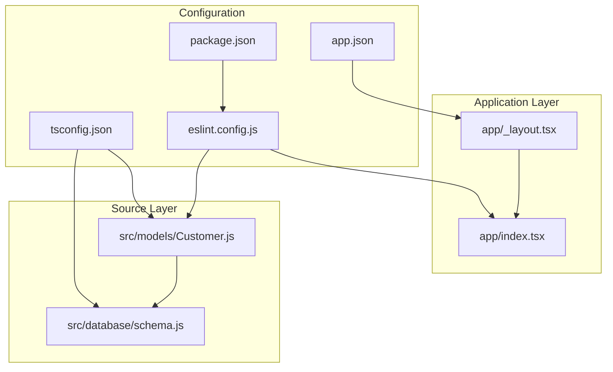
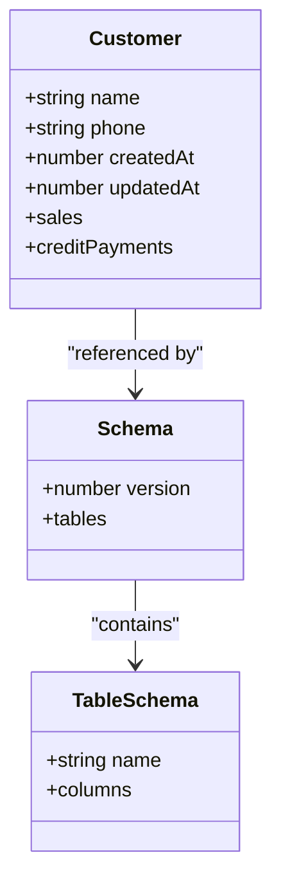
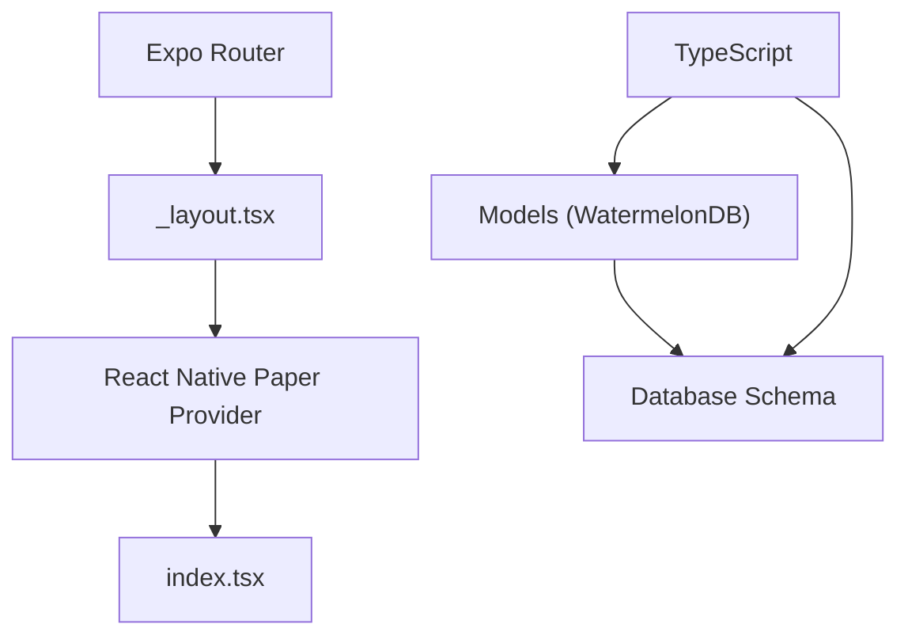
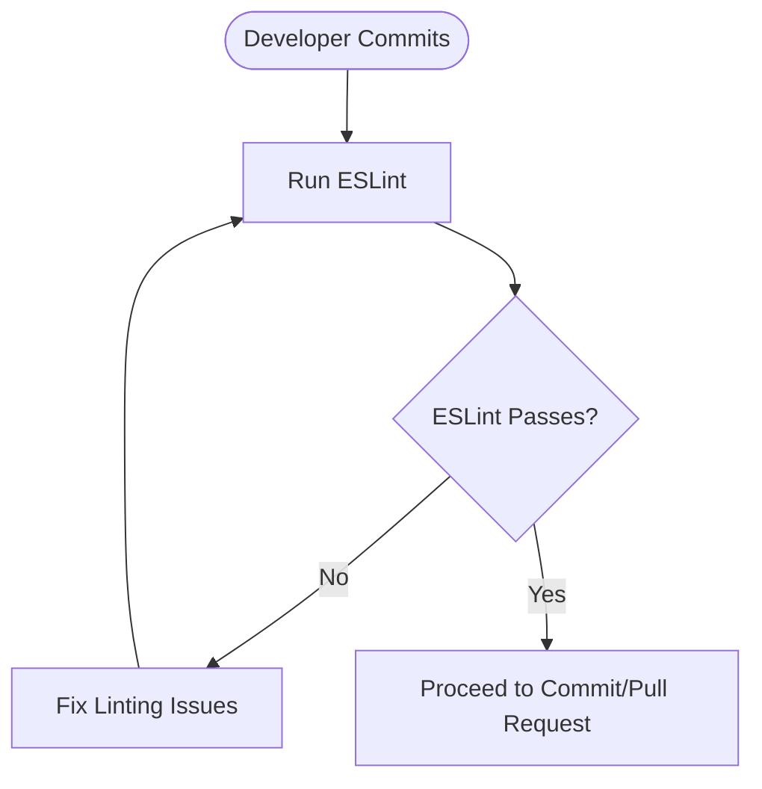
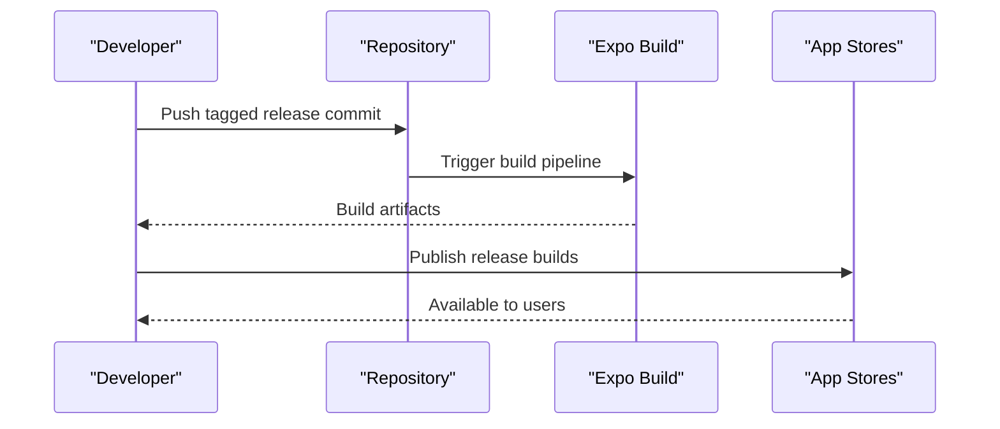
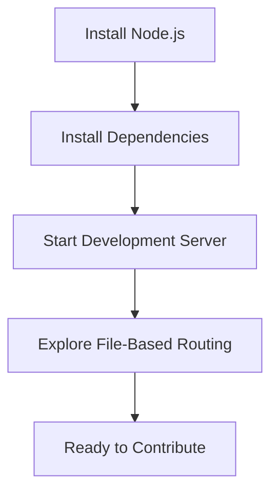

# Contributing and Development Guidelines

<cite>
**Referenced Files in This Document**
- [README.md](file://README.md)
- [package.json](file://package.json)
- [eslint.config.js](file://eslint.config.js)
- [tsconfig.json](file://tsconfig.json)
- [app.json](file://app.json)
- [app/_layout.tsx](file://app/_layout.tsx)
- [app/index.tsx](file://app/index.tsx)
- [src/models/Customer.js](file://src/models/Customer.js)
- [src/database/schema.js](file://src/database/schema.js)
</cite>

## Table of Contents
1. [Introduction](#introduction)
2. [Project Structure](#project-structure)
3. [Core Components](#core-components)
4. [Architecture Overview](#architecture-overview)
5. [Development Workflow](#development-workflow)
6. [Code Style and Formatting](#code-style-and-formatting)
7. [Testing and Quality Assurance](#testing-and-quality-assurance)
8. [Deployment and Release Management](#deployment-and-release-management)
9. [Contribution Guidelines](#contribution-guidelines)
10. [Onboarding and Environment Setup](#onboarding-and-environment-setup)
11. [Troubleshooting Guide](#troubleshooting-guide)
12. [Conclusion](#conclusion)

## Introduction
This document provides comprehensive contributing guidelines for the ZemenawiDefter project. It covers code style standards, ESLint rules, formatting requirements, development workflow, testing approaches, deployment procedures, release management, contribution practices, and onboarding information for new contributors.

## Project Structure
The project follows an Expo Router-based React Native architecture with TypeScript, WatermelonDB for local persistence, and React Native Paper for UI components. Key directories and files include:
- app: Application entry points and routing via file-based routing
- src: Source code including models and database schema
- Configuration files for ESLint, TypeScript, and Expo

**Diagram sources**
- [app/_layout.tsx](file://app/_layout.tsx#L1-L9)
- [app/index.tsx](file://app/index.tsx#L1-L16)
- [src/models/Customer.js](file://src/models/Customer.js#L1-L20)
- [src/database/schema.js](file://src/database/schema.js#L1-L90)
- [eslint.config.js](file://eslint.config.js#L1-L11)
- [tsconfig.json](file://tsconfig.json#L1-L18)
- [app.json](file://app.json#L1-L50)
- [package.json](file://package.json#L1-L55)

**Section sources**
- [README.md](file://README.md#L1-L51)
- [package.json](file://package.json#L1-L55)
- [app.json](file://app.json#L1-L50)

## Core Components
- Application entry and routing:
  - Root layout configures the navigation stack and theme provider.
  - Index screen serves as the initial view.
- Data modeling and persistence:
  - Customer model defines fields and relationships.
  - Database schema defines tables, columns, and indexes for customers, products, sales, sale items, credit payments, and credit payment items.

**Diagram sources**
- [src/models/Customer.js](file://src/models/Customer.js#L4-L17)
- [src/database/schema.js](file://src/database/schema.js#L5-L87)

**Section sources**
- [app/_layout.tsx](file://app/_layout.tsx#L1-L9)
- [app/index.tsx](file://app/index.tsx#L1-L16)
- [src/models/Customer.js](file://src/models/Customer.js#L1-L20)
- [src/database/schema.js](file://src/database/schema.js#L1-L90)

## Architecture Overview
The application uses Expo Router for file-based routing, React Native Paper for UI theming, and WatermelonDB for local database operations. TypeScript enforces strict typing across the codebase.

**Diagram sources**
- [app/_layout.tsx](file://app/_layout.tsx#L1-L9)
- [app/index.tsx](file://app/index.tsx#L1-L16)
- [src/models/Customer.js](file://src/models/Customer.js#L1-L20)
- [src/database/schema.js](file://src/database/schema.js#L1-L90)
- [tsconfig.json](file://tsconfig.json#L1-L18)

**Section sources**
- [app/_layout.tsx](file://app/_layout.tsx#L1-L9)
- [app/index.tsx](file://app/index.tsx#L1-L16)
- [src/models/Customer.js](file://src/models/Customer.js#L1-L20)
- [src/database/schema.js](file://src/database/schema.js#L1-L90)
- [tsconfig.json](file://tsconfig.json#L1-L18)

## Development Workflow
- Branch management:
  - Use feature branches prefixed with feature/, fix/, or chore/ for isolation and clarity.
  - Keep branches up to date with the main branch by rebasing or merging frequently.
- Pull request procedures:
  - Open PRs against the main branch with a clear description and linked issue.
  - Include screenshots or short videos for UI-related changes.
  - Ensure all checks pass before requesting review.
- Code review process:
  - At least one maintainer must approve each PR.
  - Address review comments promptly and update the PR accordingly.
  - Keep PRs focused and avoid mixing unrelated changes.

[No sources needed since this section provides general workflow guidance]

## Code Style and Formatting
- ESLint configuration:
  - The project uses a flat ESLint configuration extending the Expo recommended ruleset.
  - Ignore patterns exclude distribution artifacts.
- TypeScript strict mode:
  - Strict typing is enabled with explicit path mapping for module resolution.
- Formatting requirements:
  - Run the linter before committing to ensure consistent formatting.
  - Follow the established ESLint rules and TypeScript strictness.

**Diagram sources**
- [eslint.config.js](file://eslint.config.js#L1-L11)
- [package.json](file://package.json#L11-L11)
- [tsconfig.json](file://tsconfig.json#L4-L4)

**Section sources**
- [eslint.config.js](file://eslint.config.js#L1-L11)
- [package.json](file://package.json#L11-L11)
- [tsconfig.json](file://tsconfig.json#L1-L18)

## Testing and Quality Assurance
- Current state:
  - No dedicated unit tests or test runner scripts are configured in the repository.
- Recommended practices:
  - Add unit tests for models and database schema logic using a framework compatible with React Native and TypeScript.
  - Integrate a test script in package.json for automated test execution.
  - Include snapshot tests for UI components and integration tests for critical flows.
  - Enforce test coverage thresholds and run tests in CI pipelines.

[No sources needed since this section provides general QA guidance]

## Deployment and Release Management
- Expo configuration:
  - The project uses Expo Router and includes plugin configurations for router and splash screen.
  - Platform-specific settings are defined for iOS and Android.
- Versioning:
  - Both app.json and package.json specify version 1.0.0; align these versions during releases.
- Release strategy:
  - Tag releases with semantic versioning and update versions consistently across configuration files.
  - Use Expo’s build and publish workflows for distribution.

**Diagram sources**
- [app.json](file://app.json#L2-L48)
- [package.json](file://package.json#L2-L4)

**Section sources**
- [app.json](file://app.json#L1-L50)
- [package.json](file://package.json#L1-L55)

## Contribution Guidelines
- Documentation contributions:
  - Improve README, inline code comments, and inline documentation.
  - Ensure clarity and accessibility for new users.
- Bug reports:
  - Provide steps to reproduce, expected vs. actual behavior, device and OS versions, and logs or screenshots.
- Feature requests:
  - Describe the problem being solved and proposed solution with rationale and potential trade-offs.
- Community standards:
  - Follow inclusive communication, respect diverse perspectives, and collaborate constructively.

[No sources needed since this section provides general contribution guidance]

## Onboarding and Environment Setup
- Prerequisites:
  - Node.js and npm installed locally.
  - Expo CLI or npx available for development commands.
- Setup steps:
  - Install dependencies using the project’s installation command.
  - Start the development server with the provided command.
  - Explore the file-based routing structure under the app directory.
- Development commands:
  - Use the scripts defined in package.json for start, Android/iOS/web targets, and linting.

**Diagram sources**
- [README.md](file://README.md#L7-L26)
- [package.json](file://package.json#L5-L11)

**Section sources**
- [README.md](file://README.md#L1-L51)
- [package.json](file://package.json#L1-L55)

## Troubleshooting Guide
- Linting errors:
  - Run the linter script and resolve reported issues.
  - Verify ESLint configuration and ignore patterns.
- Type errors:
  - Enable strict mode and fix TypeScript errors progressively.
  - Confirm path mapping and included files in tsconfig.
- Database schema issues:
  - Review schema versioning and table/column definitions.
  - Ensure WatermelonDB decorators match schema expectations.

**Section sources**
- [eslint.config.js](file://eslint.config.js#L1-L11)
- [tsconfig.json](file://tsconfig.json#L1-L18)
- [src/database/schema.js](file://src/database/schema.js#L1-L90)

## Conclusion
These guidelines establish a consistent foundation for contributing to ZemenawiDefter. By adhering to the documented workflows, style standards, and quality practices, contributors can collaborate effectively while maintaining code quality and project stability.