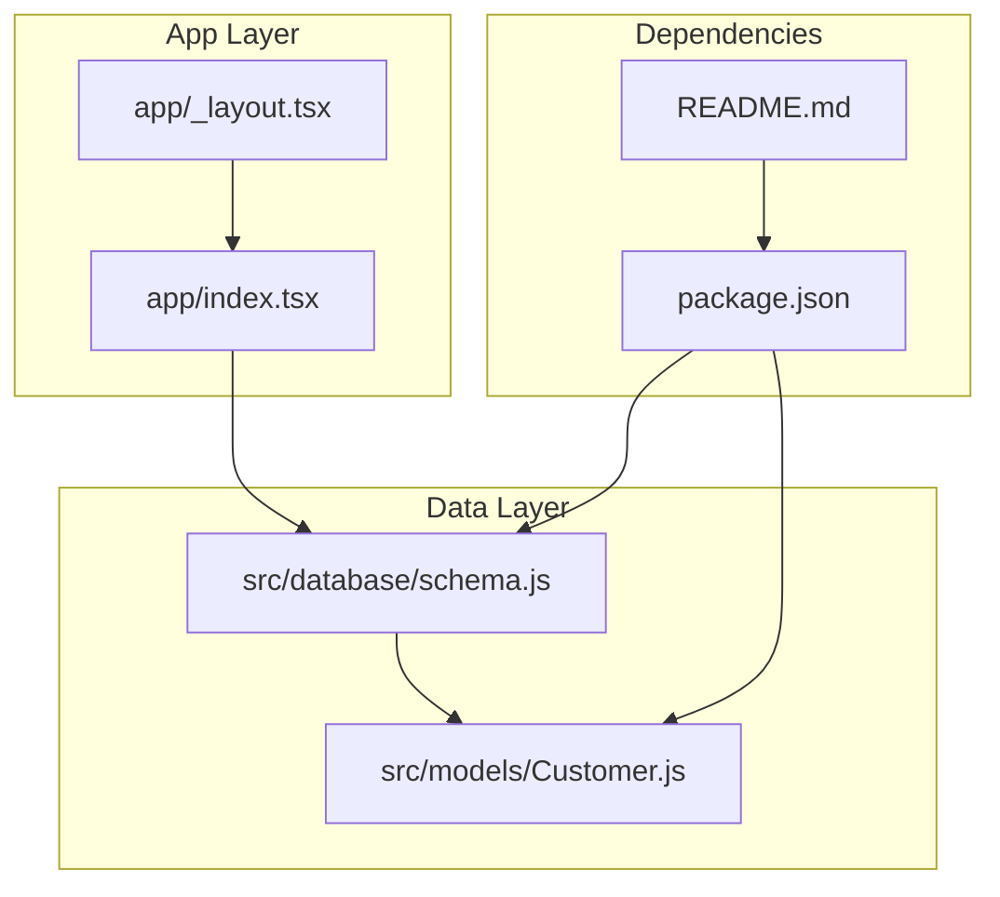
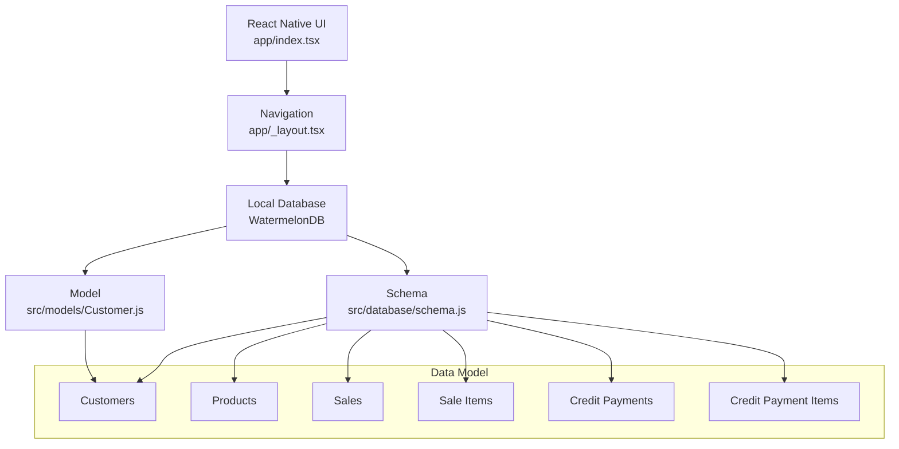
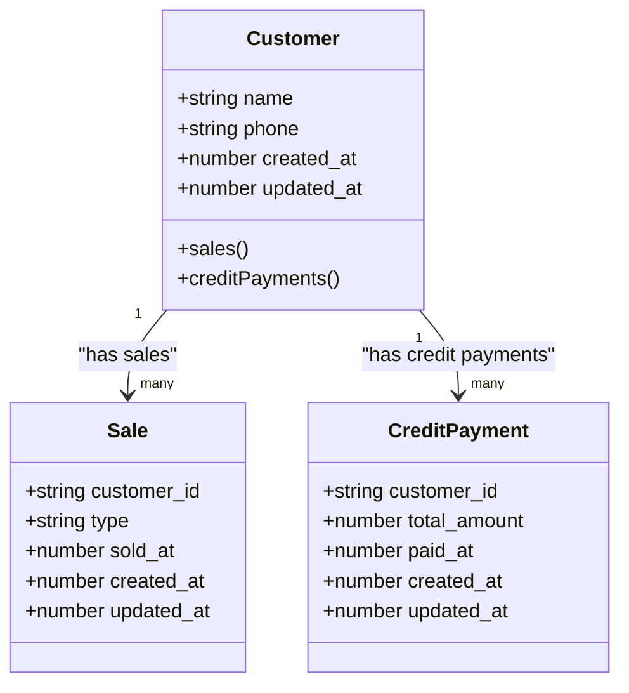
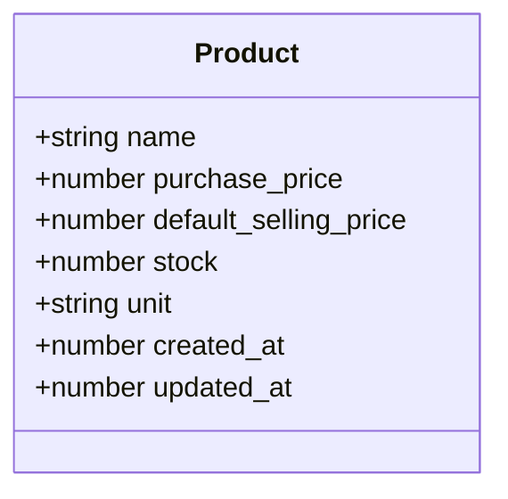
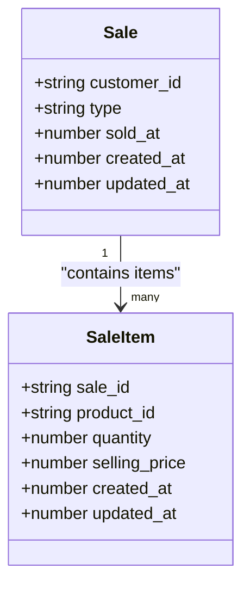
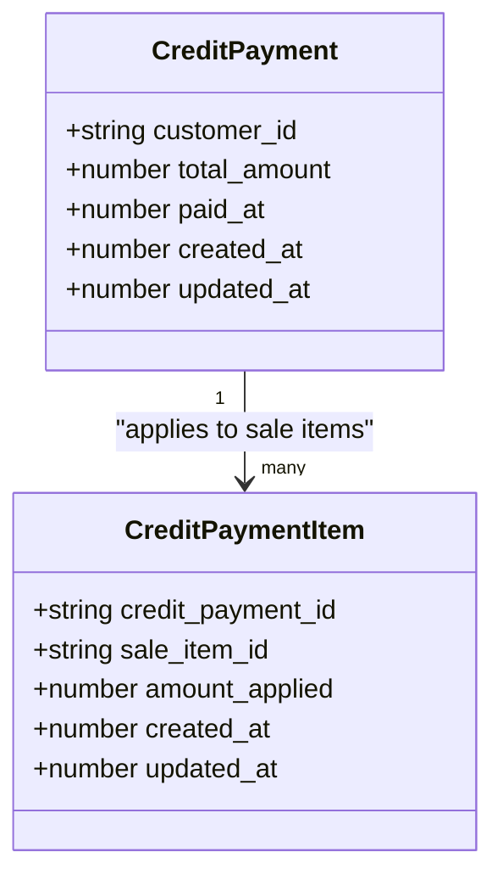
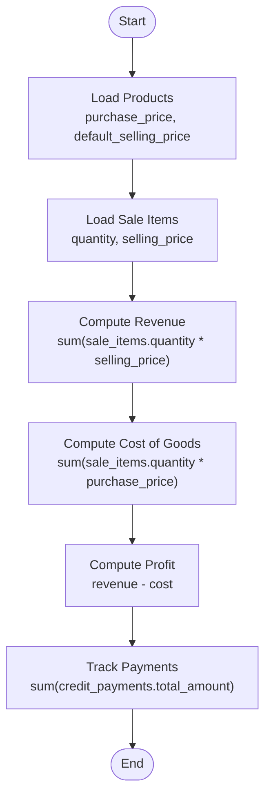
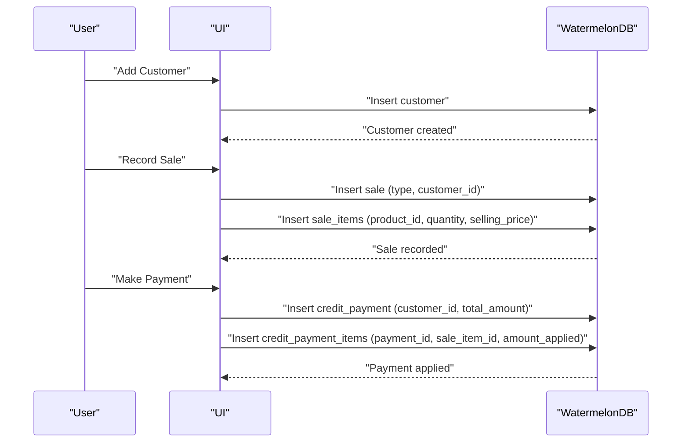
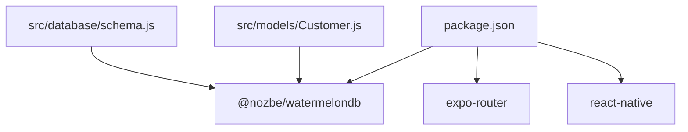

# Core Features

<cite>
**Referenced Files in This Document**
- [README.md](file://README.md)
- [package.json](file://package.json)
- [app/_layout.tsx](file://app/_layout.tsx)
- [app/index.tsx](file://app/index.tsx)
- [src/database/schema.js](file://src/database/schema.js)
- [src/models/Customer.js](file://src/models/Customer.js)
</cite>

## Table of Contents
1. [Introduction](#introduction)
2. [Project Structure](#project-structure)
3. [Core Components](#core-components)
4. [Architecture Overview](#architecture-overview)
5. [Detailed Component Analysis](#detailed-component-analysis)
6. [Dependency Analysis](#dependency-analysis)
7. [Performance Considerations](#performance-considerations)
8. [Troubleshooting Guide](#troubleshooting-guide)
9. [Conclusion](#conclusion)

## Introduction
This document describes the core features and functionality of ZemenawiDefter as implemented in the current codebase snapshot. The application is a React Native project using Expo Router for navigation and WatermelonDB for local data persistence. The database schema defines entities for customers, products, sales, sale items, credit payments, and credit payment items. These entities form the foundation for customer management, product and inventory tracking, sales processing, and credit account management.

The current repository snapshot includes:
- A minimal home screen
- A layout wrapper for navigation
- A WatermelonDB schema defining the domain model
- A WatermelonDB model for the customer entity

Additional screens and business logic for the features described in the documentation objective are not present in this snapshot. Therefore, this document focuses on the data model and available building blocks that would support those features.

## Project Structure
The project follows an Expo-based structure with a focus on local database modeling and navigation scaffolding:
- app: Navigation and basic UI scaffolding
- src/database: WatermelonDB schema definition
- src/models: WatermelonDB model definitions
- Root configuration files for the project and dependencies

**Diagram sources**
- [app/_layout.tsx](file://app/_layout.tsx#L1-L9)
- [app/index.tsx](file://app/index.tsx#L1-L16)
- [src/database/schema.js](file://src/database/schema.js#L1-L90)
- [src/models/Customer.js](file://src/models/Customer.js#L1-L20)
- [package.json](file://package.json#L1-L55)
- [README.md](file://README.md#L1-L51)

**Section sources**
- [app/_layout.tsx](file://app/_layout.tsx#L1-L9)
- [app/index.tsx](file://app/index.tsx#L1-L16)
- [src/database/schema.js](file://src/database/schema.js#L1-L90)
- [src/models/Customer.js](file://src/models/Customer.js#L1-L20)
- [package.json](file://package.json#L1-L55)
- [README.md](file://README.md#L1-L51)

## Core Components
This section outlines the core components derived from the schema and models, which underpin the intended features.

- Database Schema
  - Entities: customers, products, sales, sale_items, credit_payments, credit_payment_items
  - Columns and types define the data model for each entity
  - Indexes are applied to frequently queried columns to improve lookup performance

- Customer Model
  - Fields: name, phone, created_at, updated_at
  - Relationships: customer has many sales and many credit payments

- Navigation Layout
  - Stack-based layout with PaperProvider for UI theming
  - Header hidden globally for a full-screen navigation experience

- Home Screen
  - Minimal placeholder screen indicating where the main content would be

**Section sources**
- [src/database/schema.js](file://src/database/schema.js#L1-L90)
- [src/models/Customer.js](file://src/models/Customer.js#L1-L20)
- [app/_layout.tsx](file://app/_layout.tsx#L1-L9)
- [app/index.tsx](file://app/index.tsx#L1-L16)

## Architecture Overview
The system architecture centers around a local database (WatermelonDB) and a React Native front-end. The schema defines the domain model, while models expose typed accessors for data operations. Navigation is handled via Expo Router.

**Diagram sources**
- [app/index.tsx](file://app/index.tsx#L1-L16)
- [app/_layout.tsx](file://app/_layout.tsx#L1-L9)
- [src/database/schema.js](file://src/database/schema.js#L1-L90)
- [src/models/Customer.js](file://src/models/Customer.js#L1-L20)

## Detailed Component Analysis

### Customer Management System
The customer management system is modeled by the customer entity and its relationships. It supports:
- Customer registration: persisted via the customers table
- Profile management: fields include name and optional phone number
- Purchase history tracking: customer-to-sales relationship enables retrieval of a customer’s sales
- Credit account management: customer-to-credit-payments relationship enables retrieval of payments associated with a customer

**Diagram sources**
- [src/models/Customer.js](file://src/models/Customer.js#L1-L20)
- [src/database/schema.js](file://src/database/schema.js#L33-L48)
- [src/database/schema.js](file://src/database/schema.js#L63-L73)

**Section sources**
- [src/models/Customer.js](file://src/models/Customer.js#L1-L20)
- [src/database/schema.js](file://src/database/schema.js#L8-L17)
- [src/database/schema.js](file://src/database/schema.js#L33-L48)
- [src/database/schema.js](file://src/database/schema.js#L63-L73)

### Product and Inventory Management System
The product entity captures essential attributes for inventory and pricing:
- Product identity: name
- Pricing: purchase price and default selling price
- Stock: quantity on hand
- Unit: unit of measurement
- Timestamps: created_at and updated_at

**Diagram sources**
- [src/database/schema.js](file://src/database/schema.js#L19-L31)

**Section sources**
- [src/database/schema.js](file://src/database/schema.js#L19-L31)

### Sales Processing System
The sales system is composed of two entities:
- Sales: captures the transaction header (customer association, sale type, timestamp)
- Sale Items: captures per-item details linked to a sale, including product, quantity, and selling price

**Diagram sources**
- [src/database/schema.js](file://src/database/schema.js#L33-L48)
- [src/database/schema.js](file://src/database/schema.js#L50-L61)

**Section sources**
- [src/database/schema.js](file://src/database/schema.js#L33-L48)
- [src/database/schema.js](file://src/database/schema.js#L50-L61)

### Credit Account Management
Credit account management is supported by:
- Credit Payments: records payment transactions against credit balances, including timestamps and totals
- Credit Payment Items: links payments to specific sale items and applies amounts

**Diagram sources**
- [src/database/schema.js](file://src/database/schema.js#L63-L73)
- [src/database/schema.js](file://src/database/schema.js#L75-L85)

**Section sources**
- [src/database/schema.js](file://src/database/schema.js#L63-L73)
- [src/database/schema.js](file://src/database/schema.js#L75-L85)

### Financial Tracking Capabilities
Financial tracking can be derived from the schema:
- Revenue monitoring: sum of total_amount from credit_payments and computed totals from sale_items
- Profit margin calculations: difference between default_selling_price and purchase_price per product, aggregated per sale item
- Payment tracking: credit_payment_items link payments to sale items for reconciliation

**Diagram sources**
- [src/database/schema.js](file://src/database/schema.js#L19-L31)
- [src/database/schema.js](file://src/database/schema.js#L50-L61)
- [src/database/schema.js](file://src/database/schema.js#L63-L73)

**Section sources**
- [src/database/schema.js](file://src/database/schema.js#L19-L31)
- [src/database/schema.js](file://src/database/schema.js#L50-L61)
- [src/database/schema.js](file://src/database/schema.js#L63-L73)

### User Workflows and Feature Interactions
The following workflows describe how features interact based on the schema:

- Customer Registration and Profile Management
  - Create a new customer record with name and optional phone
  - Retrieve customer profiles and update timestamps

- Purchase History Tracking
  - Link sales to a customer via customer_id
  - Query sales and sale items to reconstruct purchase history

- Credit Account Management
  - Record credit payments against a customer
  - Apply payments to specific sale items via credit_payment_items

- Sales Processing (Cash and Credit)
  - Create a sale with type set to "cash" or "credit"
  - Add sale items with product_id, quantity, and selling_price

- Financial Tracking
  - Aggregate revenue from sale items
  - Calculate profit margins per product and overall
  - Track payment application to reconcile outstanding balances

**Diagram sources**
- [src/database/schema.js](file://src/database/schema.js#L8-L17)
- [src/database/schema.js](file://src/database/schema.js#L33-L48)
- [src/database/schema.js](file://src/database/schema.js#L50-L61)
- [src/database/schema.js](file://src/database/schema.js#L63-L73)
- [src/database/schema.js](file://src/database/schema.js#L75-L85)

**Section sources**
- [src/database/schema.js](file://src/database/schema.js#L8-L17)
- [src/database/schema.js](file://src/database/schema.js#L33-L48)
- [src/database/schema.js](file://src/database/schema.js#L50-L61)
- [src/database/schema.js](file://src/database/schema.js#L63-L73)
- [src/database/schema.js](file://src/database/schema.js#L75-L85)

## Dependency Analysis
The project relies on Expo and WatermelonDB for runtime and persistence. The schema and models depend on WatermelonDB decorators and types.

**Diagram sources**
- [package.json](file://package.json#L13-L46)
- [src/database/schema.js](file://src/database/schema.js#L1-L1)
- [src/models/Customer.js](file://src/models/Customer.js#L1-L2)

**Section sources**
- [package.json](file://package.json#L13-L46)
- [src/database/schema.js](file://src/database/schema.js#L1-L1)
- [src/models/Customer.js](file://src/models/Customer.js#L1-L2)

## Performance Considerations
- Indexed columns: customer_id, sold_at, and indexed foreign keys in sales, sale_items, credit_payments, and credit_payment_items improve query performance for lookups and joins.
- Timestamps: created_at and updated_at enable efficient sorting and filtering for reporting and reconciliation.
- Local storage: WatermelonDB provides reactive queries suitable for real-time UI updates.

[No sources needed since this section provides general guidance]

## Troubleshooting Guide
- Navigation issues: Verify the stack configuration and provider setup in the layout.
- Data inconsistencies: Ensure timestamps are updated consistently and that indexes are leveraged for queries.
- Missing screens: The current snapshot does not include dedicated screens for the features; implement screens and integrate with the schema and models.

**Section sources**
- [app/_layout.tsx](file://app/_layout.tsx#L1-L9)
- [app/index.tsx](file://app/index.tsx#L1-L16)

## Conclusion
The current repository snapshot establishes the foundational data model and navigation scaffolding for ZemenawiDefter. The WatermelonDB schema defines the entities and relationships required for customer management, product and inventory tracking, sales processing, and credit account management. While the UI screens for these features are not included in this snapshot, the schema and models provide a solid base for implementing the full business logic and user workflows described in the documentation objective.