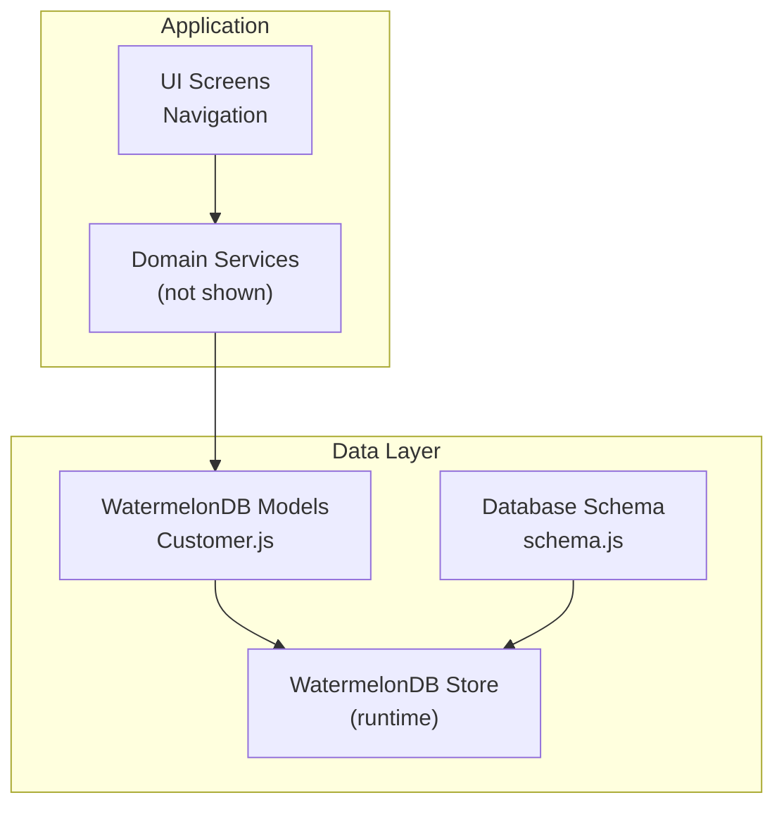
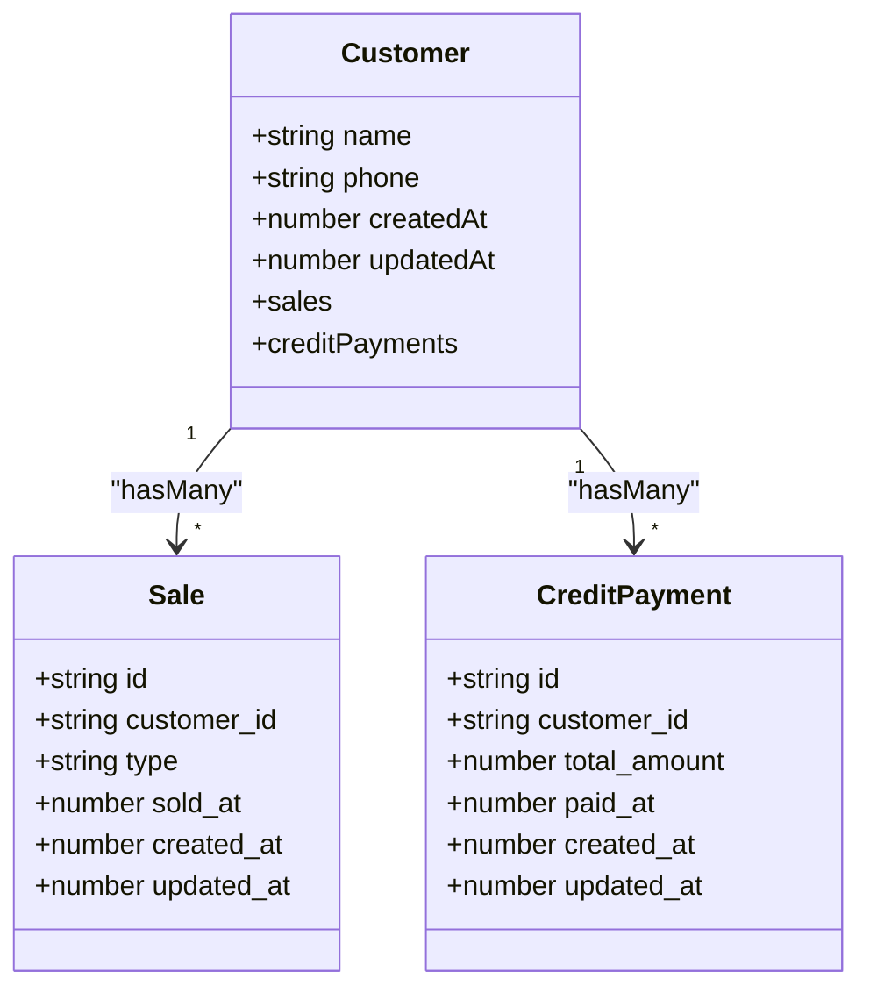
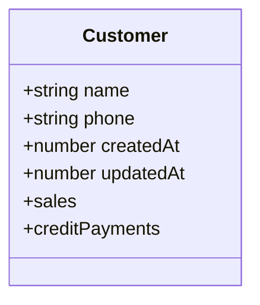
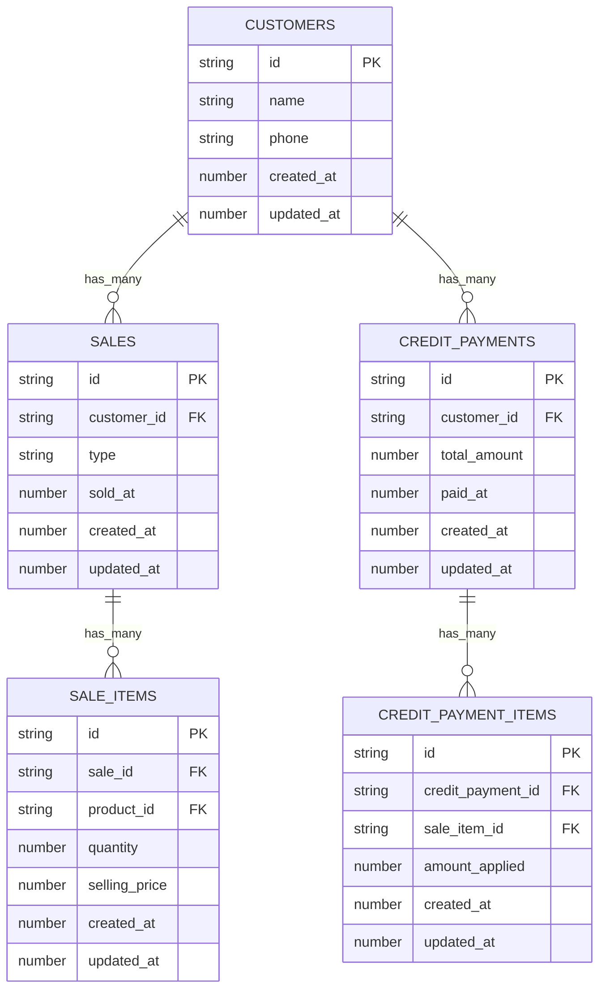
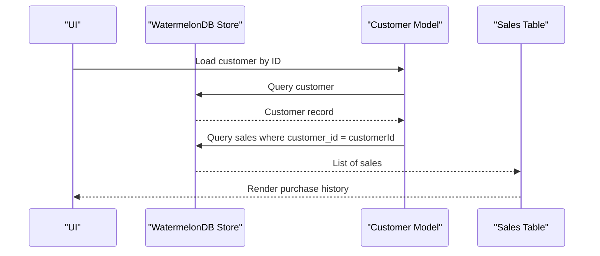
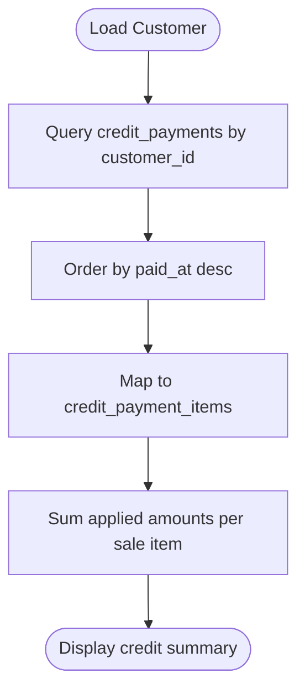
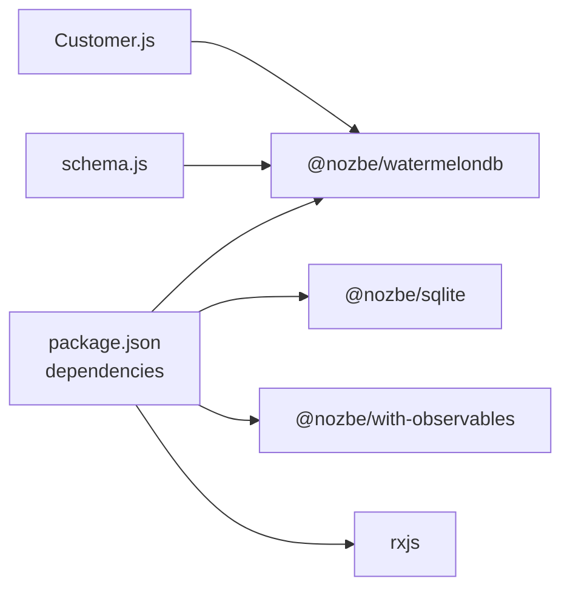

# Customer Management

<cite>
**Referenced Files in This Document**
- [Customer.js](file://src/models/Customer.js)
- [schema.js](file://src/database/schema.js)
- [package.json](file://package.json)
- [README.md](file://README.md)
</cite>

## Table of Contents
1. [Introduction](#introduction)
2. [Project Structure](#project-structure)
3. [Core Components](#core-components)
4. [Architecture Overview](#architecture-overview)
5. [Detailed Component Analysis](#detailed-component-analysis)
6. [Dependency Analysis](#dependency-analysis)
7. [Performance Considerations](#performance-considerations)
8. [Troubleshooting Guide](#troubleshooting-guide)
9. [Conclusion](#conclusion)

## Introduction
This document describes the customer management system built with React Native and WatermelonDB. It focuses on customer registration, profile management, data persistence, and integration with sales and credit payment workflows. The system currently defines a minimal but extensible customer model with relationships to sales and credit payments, along with supporting database schema definitions.

## Project Structure
The project follows a straightforward structure with a dedicated models directory for WatermelonDB models and a database directory containing schema definitions. Dependencies include WatermelonDB and related SQLite/observables packages.

**Diagram sources**
- [Customer.js](file://src/models/Customer.js#L1-L20)
- [schema.js](file://src/database/schema.js#L1-L90)

**Section sources**
- [README.md](file://README.md#L1-L51)
- [package.json](file://package.json#L1-L55)

## Core Components
- Customer model: Defines customer fields and relationships to sales and credit payments.
- Database schema: Declares tables, columns, and indexes for customers, sales, sale items, credit payments, and credit payment items.

Key characteristics:
- Customer fields include name, phone, created_at, and updated_at.
- Relationships:
  - One-to-many customer → sales via customer_id foreign key.
  - One-to-many customer → credit_payments via customer_id foreign key.
- Indexes are defined on foreign keys and timestamps to optimize queries.

**Section sources**
- [Customer.js](file://src/models/Customer.js#L4-L17)
- [schema.js](file://src/database/schema.js#L8-L17)
- [schema.js](file://src/database/schema.js#L33-L48)
- [schema.js](file://src/database/schema.js#L63-L73)

## Architecture Overview
The customer management architecture centers around WatermelonDB models and schema. The Customer model encapsulates customer data and exposes relationships to sales and credit payments. Queries and mutations are performed against the WatermelonDB store, which persists data locally using SQLite.

**Diagram sources**
- [Customer.js](file://src/models/Customer.js#L4-L17)
- [schema.js](file://src/database/schema.js#L33-L48)
- [schema.js](file://src/database/schema.js#L63-L73)

## Detailed Component Analysis

### Customer Model
The Customer model defines:
- Fields: name (required), phone (optional), created_at, updated_at.
- Relationships: children("sales") and children("credit_payments").

Implementation highlights:
- Uses WatermelonDB decorators to define fields and relationships.
- Exposes navigational properties for related records.

**Diagram sources**
- [Customer.js](file://src/models/Customer.js#L4-L17)

**Section sources**
- [Customer.js](file://src/models/Customer.js#L4-L17)

### Database Schema
The schema defines:
- customers table with indexed timestamps and optional phone.
- sales table with customer_id foreign key, sale type, and indexed sold_at timestamp.
- sale_items table linking sales to products with quantity and selling price.
- credit_payments table with customer_id foreign key and indexed paid_at timestamp.
- credit_payment_items table linking payments to sale items.

Indexing strategy:
- customer_id on sales and credit_payments for efficient joins.
- sold_at and paid_at on sales and credit_payments for chronological queries.

Constraints and types:
- String, number, and optional flags are explicitly declared per column.

**Diagram sources**
- [schema.js](file://src/database/schema.js#L8-L17)
- [schema.js](file://src/database/schema.js#L33-L48)
- [schema.js](file://src/database/schema.js#L50-L61)
- [schema.js](file://src/database/schema.js#L63-L73)
- [schema.js](file://src/database/schema.js#L75-L85)

**Section sources**
- [schema.js](file://src/database/schema.js#L8-L17)
- [schema.js](file://src/database/schema.js#L33-L48)
- [schema.js](file://src/database/schema.js#L50-L61)
- [schema.js](file://src/database/schema.js#L63-L73)
- [schema.js](file://src/database/schema.js#L75-L85)

### Customer Registration and Profile Management
- Registration: Create a new customer record with name and optional phone. Set created_at and updated_at timestamps.
- Profile updates: Modify name and phone while updating updated_at.
- Persistence: WatermelonDB handles local storage and synchronization hooks (when configured).

Operational notes:
- No explicit validation rules are defined in the model or schema; validation should be applied at the UI/service layer before persisting.

**Section sources**
- [Customer.js](file://src/models/Customer.js#L7-L10)
- [schema.js](file://src/database/schema.js#L12-L15)

### Purchase History Tracking
- Relationship: Customer has many Sales.
- Query pattern: Fetch sales where customer_id matches the customer’s ID, optionally filtered by sold_at range.
- Data access: Use WatermelonDB queries to load related sale records efficiently.

**Diagram sources**
- [Customer.js](file://src/models/Customer.js#L12-L13)
- [schema.js](file://src/database/schema.js#L37-L42)

**Section sources**
- [Customer.js](file://src/models/Customer.js#L12-L13)
- [schema.js](file://src/database/schema.js#L33-L48)

### Credit Account Management
- Relationship: Customer has many CreditPayments.
- Payment application: CreditPaymentItems link payments to sale items and apply amounts.
- Query pattern: Retrieve credit payments for a customer ordered by paid_at timestamp.

**Diagram sources**
- [Customer.js](file://src/models/Customer.js#L15-L16)
- [schema.js](file://src/database/schema.js#L63-L73)
- [schema.js](file://src/database/schema.js#L75-L85)

**Section sources**
- [Customer.js](file://src/models/Customer.js#L15-L16)
- [schema.js](file://src/database/schema.js#L63-L73)
- [schema.js](file://src/database/schema.js#L75-L85)

### Customer Search Functionality
- Available indices: customer_id on sales and credit_payments enable fast filtering by customer.
- Phone search: phone is stored as a string; implement queries by phone prefix or exact match where appropriate.
- Timestamp-based filters: sold_at and paid_at are indexed, enabling chronological searches.

**Section sources**
- [schema.js](file://src/database/schema.js#L37-L42)
- [schema.js](file://src/database/schema.js#L67-L70)
- [schema.js](file://src/database/schema.js#L13)

### Practical Examples and Patterns
Note: The following describe typical WatermelonDB usage patterns. Replace placeholders with your actual model and store references.

- Create a customer:
  - Instantiate a customer record with name and optional phone.
  - Persist using the database write operation.
  - Verify created_at and updated_at are set.

- Update a customer:
  - Load the customer by ID.
  - Modify name and/or phone.
  - Persist the updated record; updated_at should reflect the change.

- Delete a customer:
  - Remove the customer record.
  - Cascade or handle dependent sales and credit payments according to business rules.

- Query purchase history:
  - Select sales where customer_id equals the target customer.
  - Sort by sold_at descending to show most recent purchases first.

- Query credit payments:
  - Select credit_payments where customer_id equals the target customer.
  - Sort by paid_at descending to show most recent payments first.

- Apply credit to a sale item:
  - Create a credit_payment record for the customer.
  - Create credit_payment_items linking the payment to specific sale items with applied amounts.

[No sources needed since this section provides general guidance]

### Data Validation Rules
Current implementation does not define explicit validation rules in the model or schema. Recommended validation practices:
- Name: Non-empty string.
- Phone: Optional; if present, validate format and length constraints.
- Timestamps: Ensure numeric values representing milliseconds since epoch.

[No sources needed since this section provides general guidance]

### Integration with Sales System
- Foreign key linkage: sales.customer_id references customers.id.
- Sale types: sales.type distinguishes cash vs. credit transactions.
- Chronological indexing: sales.sold_at enables efficient date-range queries.

**Section sources**
- [schema.js](file://src/database/schema.js#L37-L42)
- [schema.js](file://src/database/schema.js#L43-L44)
- [schema.js](file://src/database/schema.js#L44)

## Dependency Analysis
The project relies on WatermelonDB for local persistence and observables. The model and schema files depend on WatermelonDB decorators and schema builders.

**Diagram sources**
- [package.json](file://package.json#L13-L45)
- [Customer.js](file://src/models/Customer.js#L1-L2)
- [schema.js](file://src/database/schema.js#L1)

**Section sources**
- [package.json](file://package.json#L13-L45)

## Performance Considerations
- Indexed foreign keys: customer_id on sales and credit_payments support efficient relationship queries.
- Indexed timestamps: sold_at and paid_at enable fast chronological filtering.
- Prefer batch operations for bulk inserts/updates to minimize write overhead.
- Use reactive queries to avoid redundant fetches and keep UI synchronized.

[No sources needed since this section provides general guidance]

## Troubleshooting Guide
Common issues and resolutions:
- Missing customer_id in sales: Ensure sales are saved with a valid customer_id when associating with existing customers.
- Duplicate phone entries: Treat phone as optional and implement de-duplication at the application level if needed.
- Timestamp inconsistencies: Verify that created_at and updated_at are set consistently during create/update operations.
- Query performance: Use indexed columns (customer_id, sold_at, paid_at) in WHERE clauses to leverage indexes.

[No sources needed since this section provides general guidance]

## Conclusion
The customer management system establishes a solid foundation with a focused Customer model and supporting schema for sales and credit payments. It enables customer registration, profile updates, purchase history tracking, and credit account management. Extending validation, search, and communication features can further enhance the system’s robustness and usability.