# Financial Management and Reporting

<cite>
**Referenced Files in This Document**
- [README.md](file://README.md)
- [package.json](file://package.json)
- [schema.js](file://src/database/schema.js)
- [Customer.js](file://src/models/Customer.js)
- [_layout.tsx](file://app/_layout.tsx)
- [index.tsx](file://app/index.tsx)
</cite>

## Table of Contents
1. [Introduction](#introduction)
2. [Project Structure](#project-structure)
3. [Core Components](#core-components)
4. [Architecture Overview](#architecture-overview)
5. [Detailed Component Analysis](#detailed-component-analysis)
6. [Dependency Analysis](#dependency-analysis)
7. [Performance Considerations](#performance-considerations)
8. [Troubleshooting Guide](#troubleshooting-guide)
9. [Conclusion](#conclusion)

## Introduction
This document describes the financial management and reporting system for ZemenawiDefter, focusing on revenue monitoring, profit margin calculations, payment tracking, credit payment processing, receivable management, and financial reconciliation. It also outlines reporting dashboards, financial summaries, and business analytics capabilities, along with practical workflows for financial calculations, revenue categorization, and data aggregation. The system is built with React Native, WatermelonDB for local-first data persistence, and Expo for cross-platform deployment.

## Project Structure
The project follows a modular structure with a clear separation of concerns:
- Application shell and navigation are configured via the root layout and a basic home screen.
- Data modeling and persistence are handled through WatermelonDB schema definitions and model decorators.
- Dependencies include WatermelonDB, Expo Router, React Navigation, and UI libraries.

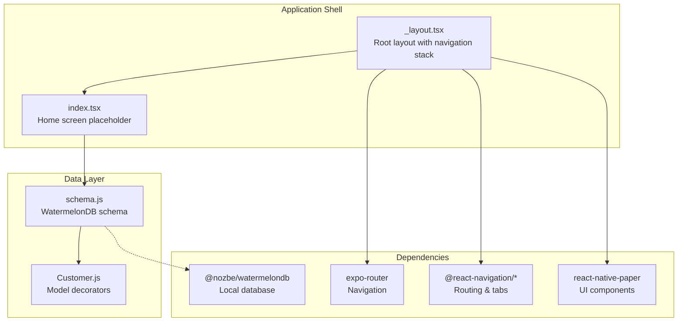

**Diagram sources**
- [_layout.tsx](file://app/_layout.tsx#L1-L9)
- [index.tsx](file://app/index.tsx#L1-L16)
- [schema.js](file://src/database/schema.js#L1-L90)
- [Customer.js](file://src/models/Customer.js#L1-L20)
- [package.json](file://package.json#L13-L45)

**Section sources**
- [_layout.tsx](file://app/_layout.tsx#L1-L9)
- [index.tsx](file://app/index.tsx#L1-L16)
- [schema.js](file://src/database/schema.js#L1-L90)
- [Customer.js](file://src/models/Customer.js#L1-L20)
- [package.json](file://package.json#L13-L45)

## Core Components
This section outlines the core financial data entities and their relationships, enabling revenue monitoring, profit analysis, and receivables management.

- Customers
  - Stores customer identity and contact information.
  - Relationship: One-to-many with Sales and Credit Payments.
- Products
  - Stores product metadata, purchase price, default selling price, stock, and unit.
  - Relationship: One-to-many with Sale Items.
- Sales
  - Records individual sales transactions with customer linkage, sale type ("cash" or "credit"), and timestamps.
  - Relationship: One-to-many with Sale Items; optional linkage to Customers.
- Sale Items
  - Links a sale to specific products, quantities, and selling prices.
  - Relationship: Many-to-one with Sales and Products.
- Credit Payments
  - Records cash received against credit sales, linked to a customer and payment timestamp.
  - Relationship: One-to-many with Credit Payment Items; optional linkage to Customers.
- Credit Payment Items
  - Applies payments to specific sale items, tracking amount applied per item.
  - Relationship: Many-to-one with Credit Payments and Sale Items.

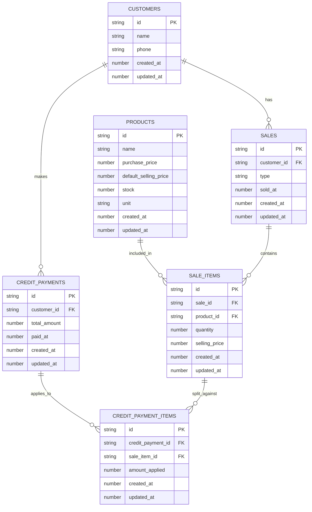

**Diagram sources**
- [schema.js](file://src/database/schema.js#L8-L85)

**Section sources**
- [schema.js](file://src/database/schema.js#L8-L85)

## Architecture Overview
The system architecture centers on a local-first data model using WatermelonDB to persist financial entities. The UI layer uses Expo Router for navigation and React Native Paper for components. The current implementation provides the foundational schema and models; reporting and analytics features are designed to operate on top of this schema.

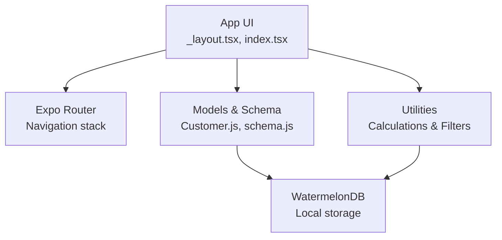

**Diagram sources**
- [_layout.tsx](file://app/_layout.tsx#L1-L9)
- [index.tsx](file://app/index.tsx#L1-L16)
- [Customer.js](file://src/models/Customer.js#L1-L20)
- [schema.js](file://src/database/schema.js#L1-L90)
- [package.json](file://package.json#L13-L45)

## Detailed Component Analysis

### Revenue Monitoring
Revenue monitoring tracks income generated from sales, distinguishing between cash and credit sales. The Sales entity captures sale type and timestamps, while Sale Items capture per-item revenue.

- Cash vs Credit Sales
  - Use the sale type field to categorize revenue streams.
  - Timestamps enable time-based filtering for daily, weekly, and monthly reports.
- Per-Item Revenue
  - Multiply quantity by selling price for each sale item to compute item-level revenue.
- Aggregation
  - Sum item-level revenue grouped by date ranges and categories for dashboards.

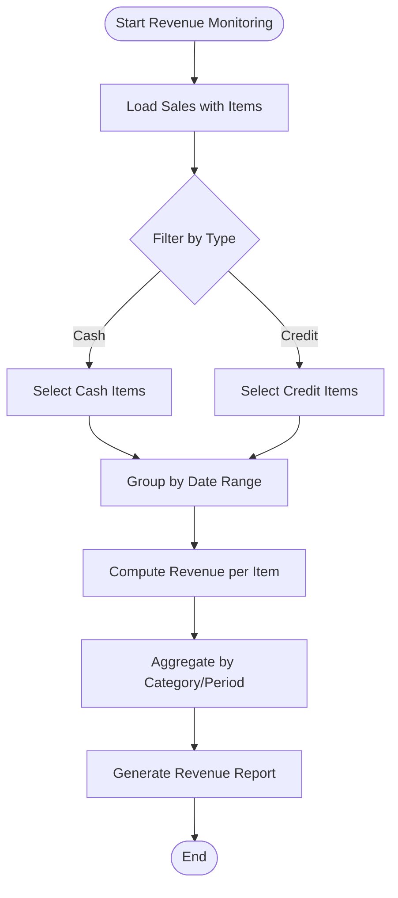

[No sources needed since this diagram shows conceptual workflow, not actual code structure]

### Profit Margin Calculations
Profit margins are computed by comparing revenue to cost of goods sold (COGS). The Product entity stores purchase price and default selling price, enabling margin computations.

- COGS per Item
  - Multiply quantity by purchase price for each sale item.
- Gross Profit
  - Revenue minus COGS per item.
- Profit Margin
  - (Gross Profit / Revenue) × 100 for each item and aggregated totals.
- Stock Impact
  - Track stock changes post-sale to maintain accurate COGS and future margin forecasts.

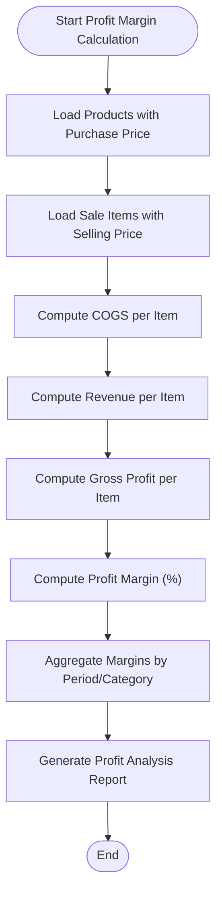

[No sources needed since this diagram shows conceptual workflow, not actual code structure]

### Payment Tracking Mechanisms
Payment tracking ensures accurate recording of cash receipts against sales. Credit Payments and Credit Payment Items link payments to specific sale items.

- Payment Recording
  - Record total payment amounts with timestamps and customer linkage.
- Allocation to Sale Items
  - Apply payment amounts to specific sale items via Credit Payment Items.
- Reconciliation
  - Match payments to outstanding balances; mark sale items as settled when fully applied.

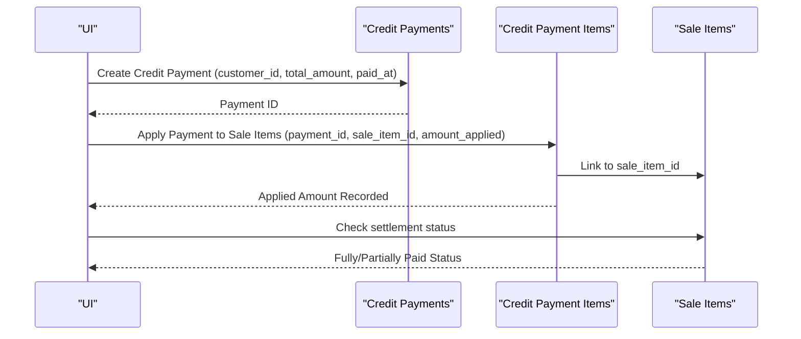

[No sources needed since this diagram shows conceptual workflow, not actual code structure]

### Credit Payment Processing
Credit payment processing enables customers to pay off credit purchases over time. The system supports partial payments and allocation across multiple sale items.

- Partial Payments
  - Allow payments less than the total sale item balance.
- Multi-Item Allocation
  - Distribute payment amounts across multiple sale items within a single sale.
- Outstanding Balances
  - Maintain balances per sale item to prevent over-application.

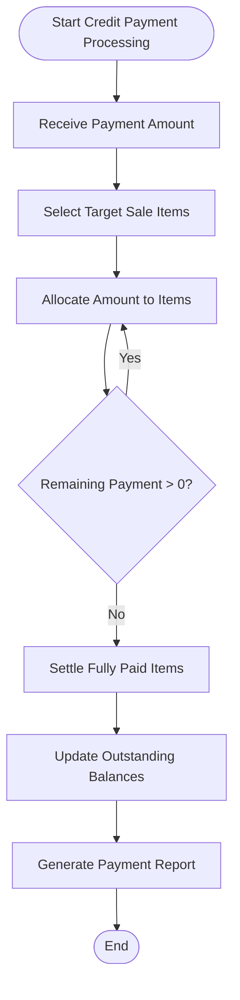

[No sources needed since this diagram shows conceptual workflow, not actual code structure]

### Receivable Management
Receivable management tracks amounts owed by customers for credit purchases. The system maintains outstanding balances derived from sale items and applied payments.

- Outstanding Balances
  - Subtract applied amounts from original sale item amounts.
- Aging Reports
  - Group receivables by age buckets (e.g., 0–30 days, 31–60 days).
- Collections Workflow
  - Integrate payment applications to reduce receivables and update statuses.

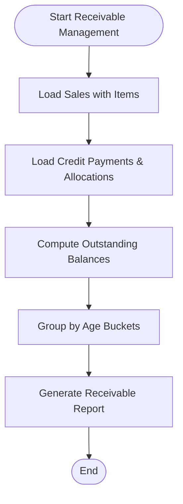

[No sources needed since this diagram shows conceptual workflow, not actual code structure]

### Financial Reconciliation Features
Reconciliation ensures that recorded payments match outstanding receivables and that financial records are balanced.

- Payment-to-Invoice Matching
  - Match credit payments to specific sale items and invoices.
- Discrepancy Detection
  - Flag overpayments, underpayments, and unmatched items.
- Reconcile Reports
  - Produce reconciliation statements for audit and accounting purposes.

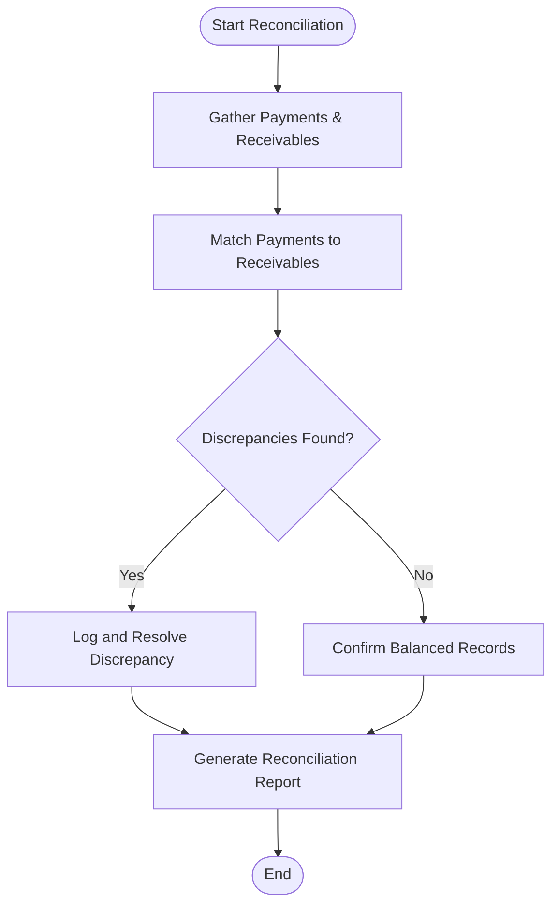

[No sources needed since this diagram shows conceptual workflow, not actual code structure]

### Reporting Dashboards and Financial Summaries
Dashboards summarize revenue, profit, receivables, and collections for quick insights.

- Revenue Dashboard
  - Daily/weekly/monthly revenue trends, categorized by product or customer.
- Profit Dashboard
  - Gross profit, margin trends, and top-performing products.
- Receivables Dashboard
  - Aging summary, collection effectiveness, and outstanding by customer.
- Export Capabilities
  - CSV/Excel exports for accounting integration, including filtered datasets and formatted summaries.

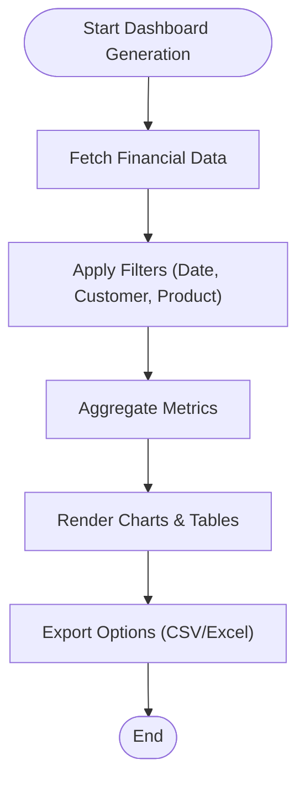

[No sources needed since this diagram shows conceptual workflow, not actual code structure]

### Business Analytics Capabilities
Analytics support deeper insights into sales patterns, profitability, and receivables trends.

- Cohort Analysis
  - Track customer acquisition and retention through sales and payment behavior.
- Product Performance
  - Analyze top-selling products, margins, and stock turnover.
- Collections Analytics
  - Measure average collection period and write-off rates.

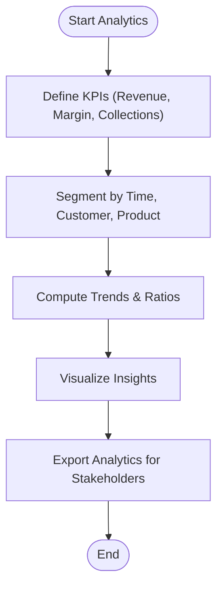

[No sources needed since this diagram shows conceptual workflow, not actual code structure]

## Dependency Analysis
The project relies on a set of core dependencies that enable navigation, UI, and local data persistence.

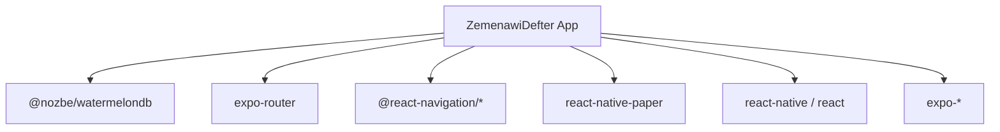

**Diagram sources**
- [package.json](file://package.json#L13-L45)

**Section sources**
- [package.json](file://package.json#L13-L45)

## Performance Considerations
- Indexed Fields
  - Leverage indexed columns (e.g., customer_id, sold_at, paid_at) to optimize queries for time-based and relationship-based filtering.
- Batch Operations
  - Group inserts/updates for sales and payments to minimize database overhead.
- Pagination and Filtering
  - Implement pagination and server-side-like filtering on the client to avoid loading excessive datasets.
- Caching Strategies
  - Cache frequently accessed reports and summaries to improve dashboard responsiveness.
- Data Sizing
  - Monitor database size growth and periodically archive historical data to maintain performance.

[No sources needed since this section provides general guidance]

## Troubleshooting Guide
- Navigation Issues
  - Verify root layout configuration and ensure the navigation stack is properly initialized.
- Data Loading Problems
  - Confirm WatermelonDB schema version compatibility and that models are decorated correctly.
- Payment Allocation Errors
  - Validate that allocated payment amounts do not exceed outstanding balances for sale items.
- Reconciliation Discrepancies
  - Cross-check payment-to-invoice matching and ensure all allocations are recorded.

**Section sources**
- [_layout.tsx](file://app/_layout.tsx#L1-L9)
- [schema.js](file://src/database/schema.js#L1-L90)
- [Customer.js](file://src/models/Customer.js#L1-L20)

## Conclusion
ZemenawiDefter establishes a robust foundation for financial management and reporting through a well-defined schema and models. By leveraging indexed fields, structured payment allocation, and reconciliation workflows, the system supports revenue monitoring, profit analysis, receivable tracking, and comprehensive reporting. Extending the UI and analytics layers will enable powerful dashboards and export capabilities for seamless accounting integration.