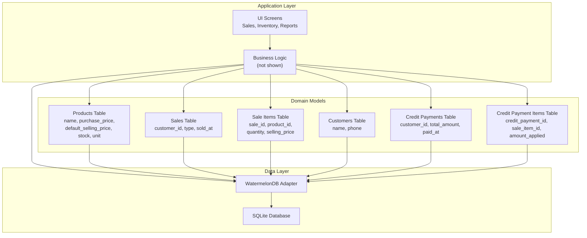
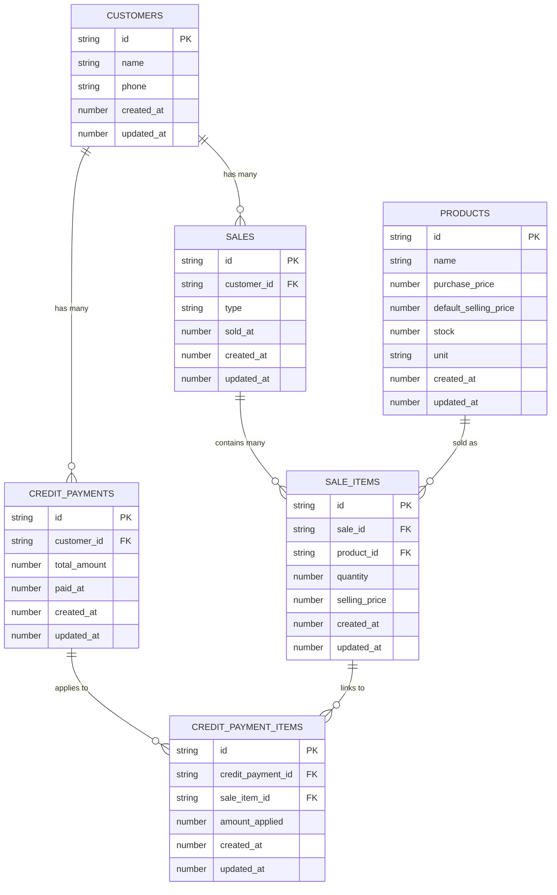
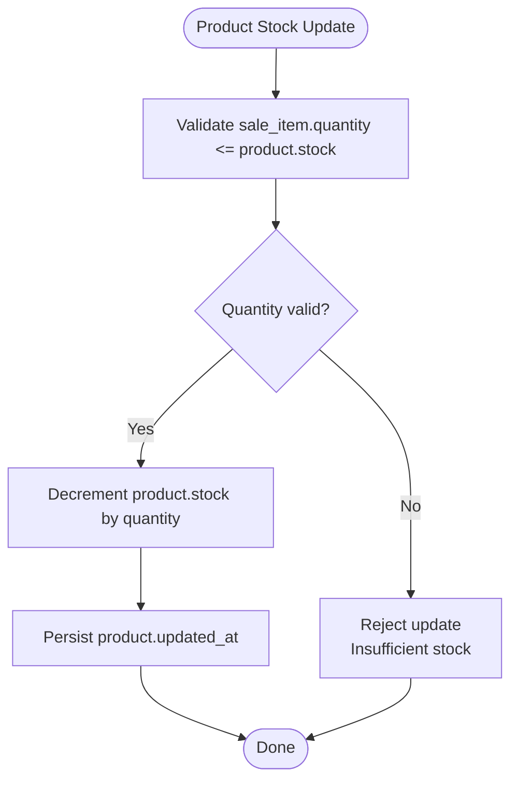
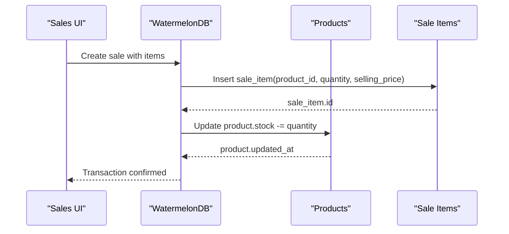
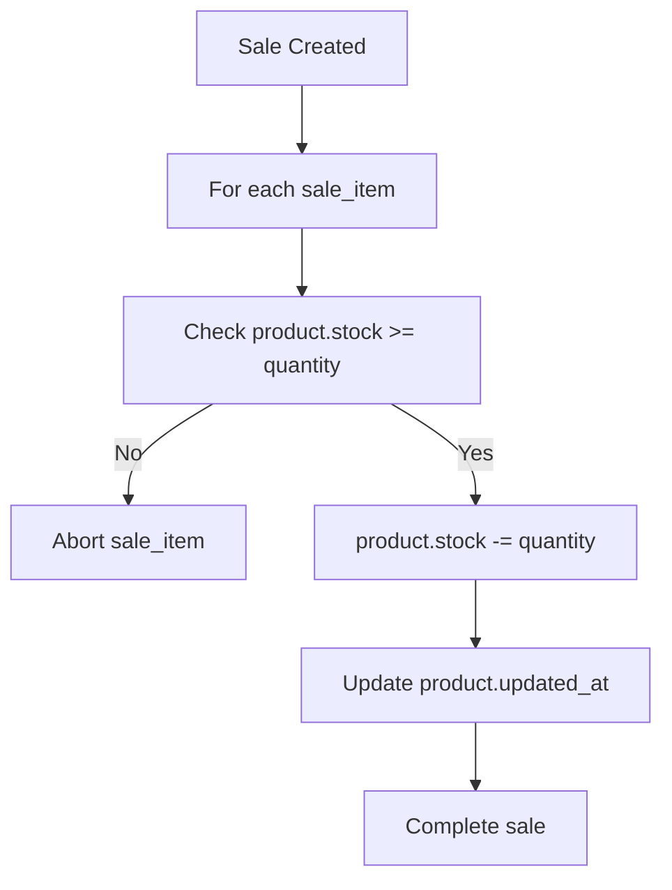
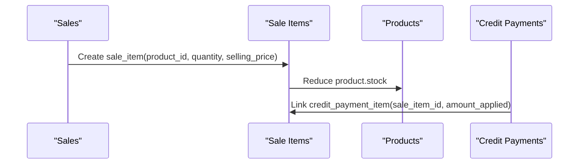
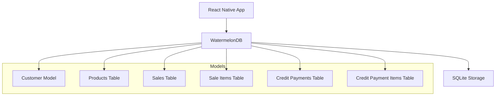

# Inventory and Product Management

<cite>
**Referenced Files in This Document**
- [README.md](file://README.md)
- [package.json](file://package.json)
- [schema.js](file://src/database/schema.js)
- [Customer.js](file://src/models/Customer.js)
</cite>

## Table of Contents
1. [Introduction](#introduction)
2. [Project Structure](#project-structure)
3. [Core Components](#core-components)
4. [Architecture Overview](#architecture-overview)
5. [Detailed Component Analysis](#detailed-component-analysis)
6. [Dependency Analysis](#dependency-analysis)
7. [Performance Considerations](#performance-considerations)
8. [Troubleshooting Guide](#troubleshooting-guide)
9. [Conclusion](#conclusion)

## Introduction
This document describes the inventory and product management system for the ZemenawiDefter application. It focuses on how product catalogs are modeled, how stock levels are tracked, how pricing is managed, and how sales integrate with inventory updates. It also covers unit of measurement handling, categorization approaches, inventory valuation, stock adjustments, low inventory alerts, and reporting capabilities. Where applicable, the document references the actual schema and model files present in the repository to ensure accuracy.

## Project Structure
The project is a React Native application using WatermelonDB for local data persistence. The inventory and product management domain is primarily defined by the database schema and the associated model classes.

**Diagram sources**
- [schema.js](file://src/database/schema.js#L1-L90)
- [Customer.js](file://src/models/Customer.js#L1-L19)

**Section sources**
- [README.md](file://README.md#L1-L51)
- [package.json](file://package.json#L1-L55)

## Core Components
The inventory and product management system is centered around the following core components derived from the schema:

- Products table: Stores product metadata, pricing, stock quantity, and unit of measure.
- Sales table: Captures sale transactions with customer linkage and timestamps.
- Sale Items table: Links individual products sold in a transaction with quantities and prices.
- Customers table: Maintains customer records linked to sales and credit payments.
- Credit Payments and Credit Payment Items: Track payments applied against credit sales.

These components collectively enable:
- Product catalog creation and maintenance
- Stock level tracking via product stock field
- Pricing management with separate purchase and selling price fields
- Unit of measurement handling via the unit field
- Integration with sales transactions for stock updates
- Reporting through aggregated queries on sales and sale items

**Section sources**
- [schema.js](file://src/database/schema.js#L19-L31)
- [schema.js](file://src/database/schema.js#L33-L48)
- [schema.js](file://src/database/schema.js#L50-L61)
- [schema.js](file://src/database/schema.js#L8-L17)
- [schema.js](file://src/database/schema.js#L63-L85)

## Architecture Overview
The system architecture leverages WatermelonDB for local persistence and exposes models that encapsulate domain logic. The following diagram illustrates the relationships among the core tables and how they participate in sales and inventory updates.

**Diagram sources**
- [schema.js](file://src/database/schema.js#L8-L85)

## Detailed Component Analysis

### Products: Catalog, Pricing, and Stock
The Products table defines the product catalog and pricing model:
- name: Product display name
- purchase_price: Cost price for inventory valuation
- default_selling_price: Standard selling price
- stock: Current available quantity
- unit: Unit of measure (e.g., piece, kg, liter)
- created_at/updated_at: Timestamps for audit and consistency

Stock level tracking is achieved by decrementing the stock field when a sale item is recorded. The purchase_price and default_selling_price enable cost of goods sold (COGS) calculations and profit margin computations.

**Diagram sources**
- [schema.js](file://src/database/schema.js#L19-L31)

**Section sources**
- [schema.js](file://src/database/schema.js#L19-L31)

### Sales and Sale Items: Transaction Integration
Sales represent transactions with optional customer linkage and timestamps. Each sale item links to a specific product, captures the quantity sold, and stores the selling price at the time of sale. This enables:
- Accurate stock reduction per product
- Historical pricing for COGS and profitability
- Reporting on revenue, quantities, and product performance

**Diagram sources**
- [schema.js](file://src/database/schema.js#L33-L48)
- [schema.js](file://src/database/schema.js#L50-L61)
- [schema.js](file://src/database/schema.js#L19-L31)

**Section sources**
- [schema.js](file://src/database/schema.js#L33-L48)
- [schema.js](file://src/database/schema.js#L50-L61)

### Pricing Management: Purchase vs Selling Price
Pricing is differentiated via two fields:
- purchase_price: Cost used for inventory valuation and COGS
- default_selling_price: Base selling price for standard sales

During a sale, the system can either:
- Use default_selling_price from the product record
- Override with a specific selling_price stored in the sale item

This separation supports promotional pricing, bulk discounts, and dynamic pricing scenarios while preserving historical pricing for financial reporting.

**Section sources**
- [schema.js](file://src/database/schema.js#L23-L26)
- [schema.js](file://src/database/schema.js#L56-L57)

### Unit of Measurement Handling
The unit field in the Products table allows storing the unit of measure for each product (e.g., piece, kg, liter). This enables:
- Consistent reporting across categories
- Proper conversion and aggregation when units vary
- Clear labeling for inventory counts and sales

Best practice: Normalize units at the point of entry or during reporting to ensure accurate totals.

**Section sources**
- [schema.js](file://src/database/schema.js#L27-L27)

### Product Categorization
The schema does not include a dedicated category field. To implement categorization:
- Add a category column to the Products table
- Use a separate categories table with a many-to-many relationship to products
- Alternatively, use tags or attributes depending on WatermelonDB modeling preferences

This would enable filtering, reporting, and analytics by product category.

**Section sources**
- [schema.js](file://src/database/schema.js#L19-L31)

### Inventory Valuation Methods
Valuation can be computed using the purchase_price field:
- Cost of Goods Sold (COGS): Sum of purchase_price × quantity for purchases
- Inventory Value: Sum of purchase_price × current stock per product
- Profit Margin: Revenue − COGS, divided by revenue

These metrics can be derived from aggregated queries over Sales and Sale Items.

**Section sources**
- [schema.js](file://src/database/schema.js#L24-L24)
- [schema.js](file://src/database/schema.js#L56-L57)

### Stock Adjustment Processes
Stock adjustments (e.g., returns, transfers, inventory counts) can be handled by:
- Creating adjustment records linked to products
- Updating stock directly in the Products table
- Recording adjustment reasons and timestamps for audit

Integration with existing sale logic requires ensuring that adjustments update stock consistently and maintain updated_at for data freshness.

**Section sources**
- [schema.js](file://src/database/schema.js#L19-L31)

### Low Inventory Alerts
Low inventory alerts can be implemented by:
- Querying products where stock ≤ threshold
- Scheduling periodic checks or triggering on stock updates
- Notifying users or generating purchase recommendations

Thresholds can be configurable per product or globally.

**Section sources**
- [schema.js](file://src/database/schema.js#L26-L26)

### Inventory Reporting Capabilities
Reporting can leverage aggregated queries on Sales and Sale Items:
- Top-selling products by quantity/revenue
- Revenue by product or category
- Stock turnover ratios
- Profitability by product or time period

These reports rely on grouping and summing data from Sale Items and joining with Products.

**Section sources**
- [schema.js](file://src/database/schema.js#L50-L61)
- [schema.js](file://src/database/schema.js#L19-L31)

### Examples: Product CRUD Operations
While the repository does not include explicit CRUD handlers, typical operations using WatermelonDB models would be:
- Create product: Insert a new record in the Products table with name, purchase_price, default_selling_price, stock, unit
- Read product: Fetch by id or filter by name/unit/category
- Update product: Modify pricing, stock, or unit; update updated_at
- Delete product: Soft-delete or cascade-delete with constraints

These operations align with the Products table schema and WatermelonDB conventions.

**Section sources**
- [schema.js](file://src/database/schema.js#L19-L31)

### Examples: Stock Update Workflows
Stock updates occur during sale processing:
- Validate available stock
- Deduct quantity from product.stock
- Persist updated_at for audit

**Diagram sources**
- [schema.js](file://src/database/schema.js#L50-L61)
- [schema.js](file://src/database/schema.js#L19-L31)

**Section sources**
- [schema.js](file://src/database/schema.js#L50-L61)
- [schema.js](file://src/database/schema.js#L19-L31)

### Integration with Sales Transactions
Sales transactions integrate with inventory via the Sale Items table:
- Each sale_item references a product and carries quantity and selling_price
- On successful sale, product stock is reduced accordingly
- Credit payments can link to sale items for partial/full settlement

**Diagram sources**
- [schema.js](file://src/database/schema.js#L33-L48)
- [schema.js](file://src/database/schema.js#L50-L61)
- [schema.js](file://src/database/schema.js#L63-L85)
- [schema.js](file://src/database/schema.js#L19-L31)

**Section sources**
- [schema.js](file://src/database/schema.js#L33-L48)
- [schema.js](file://src/database/schema.js#L50-L61)
- [schema.js](file://src/database/schema.js#L63-L85)
- [schema.js](file://src/database/schema.js#L19-L31)

## Dependency Analysis
The system relies on WatermelonDB for local persistence and React Native for the UI. The following diagram outlines key dependencies and their roles.

**Diagram sources**
- [package.json](file://package.json#L13-L45)
- [schema.js](file://src/database/schema.js#L1-L90)
- [Customer.js](file://src/models/Customer.js#L1-L19)

**Section sources**
- [package.json](file://package.json#L13-L45)
- [schema.js](file://src/database/schema.js#L1-L90)
- [Customer.js](file://src/models/Customer.js#L1-L19)

## Performance Considerations
- Indexes: The schema includes indexed columns for efficient lookups (e.g., customer_id, sold_at, sale_id, product_id). Ensure additional indexes for frequently queried fields (e.g., product name, unit).
- Batch operations: Group related writes (e.g., creating a sale and updating stock) to minimize database round trips.
- Query optimization: Use joins and aggregations judiciously; prefer server-side aggregation for large datasets.
- Data consistency: Maintain updated_at timestamps to detect conflicts and ensure audit trails.

## Troubleshooting Guide
Common issues and resolutions:
- Insufficient stock: Ensure stock validation occurs before persisting sale items; reject transactions that exceed available stock.
- Pricing discrepancies: Verify that selling_price in sale items reflects intended pricing; reconcile differences with default_selling_price.
- Unit mismatches: Standardize units at entry or during reporting to prevent incorrect totals.
- Audit gaps: Confirm updated_at is updated on stock changes and other critical updates.

**Section sources**
- [schema.js](file://src/database/schema.js#L26-L26)
- [schema.js](file://src/database/schema.js#L56-L57)
- [schema.js](file://src/database/schema.js#L27-L27)
- [schema.js](file://src/database/schema.js#L19-L31)

## Conclusion
The ZemenawiDefter inventory and product management system is built on a clear schema that supports product catalogs, pricing differentiation, stock tracking, and sales integration. By leveraging WatermelonDB, the system can efficiently manage local data and enable robust reporting and auditing. Extending the schema with category fields and indexes, implementing low-stock alerts, and standardizing unit handling will further enhance operational insights and accuracy.