# Sales and Transaction Processing

<cite>
**Referenced Files in This Document**
- [README.md](file://README.md)
- [schema.js](file://src/database/schema.js)
- [Customer.js](file://src/models/Customer.js)
</cite>

## Table of Contents
1. [Introduction](#introduction)
2. [Project Structure](#project-structure)
3. [Core Components](#core-components)
4. [Architecture Overview](#architecture-overview)
5. [Detailed Component Analysis](#detailed-component-analysis)
6. [Dependency Analysis](#dependency-analysis)
7. [Performance Considerations](#performance-considerations)
8. [Troubleshooting Guide](#troubleshooting-guide)
9. [Conclusion](#conclusion)

## Introduction
This document describes the sales and transaction processing system for the ZemenawiDefter application. It focuses on how cash and credit sales are modeled, how multi-item sales are handled, and how the system relates sales, sale items, and product inventory. It also outlines workflows for real-time calculations, discount application, payment processing, transaction recording, receipt generation, sales reporting, returns, voids, and sales history tracking. Integration patterns with customer and inventory systems are discussed conceptually.

The repository provides a foundational schema and model for sales, customers, and related entities. The current codebase does not include explicit business logic for sales processing; therefore, this document presents a comprehensive blueprint for implementing those features on top of the existing schema.

## Project Structure
The project is a React Native application using WatermelonDB for local persistence. The sales-related domain is defined in the database schema and a single model file for customers.

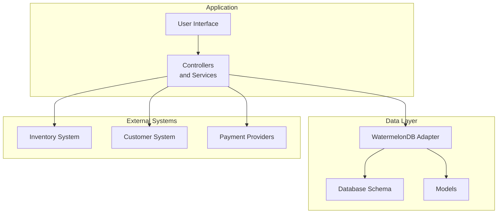

**Diagram sources**
- [schema.js](file://src/database/schema.js#L1-L90)
- [Customer.js](file://src/models/Customer.js#L1-L20)

**Section sources**
- [README.md](file://README.md#L1-L51)
- [schema.js](file://src/database/schema.js#L1-L90)
- [Customer.js](file://src/models/Customer.js#L1-L20)

## Core Components
The sales domain is composed of the following core entities and relationships:

- Sales: Represents a single sale transaction with type (cash or credit), timestamp, and optional customer linkage.
- Sale Items: Represents individual products within a sale, including quantity, selling price, and references to the sale and product.
- Products: Product catalog with purchase price, default selling price, stock level, unit, and timestamps.
- Customers: Customer profile with contact info and relationships to sales and credit payments.
- Credit Payments: Records payments made against credit sales, linked to customers and sale items.
- Credit Payment Items: Associates payments to specific sale items.

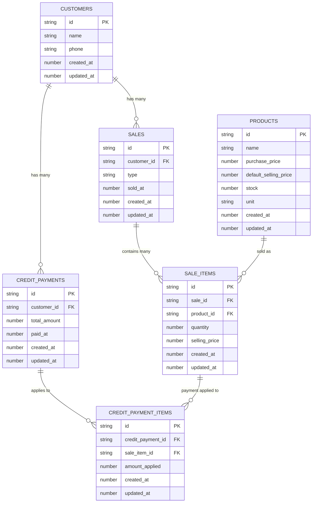

**Diagram sources**
- [schema.js](file://src/database/schema.js#L8-L85)

**Section sources**
- [schema.js](file://src/database/schema.js#L8-L85)

## Architecture Overview
The system follows a layered architecture:
- Presentation: UI screens for adding items, applying discounts, capturing payments, and generating receipts.
- Application: Controllers/services orchestrating sale creation, inventory updates, and payment recording.
- Persistence: WatermelonDB models and schema mapping entities to local storage.
- Integrations: Optional external systems for inventory and customer management.

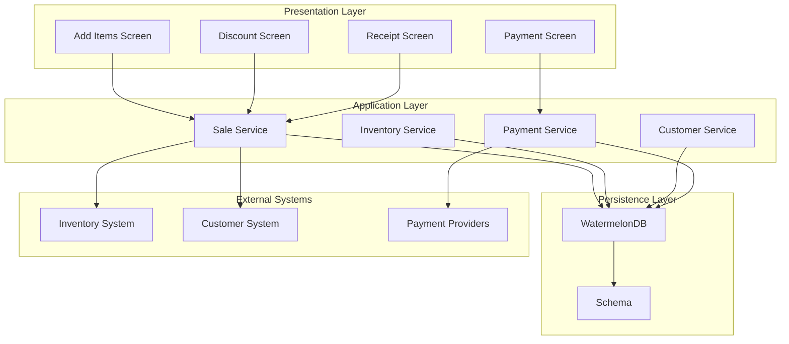

[No sources needed since this diagram shows conceptual workflow, not actual code structure]

## Detailed Component Analysis

### Sales Entity and Multi-Item Handling
Sales represent a transaction event. Each sale can contain multiple items (many-to-many via sale items). The sale entity stores:
- Type: cash or credit
- Timestamp: sold_at
- Optional customer_id for credit sales and reporting

Multi-item sales are modeled by creating multiple sale items under a single sale. Each sale item references a product and captures quantity and selling price.

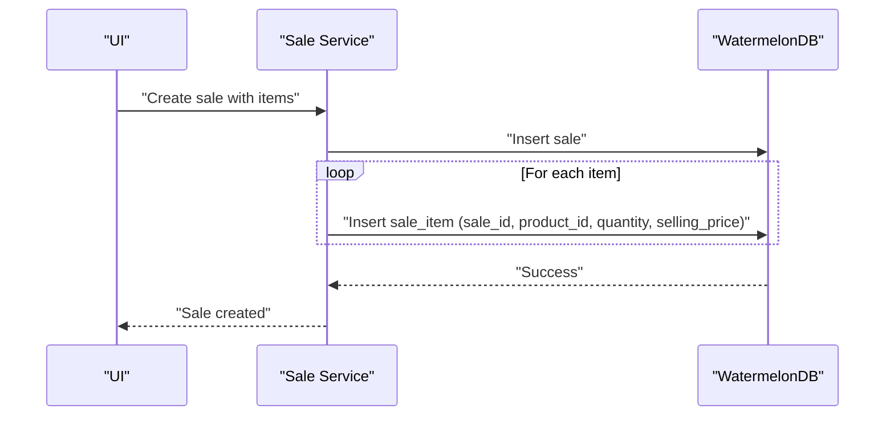

**Section sources**
- [schema.js](file://src/database/schema.js#L33-L48)
- [schema.js](file://src/database/schema.js#L50-L61)

### Cash Sale Processing
Cash sales are straightforward:
- Create a sale with type set to cash.
- Add sale items with quantities and selling prices.
- No credit payment records are created.

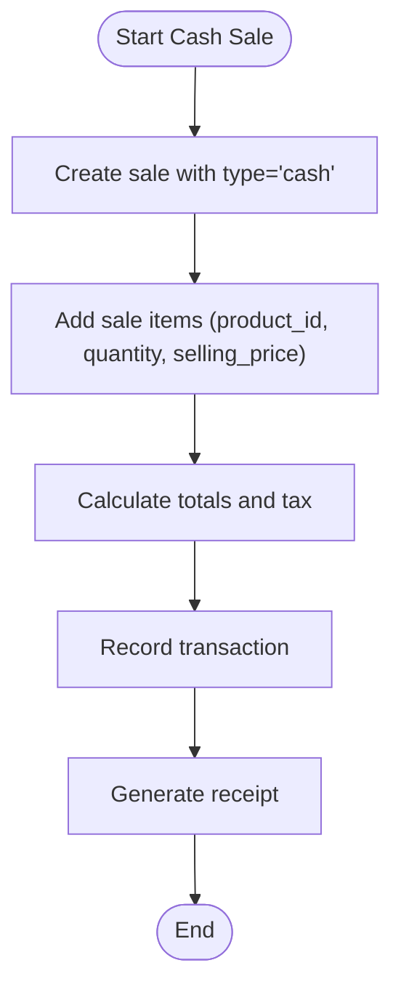

[No sources needed since this diagram shows conceptual workflow, not actual code structure]

### Credit Sale Processing
Credit sales require linking to a customer and later applying payments:
- Create a sale with type set to credit and customer_id.
- Add sale items.
- Optionally pre-apply partial payments (credit payment items) or record full amounts due.

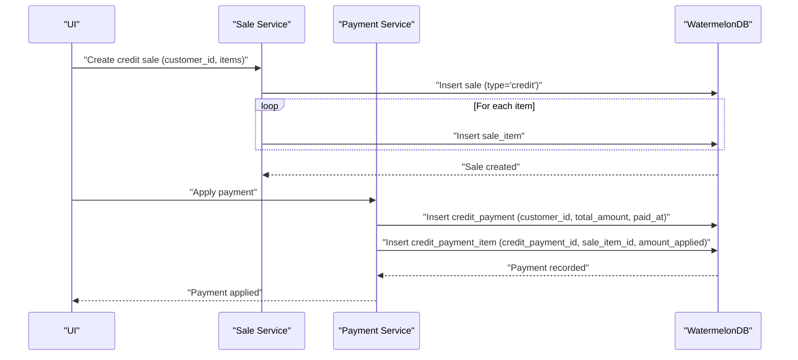

**Section sources**
- [schema.js](file://src/database/schema.js#L33-L48)
- [schema.js](file://src/database/schema.js#L50-L61)
- [schema.js](file://src/database/schema.js#L63-L85)

### Real-Time Calculations and Discount Application
Real-time calculations should occur in the presentation layer and validated in the application layer:
- Compute subtotal per item (quantity × selling_price).
- Apply discounts per item or globally (percentage or fixed amount).
- Compute taxes if applicable.
- Ensure totals match sale_item amounts plus any adjustments.

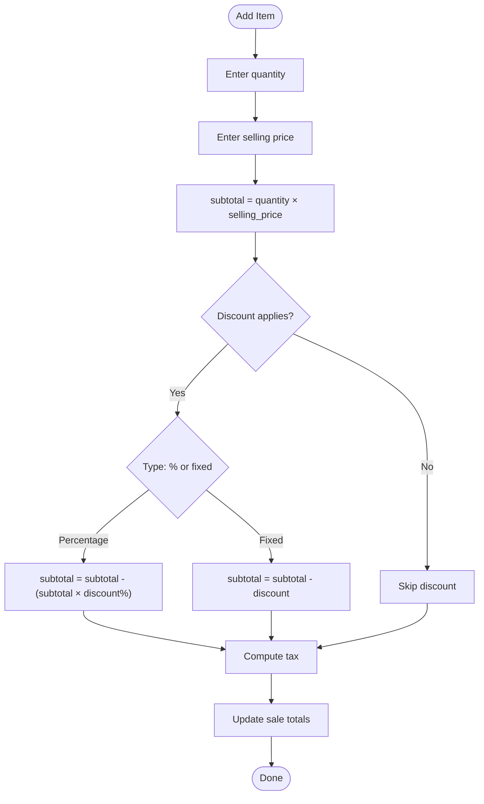

[No sources needed since this diagram shows conceptual workflow, not actual code structure]

### Payment Processing Workflows
- Cash: Total due equals sale total; payment is captured immediately.
- Credit: Total due equals sale total; payments are recorded as credit payments and applied to sale items.

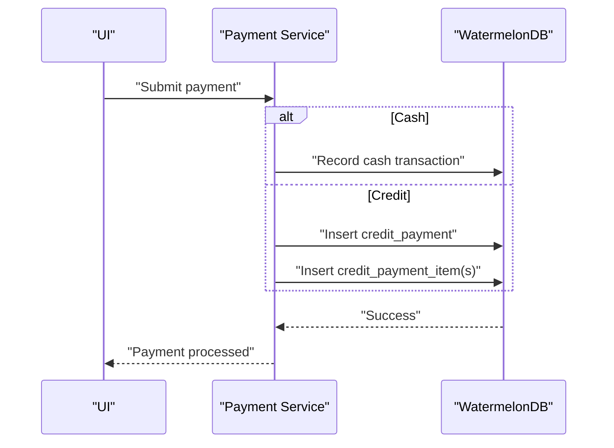

**Section sources**
- [schema.js](file://src/database/schema.js#L63-L85)

### Transaction Recording and Receipt Generation
- Persist sale and sale items atomically.
- Persist payments (cash or credit) and payment allocations.
- Generate receipt data from persisted sale and payment records.

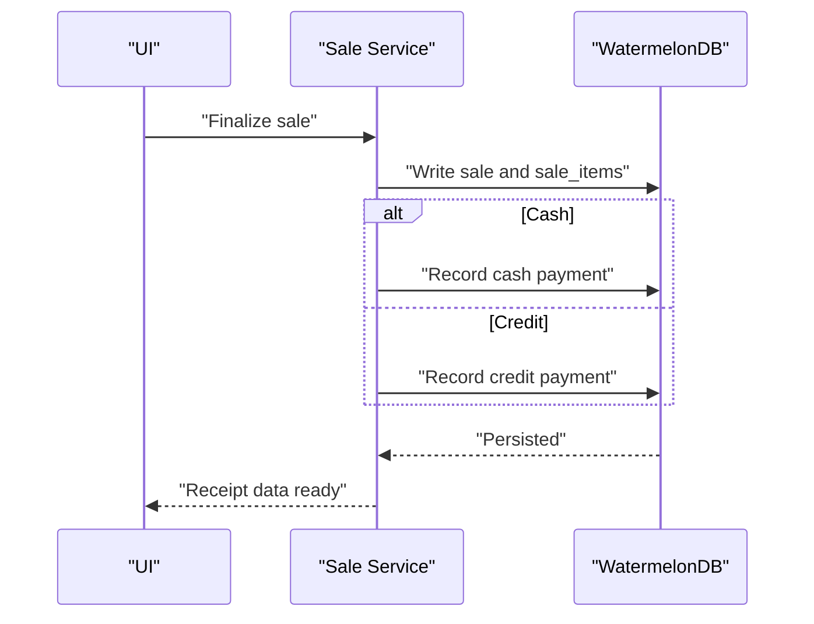

[No sources needed since this diagram shows conceptual workflow, not actual code structure]

### Sales Reporting
- Aggregate by date range, customer, product, and sale type.
- Summarize total sales, number of items sold, and revenue.
- Export reports to CSV/PDF.

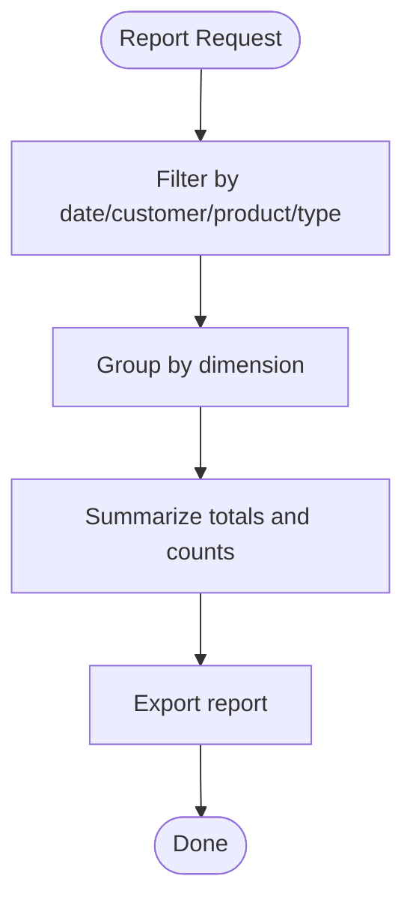

[No sources needed since this diagram shows conceptual workflow, not actual code structure]

### Sales Returns, Voids, and History Tracking
- Returns: Create a return sale with negative quantities and link to original sale items. Adjust inventory accordingly.
- Voids: Cancel a sale by marking it void and reversing inventory and payment records.
- History: Maintain updated_at timestamps on all entities for audit trails.

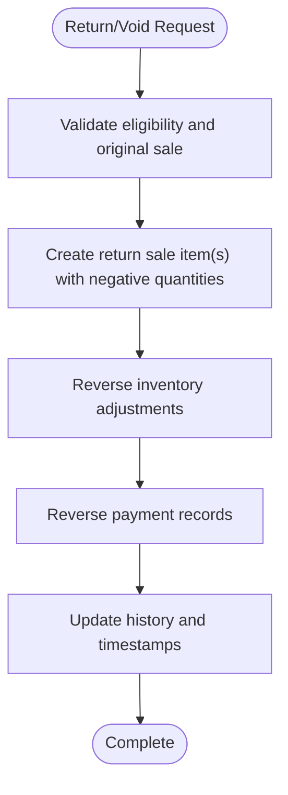

[No sources needed since this diagram shows conceptual workflow, not actual code structure]

### Integration Patterns with Customer and Inventory Systems
- Customer System: Sync customer profiles and credit limits. Link sales to customer_id for reporting and credit tracking.
- Inventory System: On sale creation, reserve or reduce stock. On returns, reverse stock adjustments. Optionally integrate with external APIs for real-time stock checks.

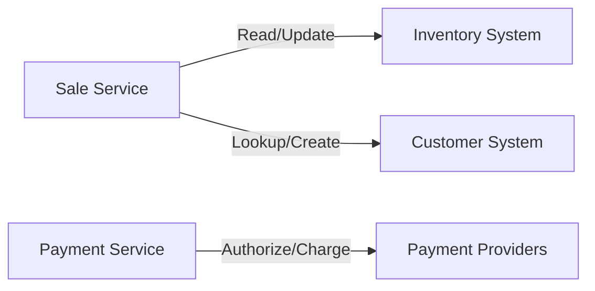

[No sources needed since this diagram shows conceptual workflow, not actual code structure]

## Dependency Analysis
The schema defines clear foreign keys and indexes that support efficient queries:
- Sales.customer_id is indexed for fast customer-based lookups.
- Sale_items.sale_id and product_id are indexed for fast item retrieval and inventory updates.
- Credit payment records are indexed by customer_id and paid_at for reporting.

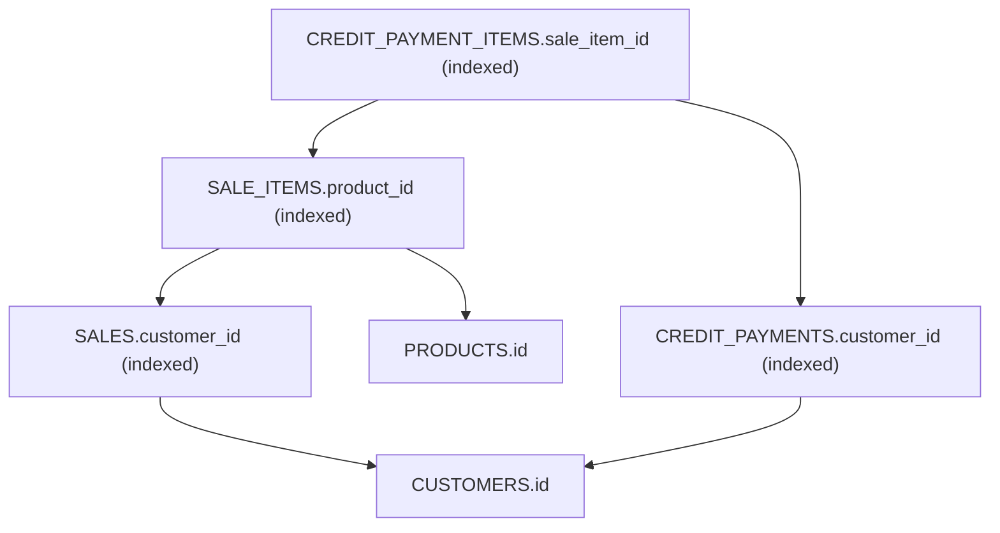

**Diagram sources**
- [schema.js](file://src/database/schema.js#L37-L42)
- [schema.js](file://src/database/schema.js#L54-L55)
- [schema.js](file://src/database/schema.js#L67)
- [schema.js](file://src/database/schema.js#L79-L80)

**Section sources**
- [schema.js](file://src/database/schema.js#L37-L42)
- [schema.js](file://src/database/schema.js#L54-L55)
- [schema.js](file://src/database/schema.js#L67)
- [schema.js](file://src/database/schema.js#L79-L80)

## Performance Considerations
- Indexing: Ensure all foreign keys and frequently queried columns (sold_at, customer_id, product_id) are indexed.
- Batch writes: Group sale items and payments in a single transaction to minimize write overhead.
- Caching: Cache product pricing and customer credit limits to avoid repeated lookups during checkout.
- Queries: Use WatermelonDB queries to fetch sale items and payments efficiently by sale_id.

[No sources needed since this section provides general guidance]

## Troubleshooting Guide
Common issues and resolutions:
- Missing customer_id on credit sale: Ensure customer selection is mandatory for credit sales.
- Stock underflow: Validate inventory before creating sale items; block if insufficient stock.
- Payment mismatch: Verify that total payments equal sale total for credit sales.
- Duplicate sale items: Deduplicate by product_id within a sale before persisting.

[No sources needed since this section provides general guidance]

## Conclusion
The ZemenawiDefter repository establishes a solid foundation for sales and transaction processing using WatermelonDB. The schema supports cash and credit sales, multi-item handling, and payment tracking. By implementing the workflows described—real-time calculations, discount application, payment processing, inventory updates, receipt generation, reporting, returns, voids, and history tracking—the system can become a complete point-of-sale solution. Integrations with customer and inventory systems can be added incrementally to meet business needs.