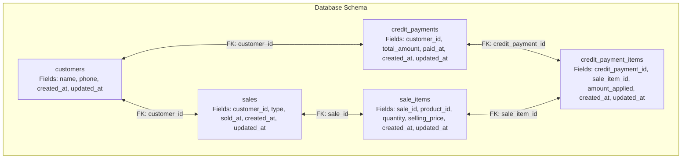
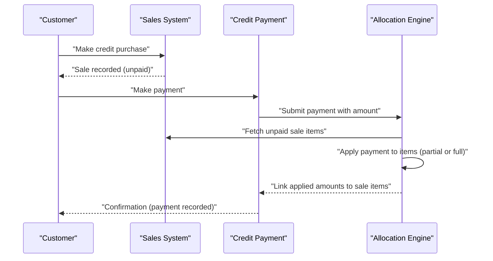
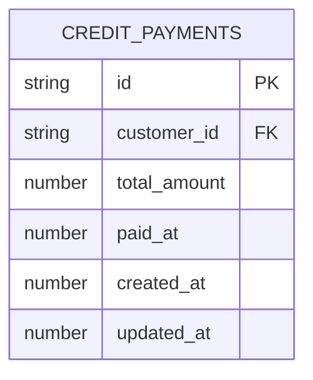
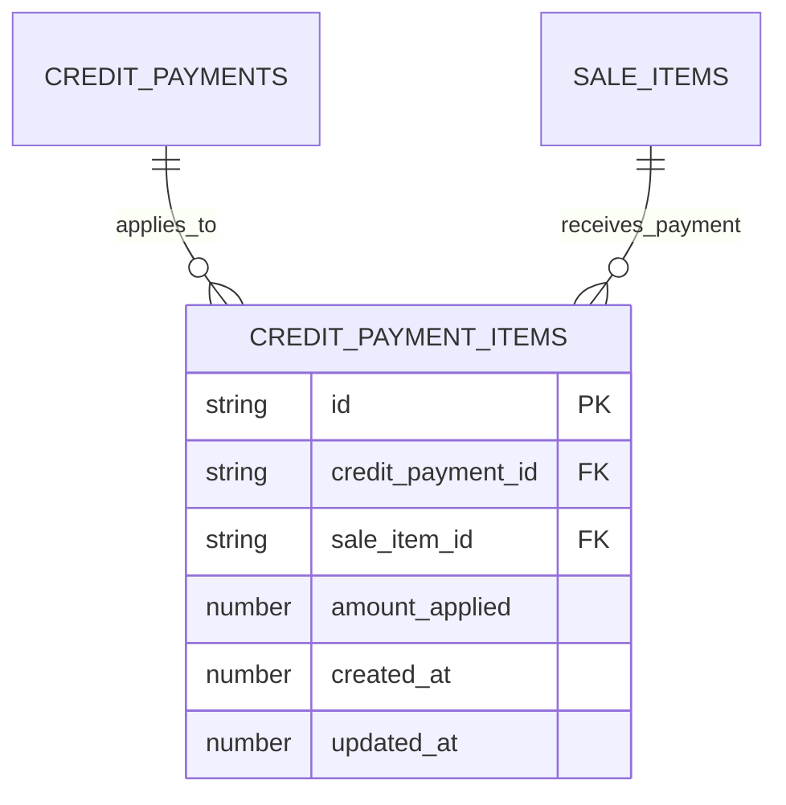
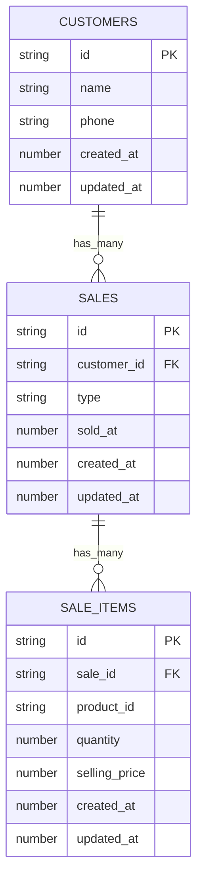
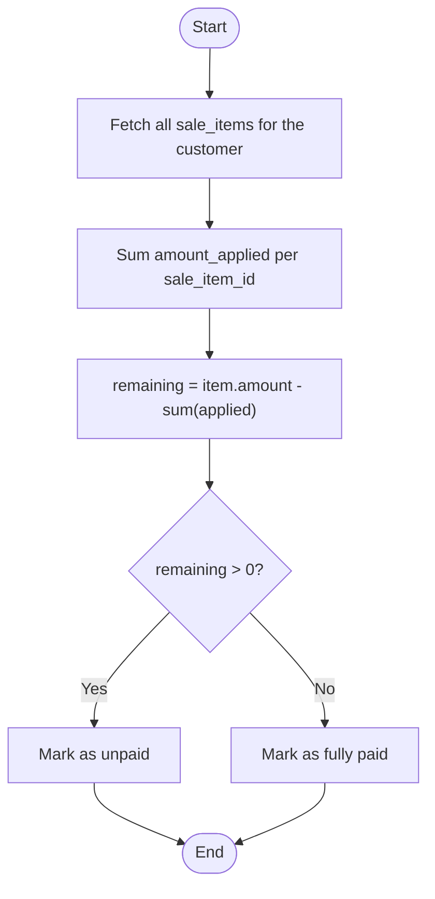
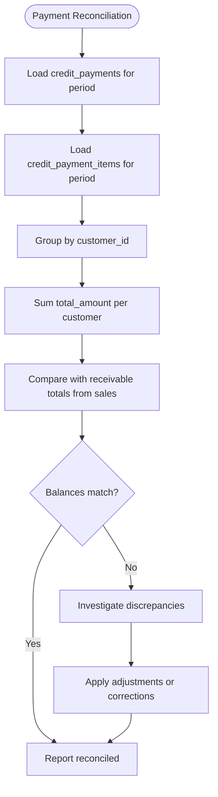
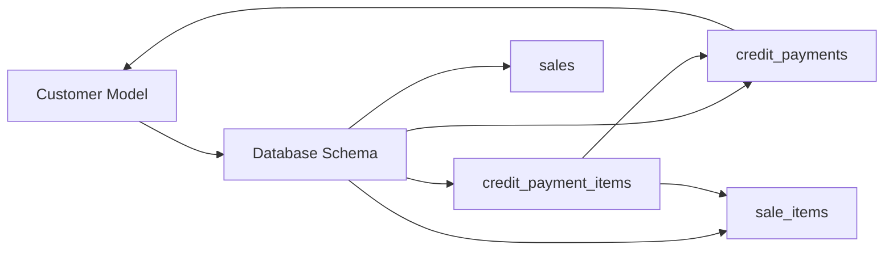

# Credit Payment and Receivables Model

<cite>
**Referenced Files in This Document**
- [schema.js](file://src/database/schema.js)
- [Customer.js](file://src/models/Customer.js)
- [README.md](file://README.md)
</cite>

## Table of Contents
1. [Introduction](#introduction)
2. [Project Structure](#project-structure)
3. [Core Components](#core-components)
4. [Architecture Overview](#architecture-overview)
5. [Detailed Component Analysis](#detailed-component-analysis)
6. [Dependency Analysis](#dependency-analysis)
7. [Performance Considerations](#performance-considerations)
8. [Troubleshooting Guide](#troubleshooting-guide)
9. [Conclusion](#conclusion)

## Introduction
This document explains the Credit Payments model system implemented in the project. It focuses on the database schema for credit payments, the relationship between credit payments and the sales system, and the mechanics of payment application against specific sale items. The goal is to help both technical and non-technical readers understand how customer receivables are tracked, how payments are applied, and how outstanding balances are calculated.

## Project Structure
The credit payment system is defined in the WatermelonDB schema and integrates with the existing sales and customer models. The schema defines:
- A customers table with basic contact and audit fields
- A sales table that records transactions and links to customers
- A sale_items table that captures per-item details for each sale
- A credit_payments table that records cash received from customers for credit purchases
- A credit_payment_items table that links payments to specific sale items and tracks the amount applied

**Diagram sources**
- [schema.js](file://src/database/schema.js#L8-L85)

**Section sources**
- [schema.js](file://src/database/schema.js#L1-L90)
- [README.md](file://README.md#L1-L51)

## Core Components
This section documents the two primary tables involved in credit payments and receivables:

- credit_payments
  - Purpose: Records cash receipts from customers for credit sales
  - Key fields:
    - customer_id: Foreign key to customers
    - total_amount: Total payment amount
    - paid_at: Timestamp of payment
    - created_at, updated_at: Audit timestamps
  - Indexes: customer_id, paid_at

- credit_payment_items
  - Purpose: Links payments to specific sale items and tracks how much was applied
  - Key fields:
    - credit_payment_id: Foreign key to credit_payments
    - sale_item_id: Foreign key to sale_items
    - amount_applied: Amount allocated to this sale item
    - created_at, updated_at: Audit timestamps
  - Indexes: credit_payment_id, sale_item_id

These tables enable:
- Tracking which customer paid how much and when
- Applying payments to specific sale items
- Calculating outstanding balances by comparing sale item amounts to applied amounts

**Section sources**
- [schema.js](file://src/database/schema.js#L63-L85)

## Architecture Overview
The credit payment workflow connects the sales system with the payment application logic:

This sequence illustrates:
- Credit purchases create sale items with outstanding amounts
- Payments are recorded in credit_payments
- The allocation engine applies payment amounts to specific sale items via credit_payment_items
- Outstanding balances are derived from remaining unpaid portions of sale items

[No sources needed since this diagram shows conceptual workflow, not actual code structure]

## Detailed Component Analysis

### Credit Payments Table
The credit_payments table stores payment metadata and enables customer-level aggregation of receivable collections.

- Relationships:
  - One-to-many with credit_payment_items (via credit_payment_id)
  - Many-to-one with customers (via customer_id)

- Use cases:
  - Track total payment amounts per customer
  - Filter payments by date range using paid_at
  - Reconcile customer accounts by summing applied amounts

**Section sources**
- [schema.js](file://src/database/schema.js#L63-L73)

### Credit Payment Items Junction Table
The credit_payment_items table is the core of payment allocation, linking payments to specific sale items.

- Allocation logic:
  - amount_applied is the portion of the payment attributed to a specific sale_item_id
  - Multiple credit_payment_items can reference the same sale_item_id (multiple payments to one item)
  - Multiple sale_item_ids can be linked to the same credit_payment_id (single payment covering multiple items)

- Outstanding balance calculation:
  - Sum all amount_applied for each sale_item_id
  - Compare to the original sale item amount (quantity × selling_price)
  - Remaining unpaid amount = sale item amount - sum of applied amounts

**Section sources**
- [schema.js](file://src/database/schema.js#L75-L85)

### Relationship to Sales System
Credit payments are tightly coupled to the sales system:

- Credit purchases:
  - A sale with type indicating credit creates sale_items with unpaid amounts
  - These items represent the customer's receivable

- Payment application:
  - Payments are recorded in credit_payments
  - credit_payment_items link payment amounts to specific sale_items
  - This maintains auditability and supports partial payments

**Section sources**
- [schema.js](file://src/database/schema.js#L33-L61)
- [schema.js](file://src/database/schema.js#L63-L85)

### Payment Application Examples

#### Example 1: Partial payment to a single sale item
- Scenario: A sale item amount is 1000. A payment of 400 is applied.
- Outcome:
  - Create one credit_payment record with total_amount = 400 and paid_at timestamp
  - Create one credit_payment_items record with amount_applied = 400 linking to the specific sale_item_id
  - Outstanding balance for that item remains 600

#### Example 2: Single payment applied to multiple sale items
- Scenario: A payment of 700 is applied across two sale items with amounts 300 and 500.
- Outcome:
  - Create one credit_payment record with total_amount = 700
  - Create two credit_payment_items records:
    - First with amount_applied = 300
    - Second with amount_applied = 400 (partial application to second item)
  - Outstanding balances: 0 and 100 respectively

#### Example 3: Multiple payments to the same sale item
- Scenario: A sale item amount is 200. Two payments apply 80 and 120 respectively.
- Outcome:
  - Create two credit_payment records (or one with total_amount = 200)
  - Create two credit_payment_items pointing to the same sale_item_id with amount_applied = 80 and 120
  - Outstanding balance: 0

[No sources needed since this section provides conceptual examples]

### Outstanding Balance Calculation
Outstanding balances are computed per sale item:

- Unpaid items require follow-up collection
- Fully paid items can be closed in reporting
- Partially paid items show remaining balance for future allocations

[No sources needed since this diagram shows conceptual workflow, not actual code structure]

### Credit Account Reconciliation
Reconciliation ties together payments and receivables:

- Periodic reconciliation ensures financial accuracy
- Discrepancies often arise from missing allocations or incorrect amounts
- Historical audit trails (created_at, updated_at) support dispute resolution

[No sources needed since this diagram shows conceptual workflow, not actual code structure]

## Dependency Analysis
The credit payment system depends on the sales and customer models:

- Cohesion: Payment logic is encapsulated in the schema and related models
- Coupling: credit_payment_items depends on both credit_payments and sale_items
- External dependencies: WatermelonDB decorators and model relations

**Section sources**
- [schema.js](file://src/database/schema.js#L63-L85)
- [Customer.js](file://src/models/Customer.js#L1-L20)

## Performance Considerations
- Indexes: customer_id and paid_at in credit_payments; credit_payment_id and sale_item_id in credit_payment_items improve query performance for common filters and joins
- Audit fields: created_at and updated_at enable efficient change tracking and incremental sync
- Allocation granularity: Using per-sale-item allocations allows precise balance tracking without recalculating entire sale amounts

[No sources needed since this section provides general guidance]

## Troubleshooting Guide
Common issues and resolutions:
- Mismatched totals: Verify that sum(amount_applied) does not exceed sale item amount
- Missing allocations: Ensure every payment has corresponding credit_payment_items entries
- Duplicate payments: Use paid_at and customer_id to deduplicate and reconcile
- Audit trail: Use created_at and updated_at to track changes and resolve disputes

**Section sources**
- [schema.js](file://src/database/schema.js#L63-L85)

## Conclusion
The credit payment and receivables model provides a robust foundation for managing customer receivables and payment applications. By linking payments to specific sale items and maintaining audit trails, the system supports accurate outstanding balance calculations, flexible partial payments, and reliable reconciliation. The schema design leverages WatermelonDB’s indexing and relation capabilities to keep queries efficient while preserving data integrity.