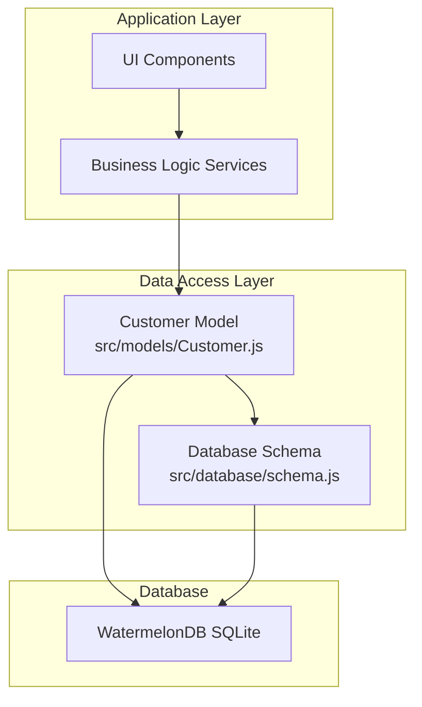
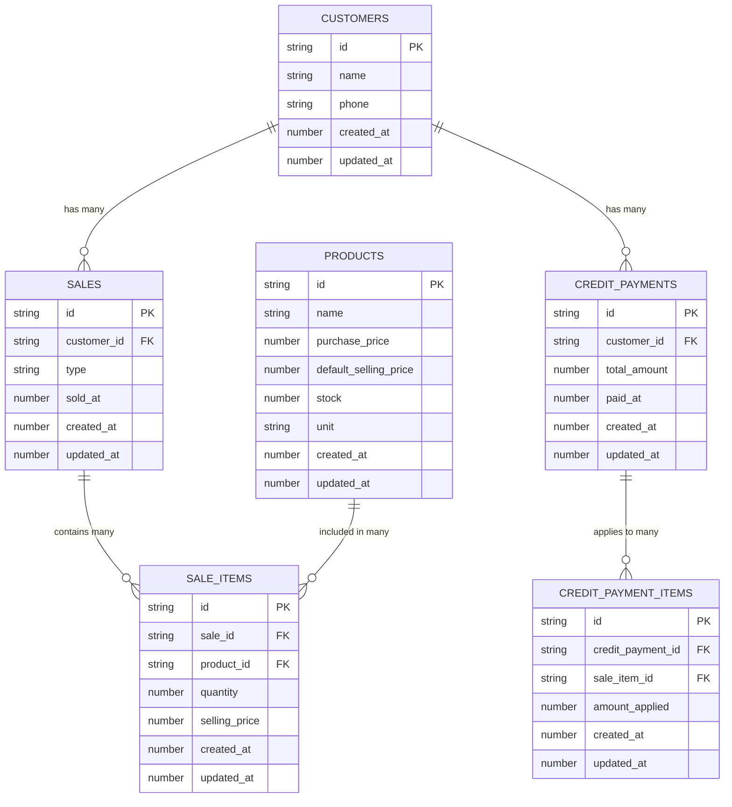
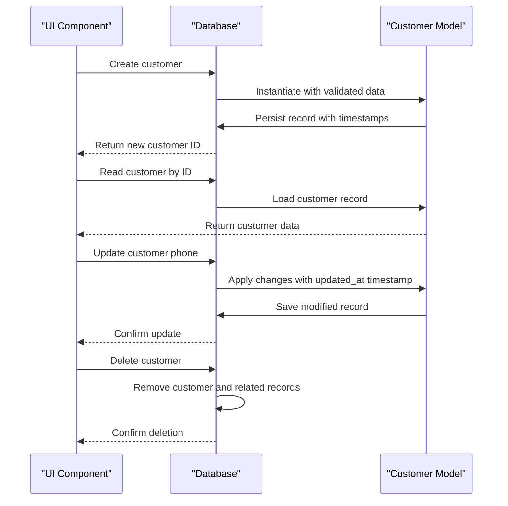
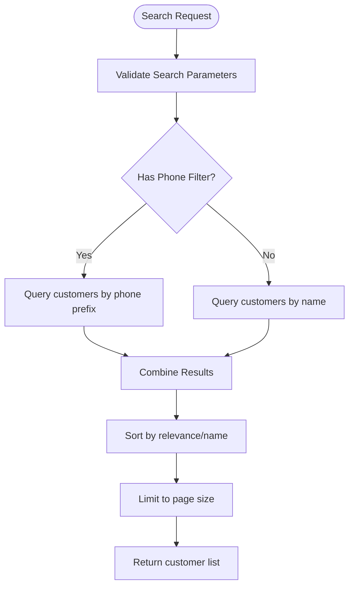
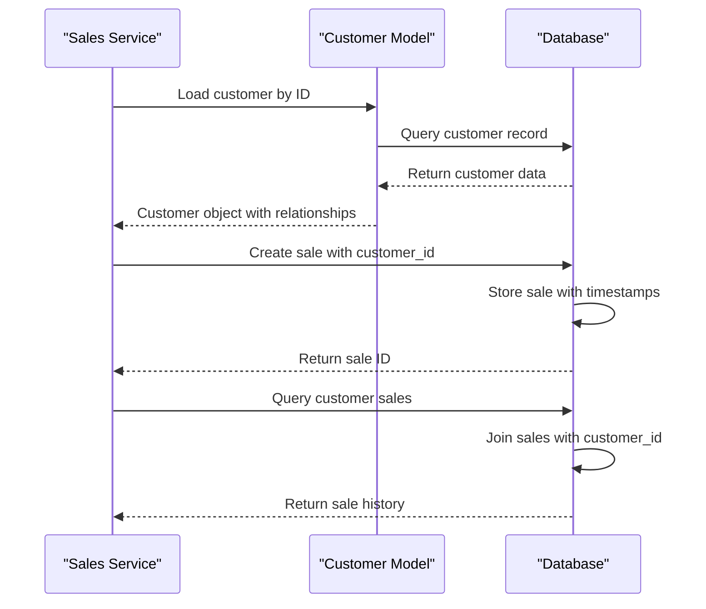
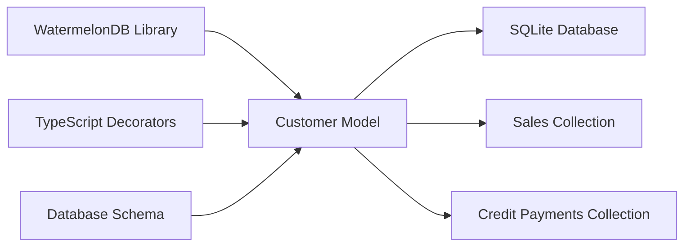

# Customer Model

<cite>
**Referenced Files in This Document**
- [Customer.js](file://src/models/Customer.js)
- [schema.js](file://src/database/schema.js)
- [README.md](file://README.md)
- [package.json](file://package.json)
</cite>

## Table of Contents
1. [Introduction](#introduction)
2. [Project Structure](#project-structure)
3. [Core Components](#core-components)
4. [Architecture Overview](#architecture-overview)
5. [Detailed Component Analysis](#detailed-component-analysis)
6. [Dependency Analysis](#dependency-analysis)
7. [Performance Considerations](#performance-considerations)
8. [Troubleshooting Guide](#troubleshooting-guide)
9. [Conclusion](#conclusion)

## Introduction
This document provides comprehensive technical documentation for the Customer model implementation in the ZemenawiDefter React Native application. It covers the customer table schema, WatermelonDB model definition, field decorators, relationship mappings to sales and credit payments, data structure, validation rules, indexing strategy, and practical examples of CRUD operations, search functionality, and integration with sales processing. It also explains the optional phone field and its implications for customer communication features.

## Project Structure
The Customer model and its database schema are implemented in two primary locations:
- Model definition: src/models/Customer.js
- Database schema: src/database/schema.js

The project uses WatermelonDB for local database operations and Expo for the cross-platform runtime. The model leverages decorators to define fields and relationships, while the schema enforces column types, optionality, and indexes.

**Diagram sources**
- [Customer.js](file://src/models/Customer.js#L1-L19)
- [schema.js](file://src/database/schema.js#L1-L89)

**Section sources**
- [README.md](file://README.md#L1-L51)
- [package.json](file://package.json#L1-L55)

## Core Components
The Customer model is defined as a WatermelonDB Model with the following characteristics:
- Table name: customers
- Fields:
  - name: string (required)
  - phone: string (optional)
  - created_at: number (timestamp)
  - updated_at: number (timestamp)
- Relationships:
  - Children relationship to sales
  - Children relationship to credit_payments

The model uses decorators to map JavaScript properties to database columns and to define parent-child relationships with related collections.

**Section sources**
- [Customer.js](file://src/models/Customer.js#L4-L17)
- [schema.js](file://src/database/schema.js#L9-L17)

## Architecture Overview
The Customer model participates in a broader data architecture that includes Products, Sales, Sale Items, Credit Payments, and Credit Payment Items. The schema defines foreign keys and indexes to optimize queries for customer-related operations.

**Diagram sources**
- [schema.js](file://src/database/schema.js#L9-L85)

## Detailed Component Analysis

### Customer Table Schema
The customer table schema defines four core columns:
- name: string, required
- phone: string, optional
- created_at: number (Unix timestamp)
- updated_at: number (Unix timestamp)

The schema ensures that customer records maintain consistent timestamps for creation and updates, enabling audit trails and chronological ordering.

**Section sources**
- [schema.js](file://src/database/schema.js#L9-L17)

### WatermelonDB Model Definition
The Customer model extends the base Model class and uses decorators to define:
- Field decorators (@field) for each column mapping
- Relationship decorators (@children) for related collections

Field decorators map JavaScript properties to database columns, ensuring type safety and consistent serialization. The relationship decorators establish parent-child associations with sales and credit payments collections.

**Section sources**
- [Customer.js](file://src/models/Customer.js#L4-L17)

### Field Decorators and Data Types
The model employs field decorators to define typed accessors:
- name: mapped to the name column
- phone: mapped to the phone column (optional)
- created_at: mapped to the created_at timestamp
- updated_at: mapped to the updated_at timestamp

These decorators enable type-safe property access and automatic conversion between JavaScript values and database storage formats.

**Section sources**
- [Customer.js](file://src/models/Customer.js#L7-L10)

### Relationship Mappings
The Customer model establishes two key relationships:
- One-to-many relationship with sales via @children("sales")
- One-to-many relationship with credit_payments via @children("credit_payments")

These relationships enable navigation from customer records to their associated sales and payment history, supporting reporting and reconciliation workflows.

**Section sources**
- [Customer.js](file://src/models/Customer.js#L12-L16)

### Validation Rules and Constraints
The schema enforces the following validation rules:
- name is required (non-null)
- phone is optional (nullable)
- created_at and updated_at are required numeric timestamps
- Foreign keys (customer_id) in related tables are indexed for performance

These constraints ensure data integrity and support efficient querying patterns.

**Section sources**
- [schema.js](file://src/database/schema.js#L12-L15)
- [schema.js](file://src/database/schema.js#L37-L41)
- [schema.js](file://src/database/schema.js#L67-L67)

### Indexing Strategy
The schema implements strategic indexing to optimize common queries:
- customer_id is indexed in sales and credit_payments tables
- sold_at is indexed in sales for chronological queries
- paid_at is indexed in credit_payments for payment tracking
- sale_id and product_id are indexed in sale_items for join operations

This indexing strategy supports efficient filtering, sorting, and joining operations commonly performed in customer-centric workflows.

**Section sources**
- [schema.js](file://src/database/schema.js#L40-L41)
- [schema.js](file://src/database/schema.js#L67-L67)
- [schema.js](file://src/database/schema.js#L43-L44)
- [schema.js](file://src/database/schema.js#L69-L69)
- [schema.js](file://src/database/schema.js#L54-L55)

### Optional Phone Field and Communication Implications
The phone field is defined as optional, allowing customers to be created without contact information. This design enables:
- Basic customer records for cash transactions
- Privacy-conscious customer management
- Flexibility for customers who prefer anonymous purchases

However, optional phone fields may impact communication features such as:
- SMS notifications or alerts
- Customer follow-up capabilities
- Marketing campaigns or promotional communications

Applications should implement appropriate fallbacks or user prompts when communication features require contact information.

**Section sources**
- [schema.js](file://src/database/schema.js#L13-L13)
- [Customer.js](file://src/models/Customer.js#L8-L8)

### Practical Examples

#### CRUD Operations
While the current implementation focuses on the model definition, typical CRUD operations would follow this pattern:

#### Search Functionality
Customer search operations leverage the database schema's design:

#### Sales Processing Integration
Customer integration with sales processing follows established relationships:

**Section sources**
- [Customer.js](file://src/models/Customer.js#L12-L16)
- [schema.js](file://src/database/schema.js#L37-L47)
- [schema.js](file://src/database/schema.js#L67-L73)

## Dependency Analysis
The Customer model depends on WatermelonDB for database operations and TypeScript decorators for type safety. The model maintains loose coupling with other domain entities through foreign key relationships.

**Diagram sources**
- [package.json](file://package.json#L15-L15)
- [Customer.js](file://src/models/Customer.js#L1-L2)
- [schema.js](file://src/database/schema.js#L1-L1)

**Section sources**
- [package.json](file://package.json#L15-L15)
- [Customer.js](file://src/models/Customer.js#L1-L2)

## Performance Considerations
- Indexed foreign keys enable fast joins and filtering
- Timestamp indexes support chronological queries
- Optional phone field reduces storage overhead for privacy-focused use cases
- Relationship loading should be optimized to avoid N+1 query patterns
- Consider lazy loading for related collections when displaying customer lists

## Troubleshooting Guide
Common issues and resolutions:
- Phone field validation: Since phone is optional, ensure UI validation handles empty values gracefully
- Relationship queries: Verify foreign key constraints when loading customer sales or payments
- Timestamp synchronization: Ensure client-side timestamp handling aligns with database updates
- Migration compatibility: When updating schema versions, verify backward compatibility for existing customer records

**Section sources**
- [schema.js](file://src/database/schema.js#L13-L15)
- [schema.js](file://src/database/schema.js#L37-L41)

## Conclusion
The Customer model provides a robust foundation for customer data management in the ZemenawiDefter application. Its design balances flexibility with performance through strategic indexing, optional fields for privacy, and clear relationship mappings. The implementation supports efficient CRUD operations, search functionality, and seamless integration with sales processing workflows while maintaining data integrity and type safety.