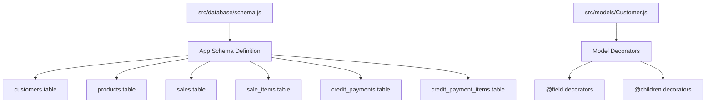
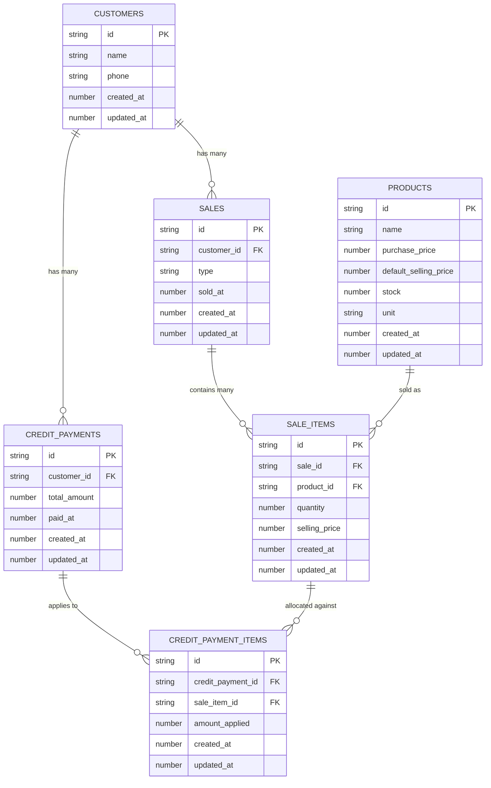
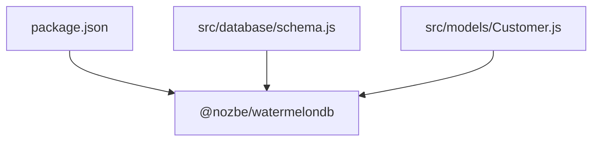

# Data Integrity and Constraints

<cite>
**Referenced Files in This Document**
- [schema.js](file://src/database/schema.js)
- [Customer.js](file://src/models/Customer.js)
- [package.json](file://package.json)
</cite>

## Table of Contents
1. [Introduction](#introduction)
2. [Project Structure](#project-structure)
3. [Core Components](#core-components)
4. [Architecture Overview](#architecture-overview)
5. [Detailed Component Analysis](#detailed-component-analysis)
6. [Dependency Analysis](#dependency-analysis)
7. [Performance Considerations](#performance-considerations)
8. [Troubleshooting Guide](#troubleshooting-guide)
9. [Conclusion](#conclusion)

## Introduction
This document explains the data integrity mechanisms and constraints implemented in the ZemenawiDefter database schema. It focuses on:
- Referential integrity rules and foreign key relationships
- Cascading behaviors
- Indexing strategy for performance optimization
- Timestamp consistency pattern with created_at and updated_at fields
- Validation rules, data type constraints, and business rule enforcement
- Examples of constraint violations and resolution strategies

The schema is defined declaratively using WatermelonDB’s schema builder and is versioned to support future migrations.

## Project Structure
The database schema and related model definitions are located under the src directory. The schema file defines all tables, columns, and indexes. The model file demonstrates how WatermelonDB decorators map JavaScript properties to database columns and define relationships.

**Diagram sources**
- [schema.js](file://src/database/schema.js#L5-L87)
- [Customer.js](file://src/models/Customer.js#L4-L17)

**Section sources**
- [schema.js](file://src/database/schema.js#L1-L90)
- [Customer.js](file://src/models/Customer.js#L1-L20)

## Core Components
This section documents the schema-level integrity mechanisms and constraints.

- Schema versioning: The schema is versioned to enable controlled migrations.
- Column types: All columns specify explicit types (string, number).
- Optional columns: Some columns are marked optional, allowing null values.
- Indexes: Specific columns are indexed to optimize queries on frequently filtered or joined fields.
- Timestamps: Every table includes created_at and updated_at numeric timestamps for auditability and ordering.

Key observations:
- No explicit foreign key constraints are declared in the schema. WatermelonDB relies on application-level relationships via decorators and naming conventions rather than enforcing referential integrity at the database level.
- Indexes are explicitly enabled on foreign key columns and timestamp fields to improve query performance.

**Section sources**
- [schema.js](file://src/database/schema.js#L5-L87)

## Architecture Overview
The database architecture follows a normalized retail domain model with separate entities for customers, products, sales, sale items, credit payments, and credit payment items. Relationships are expressed through foreign keys and indexes.

**Diagram sources**
- [schema.js](file://src/database/schema.js#L9-L85)

## Detailed Component Analysis

### Referential Integrity and Foreign Keys
- Foreign keys are represented by string-typed columns named with the _id suffix (e.g., customer_id, product_id, sale_id).
- Indexes are applied to foreign key columns to speed up joins and lookups.
- There are no explicit foreign key constraints defined in the schema. WatermelonDB does not enforce referential integrity at the database level; instead, it relies on application logic and decorators to maintain relationships.

Implications:
- Deleting a parent record (e.g., a customer) without first deleting dependent child records (sales, credit payments) will leave orphaned child rows.
- Queries must ensure referential integrity at the application level.

**Section sources**
- [schema.js](file://src/database/schema.js#L37-L84)

### Indexing Strategy
Indexes are strategically placed to optimize common query patterns:
- customer_id is indexed in sales, credit_payments, and credit_payment_items.
- product_id is indexed in sale_items.
- sale_id is indexed in sale_items and credit_payment_items.
- Timestamp fields sold_at, paid_at, created_at, and updated_at are indexed where applicable.

Benefits:
- Faster filtering and sorting by date/time.
- Improved join performance on foreign keys.

Considerations:
- Indexes improve read performance but may slightly impact write performance due to maintenance overhead.

**Section sources**
- [schema.js](file://src/database/schema.js#L37-L84)

### Timestamp Consistency Pattern
All tables include created_at and updated_at numeric timestamps. The schema comment indicates a focus on updated_at consistency, suggesting a convention to update updated_at on every write operation.

Guidelines:
- created_at should be set once during creation.
- updated_at should be updated on every subsequent modification.

**Section sources**
- [schema.js](file://src/database/schema.js#L14-L15)
- [schema.js](file://src/database/schema.js#L28-L29)
- [schema.js](file://src/database/schema.js#L45-L46)
- [schema.js](file://src/database/schema.js#L58-L59)
- [schema.js](file://src/database/schema.js#L71-L72)
- [schema.js](file://src/database/schema.js#L83-L84)

### Validation Rules and Data Type Constraints
- String columns: Enforce textual data (e.g., names, units, identifiers).
- Number columns: Enforce numeric data (e.g., prices, quantities, timestamps).
- Optional columns: phone in customers allows null values.
- Business rule indicators in schema comments:
  - sales.type is constrained to "cash" or "credit".
  - Timestamps are stored as numbers (Unix timestamps).

Validation enforcement:
- Column types and optionality are enforced by the schema.
- Business rules (e.g., sales.type values) are not enforced at the schema level; they must be validated in application code.

**Section sources**
- [schema.js](file://src/database/schema.js#L12-L13)
- [schema.js](file://src/database/schema.js#L23-L27)
- [schema.js](file://src/database/schema.js#L43-L44)

### Relationship Mapping in Models
The Customer model demonstrates how WatermelonDB decorators map relationships:
- @field decorators bind JavaScript properties to database columns.
- @children decorators declare inverse relationships (e.g., sales, credit_payments).

This mapping supports querying related records without explicit foreign key constraints.

**Section sources**
- [Customer.js](file://src/models/Customer.js#L7-L16)

## Dependency Analysis
WatermelonDB is the primary runtime dependency responsible for schema compilation, migrations, and model interactions.

**Diagram sources**
- [package.json](file://package.json#L15-L15)
- [schema.js](file://src/database/schema.js#L1-L1)
- [Customer.js](file://src/models/Customer.js#L1-L2)

**Section sources**
- [package.json](file://package.json#L13-L45)
- [schema.js](file://src/database/schema.js#L1-L1)
- [Customer.js](file://src/models/Customer.js#L1-L2)

## Performance Considerations
- Indexed foreign keys reduce join costs and improve lookup performance.
- Indexed timestamps enable efficient time-range queries for sales and payments.
- Numeric timestamps avoid timezone parsing overhead and enable straightforward comparisons.
- Minimizing unnecessary indexes helps maintain write performance.

[No sources needed since this section provides general guidance]

## Troubleshooting Guide

Common constraint violations and resolutions:
- Violation: Inserting a sale item with a non-existent product_id.
  - Cause: No foreign key constraint enforces referential integrity.
  - Resolution: Validate product existence in application logic before insertion.
- Violation: Deleting a customer while related sales or credit payments exist.
  - Cause: No cascading delete behavior is defined.
  - Resolution: Delete dependent records first or implement cascading deletes at the application level.
- Violation: Using an invalid sales.type value.
  - Cause: Not enforced by schema.
  - Resolution: Validate type values ("cash" or "credit") in application code.
- Violation: Omitting or misusing created_at/updated_at.
  - Cause: No triggers or defaults in schema.
  - Resolution: Set created_at on insert and updated_at on every update consistently across the application.

Resolution strategies:
- Centralize validation in service layers or repositories.
- Use transactions to ensure atomicity for related writes.
- Add pre-insert/update hooks to populate timestamps and normalize values.
- Implement soft-deletion patterns if needed, with appropriate indexing on deleted flags.

**Section sources**
- [schema.js](file://src/database/schema.js#L37-L44)
- [schema.js](file://src/database/schema.js#L54-L57)
- [schema.js](file://src/database/schema.js#L67-L72)
- [schema.js](file://src/database/schema.js#L79-L84)

## Conclusion
The ZemenawiDefter schema establishes a clear, indexed foundation for a retail-focused database using WatermelonDB. While referential integrity is not enforced at the database level, the schema’s indexes and timestamp conventions support efficient queries and auditability. Application-level validation and careful transaction handling are essential to maintain data integrity, particularly around foreign key relationships and business rule compliance.