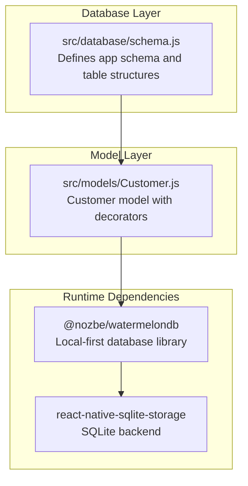
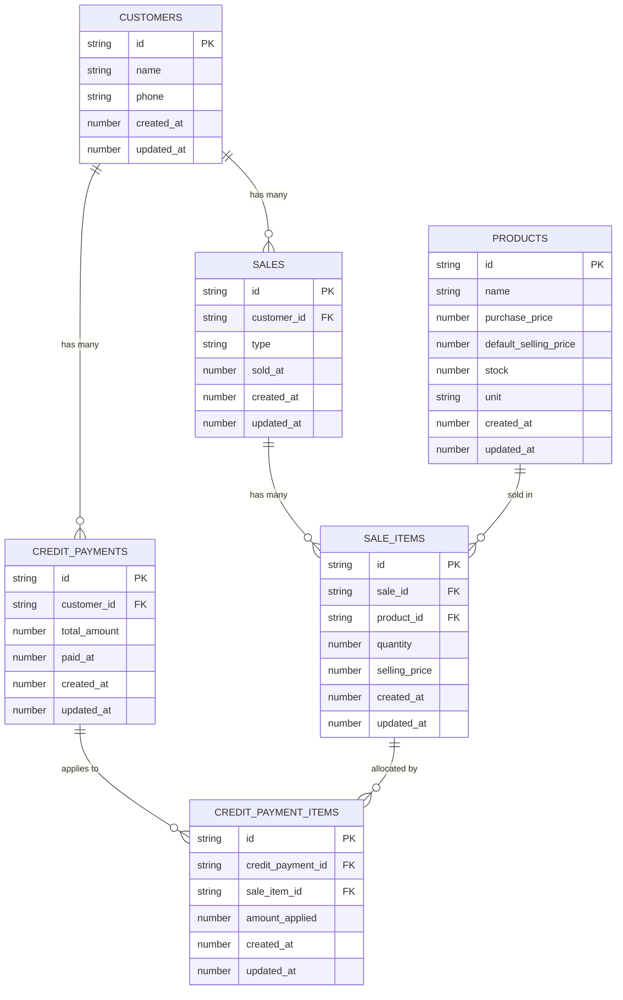
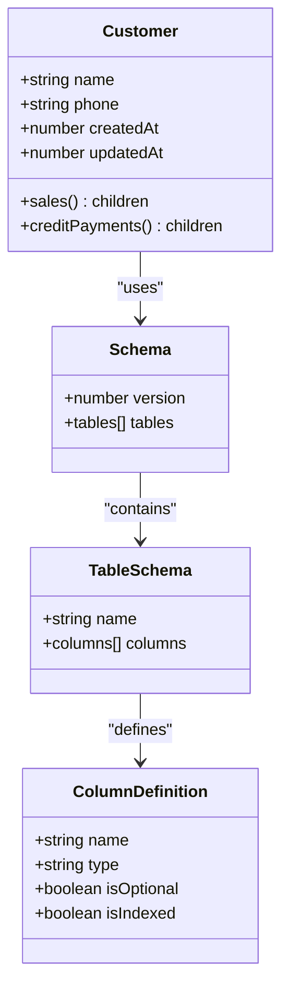

# Database Schema Overview

<cite>
**Referenced Files in This Document**
- [schema.js](file://src/database/schema.js)
- [Customer.js](file://src/models/Customer.js)
- [package.json](file://package.json)
</cite>

## Table of Contents
1. [Introduction](#introduction)
2. [Project Structure](#project-structure)
3. [Core Components](#core-components)
4. [Architecture Overview](#architecture-overview)
5. [Detailed Component Analysis](#detailed-component-analysis)
6. [Dependency Analysis](#dependency-analysis)
7. [Performance Considerations](#performance-considerations)
8. [Troubleshooting Guide](#troubleshooting-guide)
9. [Conclusion](#conclusion)

## Introduction
This document provides a comprehensive overview of ZemenawiDefter's database schema designed for a Point of Sale (POS) application. The schema follows a six-table relational structure built on WatermelonDB, emphasizing local-first data storage with strong typing and efficient indexing for transaction-heavy workflows. It supports core POS operations including customer management, product inventory, sales transactions, and credit payment reconciliation.

The schema versioning strategy ensures incremental updates while maintaining backward compatibility. Timestamp consistency is enforced across all tables with created_at and updated_at fields, enabling audit trails and temporal queries. Indexing is strategically applied to frequently queried columns to optimize performance for common POS operations.

## Project Structure
The database schema is defined centrally and integrated with React Native models:

**Diagram sources**
- [schema.js](file://src/database/schema.js#L1-L90)
- [Customer.js](file://src/models/Customer.js#L1-L20)
- [package.json](file://package.json#L13-L45)

**Section sources**
- [schema.js](file://src/database/schema.js#L1-L90)
- [Customer.js](file://src/models/Customer.js#L1-L20)
- [package.json](file://package.json#L13-L45)

## Core Components
The schema defines six core tables with explicit relationships and constraints:

### Schema Versioning Strategy
- Current version: 2
- Purpose: Enhanced timestamp consistency and strategic indexing
- Design philosophy: Incremental improvements without breaking changes

### Timestamp Consistency Pattern
All tables implement a standardized timestamp pattern:
- created_at: Number representing Unix timestamp
- updated_at: Number representing Unix timestamp
- Enforced consistently across customers, products, sales, sale_items, credit_payments, and credit_payment_items

### Indexing Approach
Strategic indexing targets high-frequency query patterns:
- customer_id indexed in sales and credit_payments
- sold_at indexed in sales for chronological queries
- paid_at indexed in credit_payments for payment history
- sale_id indexed in sale_items for transaction breakdowns
- product_id indexed in sale_items for inventory tracking
- credit_payment_id indexed in credit_payment_items
- sale_item_id indexed in credit_payment_items for payment allocation

**Section sources**
- [schema.js](file://src/database/schema.js#L4-L4)
- [schema.js](file://src/database/schema.js#L14-L15)
- [schema.js](file://src/database/schema.js#L28-L29)
- [schema.js](file://src/database/schema.js#L44-L46)
- [schema.js](file://src/database/schema.js#L58-L59)
- [schema.js](file://src/database/schema.js#L71-L72)
- [schema.js](file://src/database/schema.js#L83-L84)

## Architecture Overview
The six-table relational structure supports POS functionality through clear separation of concerns:

**Diagram sources**
- [schema.js](file://src/database/schema.js#L9-L17)
- [schema.js](file://src/database/schema.js#L19-L31)
- [schema.js](file://src/database/schema.js#L33-L48)
- [schema.js](file://src/database/schema.js#L50-L61)
- [schema.js](file://src/database/schema.js#L63-L73)
- [schema.js](file://src/database/schema.js#L75-L85)

## Detailed Component Analysis

### Customers Table
The foundation for customer relationships and credit management:
- Stores customer identification and contact information
- Supports optional phone numbers for communication
- Enables customer-centric reporting and credit tracking
- Links to sales and credit_payments through foreign keys

### Products Table
Inventory management with pricing and stock control:
- Maintains product catalog with descriptive attributes
- Tracks purchase and selling prices for profit calculations
- Stock management for inventory control
- Unit specification for measurement consistency

### Sales Table
Primary transaction record with cash/credit distinction:
- Cash vs credit transaction classification
- Timestamped sale records for chronological ordering
- Optional customer association for credit tracking
- Efficient indexing on customer_id and sold_at for common queries

### Sale Items Table
Transaction line items with pricing details:
- Links individual products to specific sales
- Records quantities and actual selling prices
- Enables detailed transaction analysis and reporting
- Supports inventory reduction and profit calculations

### Credit Payments Table
Credit transaction management:
- Tracks customer payments against outstanding balances
- Timestamped payment records for financial reconciliation
- Total amount tracking for payment applications
- Customer association for credit account management

### Credit Payment Items Table
Payment allocation to specific sale items:
- Maps payments to individual sale items
- Amount application tracking for partial payments
- Enables granular credit reconciliation
- Supports complex payment scenarios with multiple allocations

### Design Decisions and Rationale

#### Separation of Sales and Sale Items
The schema separates sales from sale_items to support:
- Transaction normalization reducing data duplication
- Flexible itemization allowing multiple products per sale
- Independent pricing adjustments per item
- Efficient querying of transaction details

#### Credit Payments and Credit Payment Items Separation
This two-tier structure enables:
- Payment tracking independent of individual items
- Granular allocation of payments to specific sale items
- Support for partial payments across multiple transactions
- Complex credit reconciliation scenarios

#### Optional Customer ID Fields
Customer_id fields are optional in sales to accommodate:
- Walk-in customers without accounts
- Anonymous transactions
- Simplified cash sales
- Backward compatibility with existing data

#### Cash/Credit Distinction
The sales table includes a type field distinguishing:
- Cash transactions for immediate payment
- Credit transactions for deferred payment
- Separate processing logic for each transaction type
- Financial reporting segregation

**Section sources**
- [schema.js](file://src/database/schema.js#L37-L42)
- [schema.js](file://src/database/schema.js#L43-L44)
- [schema.js](file://src/database/schema.js#L67-L67)
- [schema.js](file://src/database/schema.js#L79-L80)

## Dependency Analysis
The schema integrates with WatermelonDB through explicit model definitions:

**Diagram sources**
- [Customer.js](file://src/models/Customer.js#L4-L17)
- [schema.js](file://src/database/schema.js#L5-L87)

The dependency chain demonstrates:
- WatermelonDB provides the foundational ORM framework
- Schema definitions establish table structures
- Model decorators connect business logic to database entities
- Runtime dependencies enable SQLite-backed persistence

**Section sources**
- [Customer.js](file://src/models/Customer.js#L1-L20)
- [schema.js](file://src/database/schema.js#L1-L90)
- [package.json](file://package.json#L15-L15)

## Performance Considerations
Indexing strategy optimization:
- High-selectivity columns (customer_id, product_id) indexed for JOIN operations
- Timestamp columns (sold_at, paid_at) indexed for chronological queries
- Composite query patterns supported through targeted indexing
- Storage overhead balanced against query performance gains

Timestamp consistency benefits:
- Audit trail capabilities across all transaction types
- Temporal reporting and analytics
- Data integrity verification through update timestamps
- Efficient change tracking and synchronization

## Troubleshooting Guide
Common schema-related issues and resolutions:

### Version Migration Issues
- Verify schema version matches expected value (currently 2)
- Ensure backward compatibility when adding new columns
- Test migration scripts carefully before deployment

### Index Performance Problems
- Monitor query execution plans for missing indexes
- Consider additional indexes for complex JOIN patterns
- Regular maintenance of index statistics

### Data Integrity Concerns
- Validate foreign key relationships in production data
- Check timestamp consistency across related records
- Monitor for orphaned records in child tables

**Section sources**
- [schema.js](file://src/database/schema.js#L6-L6)
- [schema.js](file://src/database/schema.js#L4-L4)

## Conclusion
ZemenawiDefter's database schema represents a well-architected six-table relational structure optimized for POS operations. The design emphasizes:

- Clear separation of concerns through normalized table relationships
- Strategic indexing for performance-critical query patterns
- Comprehensive timestamp tracking for audit and reporting
- Flexible transaction modeling supporting both cash and credit operations
- Scalable architecture accommodating future enhancements

The schema provides a solid foundation for POS functionality while maintaining flexibility for business growth and evolving requirements.