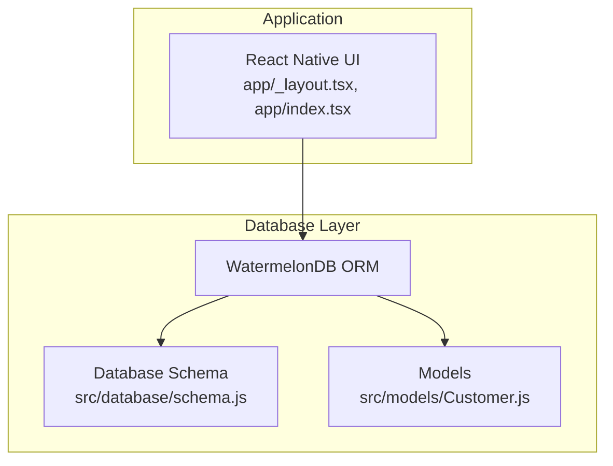
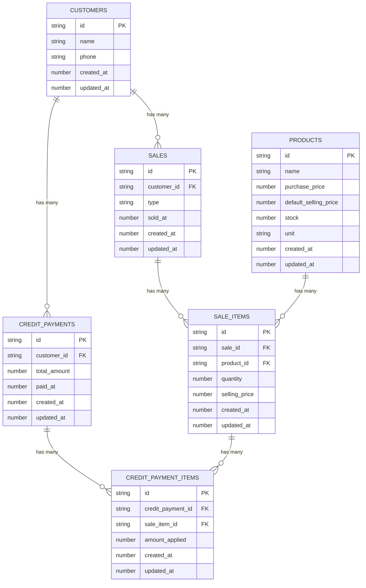
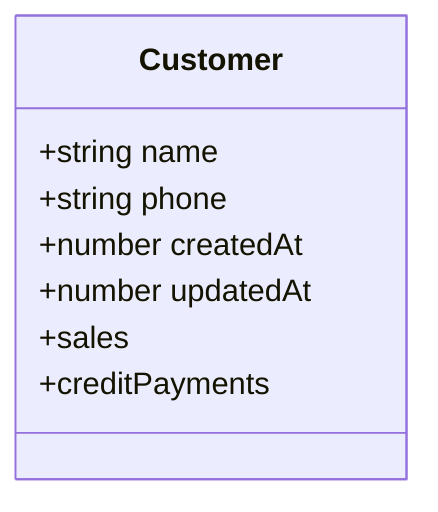
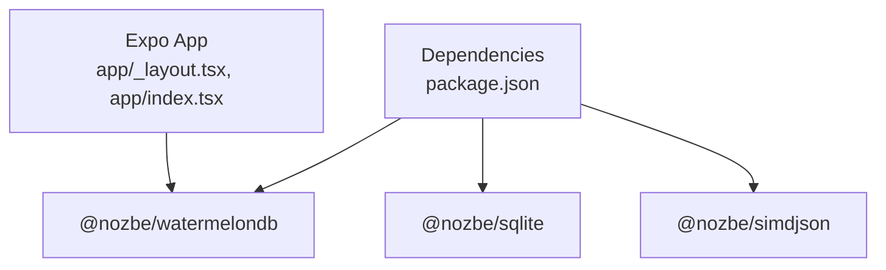

# Database Schema and Models

<cite>
**Referenced Files in This Document**
- [schema.js](file://src/database/schema.js)
- [Customer.js](file://src/models/Customer.js)
- [package.json](file://package.json)
- [app/_layout.tsx](file://app/_layout.tsx)
- [app/index.tsx](file://app/index.tsx)
</cite>

## Table of Contents
1. [Introduction](#introduction)
2. [Project Structure](#project-structure)
3. [Core Components](#core-components)
4. [Architecture Overview](#architecture-overview)
5. [Detailed Component Analysis](#detailed-component-analysis)
6. [Dependency Analysis](#dependency-analysis)
7. [Performance Considerations](#performance-considerations)
8. [Troubleshooting Guide](#troubleshooting-guide)
9. [Conclusion](#conclusion)
10. [Appendices](#appendices)

## Introduction
This document provides comprehensive data model documentation for ZemenawiDefter's database schema and WatermelonDB models. It covers the six interconnected tables: customers, products, sales, sale_items, credit_payments, and credit_payment_items. The document explains entity relationships, field definitions, data types, primary/foreign keys, indexes, and constraints. It also details the WatermelonDB model implementations, field decorators, and relationship mappings. Business rules, referential integrity constraints, data lifecycle, performance considerations, and migration strategies are included to support POS functionality.

## Project Structure
The project uses WatermelonDB for local database persistence in a React Native application. The schema defines the database structure, and models define the object-relational mapping with decorators for fields and relationships.

**Diagram sources**
- [schema.js](file://src/database/schema.js#L1-L90)
- [Customer.js](file://src/models/Customer.js#L1-L20)
- [app/_layout.tsx](file://app/_layout.tsx#L1-L9)
- [app/index.tsx](file://app/index.tsx#L1-L16)

**Section sources**
- [schema.js](file://src/database/schema.js#L1-L90)
- [Customer.js](file://src/models/Customer.js#L1-L20)
- [package.json](file://package.json#L1-L55)
- [app/_layout.tsx](file://app/_layout.tsx#L1-L9)
- [app/index.tsx](file://app/index.tsx#L1-L16)

## Core Components
This section documents the six database tables and their WatermelonDB model mappings.

- **Customers**
  - Purpose: Stores customer information for sales and credit records.
  - Fields:
    - name: string (required)
    - phone: string (optional)
    - created_at: number (timestamp)
    - updated_at: number (timestamp)
  - Indexes: None explicitly defined.
  - Constraints: name is required; phone is optional.

- **Products**
  - Purpose: Inventory and pricing information for items sold.
  - Fields:
    - name: string (required)
    - purchase_price: number (required)
    - default_selling_price: number (required)
    - stock: number (required)
    - unit: string (required)
    - created_at: number (timestamp)
    - updated_at: number (timestamp)
  - Indexes: None explicitly defined.
  - Constraints: All numeric fields are required; unit indicates measurement.

- **Sales**
  - Purpose: Records individual sales transactions.
  - Fields:
    - customer_id: string (optional foreign key to customers)
    - type: string (required; "cash" or "credit")
    - sold_at: number (required timestamp)
    - created_at: number (timestamp)
    - updated_at: number (timestamp)
  - Indexes: customer_id is indexed; sold_at is indexed.
  - Constraints: type must be "cash" or "credit".

- **Sale Items**
  - Purpose: Line items for each sale, linking products to sales.
  - Fields:
    - sale_id: string (required foreign key to sales)
    - product_id: string (required foreign key to products)
    - quantity: number (required)
    - selling_price: number (required)
    - created_at: number (timestamp)
    - updated_at: number (timestamp)
  - Indexes: sale_id is indexed; product_id is indexed.
  - Constraints: quantity and selling_price are required.

- **Credit Payments**
  - Purpose: Records cash payments against customer credit balances.
  - Fields:
    - customer_id: string (required foreign key to customers)
    - total_amount: number (required)
    - paid_at: number (required timestamp)
    - created_at: number (timestamp)
    - updated_at: number (timestamp)
  - Indexes: customer_id is indexed; paid_at is indexed.
  - Constraints: total_amount is required.

- **Credit Payment Items**
  - Purpose: Links credit payments to specific sale items.
  - Fields:
    - credit_payment_id: string (required foreign key to credit_payments)
    - sale_item_id: string (required foreign key to sale_items)
    - amount_applied: number (required)
    - created_at: number (timestamp)
    - updated_at: number (timestamp)
  - Indexes: credit_payment_id is indexed; sale_item_id is indexed.
  - Constraints: amount_applied is required.

**Section sources**
- [schema.js](file://src/database/schema.js#L8-L17)
- [schema.js](file://src/database/schema.js#L19-L31)
- [schema.js](file://src/database/schema.js#L33-L48)
- [schema.js](file://src/database/schema.js#L50-L61)
- [schema.js](file://src/database/schema.js#L63-L73)
- [schema.js](file://src/database/schema.js#L75-L86)

## Architecture Overview
The database architecture follows a normalized design supporting POS operations:
- Sales are linked to customers (optional for walk-in cash sales).
- Sale items link to both sales and products.
- Credit payments link to customers and apply to specific sale items.
- Indexes are strategically placed on foreign keys and timestamps to optimize queries.

**Diagram sources**
- [schema.js](file://src/database/schema.js#L8-L17)
- [schema.js](file://src/database/schema.js#L19-L31)
- [schema.js](file://src/database/schema.js#L33-L48)
- [schema.js](file://src/database/schema.js#L50-L61)
- [schema.js](file://src/database/schema.js#L63-L73)
- [schema.js](file://src/database/schema.js#L75-L86)

## Detailed Component Analysis

### Database Schema Details
- Versioning: The schema uses version 2 with updated_at consistency and helpful indexes.
- Indexes:
  - customer_id indexed in sales and credit_payments.
  - sold_at indexed in sales.
  - product_id indexed in sale_items.
  - sale_id indexed in sale_items and credit_payment_items.
  - paid_at indexed in credit_payments.
  - credit_payment_id indexed in credit_payment_items.
- Timestamps: All tables include created_at and updated_at for auditability.

**Section sources**
- [schema.js](file://src/database/schema.js#L4-L6)
- [schema.js](file://src/database/schema.js#L38-L41)
- [schema.js](file://src/database/schema.js#L44-L44)
- [schema.js](file://src/database/schema.js#L54-L55)
- [schema.js](file://src/database/schema.js#L67-L67)
- [schema.js](file://src/database/schema.js#L69-L69)
- [schema.js](file://src/database/schema.js#L79-L79)
- [schema.js](file://src/database/schema.js#L81-L81)

### WatermelonDB Models
- Customer Model
  - Decorators:
    - @field("name")
    - @field("phone")
    - @field("created_at")
    - @field("updated_at")
  - Relationships:
    - @children("sales") for customer-to-sales
    - @children("credit_payments") for customer-to-credit-payments

**Diagram sources**
- [Customer.js](file://src/models/Customer.js#L4-L17)

**Section sources**
- [Customer.js](file://src/models/Customer.js#L1-L20)

### Relationship Mapping
- One-to-many:
  - customers → sales
  - customers → credit_payments
  - sales → sale_items
  - products → sale_items
  - credit_payments → credit_payment_items
  - sale_items → credit_payment_items
- Many-to-one:
  - sale_items → sales
  - sale_items → products
  - credit_payment_items → credit_payments
  - credit_payment_items → sale_items

**Section sources**
- [schema.js](file://src/database/schema.js#L33-L48)
- [schema.js](file://src/database/schema.js#L50-L61)
- [schema.js](file://src/database/schema.js#L63-L73)
- [schema.js](file://src/database/schema.js#L75-L86)

### Data Validation Rules and Business Rules
- Sales type must be "cash" or "credit".
- Quantities and prices are numeric and required for sale items and credit payments.
- Timestamps enforce chronological ordering and audit trails.
- Optional customer_id in sales supports walk-in cash transactions.
- Credit payment amounts must match applied amounts to sale items.

**Section sources**
- [schema.js](file://src/database/schema.js#L43-L43)
- [schema.js](file://src/database/schema.js#L56-L57)
- [schema.js](file://src/database/schema.js#L79-L81)

### Referential Integrity Constraints
- Foreign key constraints enforced by WatermelonDB relationships:
  - sale_items.sale_id → sales.id
  - sale_items.product_id → products.id
  - credit_payments.customer_id → customers.id
  - credit_payment_items.credit_payment_id → credit_payments.id
  - credit_payment_items.sale_item_id → sale_items.id

**Section sources**
- [schema.js](file://src/database/schema.js#L54-L55)
- [schema.js](file://src/database/schema.js#L67-L67)
- [schema.js](file://src/database/schema.js#L79-L79)
- [schema.js](file://src/database/schema.js#L81-L81)

### Data Lifecycle
- Creation: created_at populated on insert.
- Updates: updated_at updated on record modification.
- Indexes: timestamps and foreign keys indexed to support filtering and joins.
- Deletion: Cascading deletes depend on WatermelonDB configuration; ensure referential integrity when removing records.

**Section sources**
- [schema.js](file://src/database/schema.js#L14-L15)
- [schema.js](file://src/database/schema.js#L28-L29)
- [schema.js](file://src/database/schema.js#L45-L46)
- [schema.js](file://src/database/schema.js#L58-L59)
- [schema.js](file://src/database/schema.js#L70-L71)
- [schema.js](file://src/database/schema.js#L82-L83)

## Dependency Analysis
WatermelonDB is integrated as a core dependency. The application initializes UI components via Expo Router.

**Diagram sources**
- [package.json](file://package.json#L13-L45)
- [app/_layout.tsx](file://app/_layout.tsx#L1-L9)
- [app/index.tsx](file://app/index.tsx#L1-L16)

**Section sources**
- [package.json](file://package.json#L13-L45)
- [app/_layout.tsx](file://app/_layout.tsx#L1-L9)
- [app/index.tsx](file://app/index.tsx#L1-L16)

## Performance Considerations
- Indexed foreign keys and timestamps improve query performance for joins and chronological filtering.
- Numeric fields for prices and quantities enable efficient aggregations.
- Timestamps support efficient time-range queries (sold_at, paid_at).
- Consider adding composite indexes for frequent join patterns if query volume grows.

[No sources needed since this section provides general guidance]

## Troubleshooting Guide
- Schema version conflicts: Ensure the app uses schema version 2 consistently across environments.
- Missing indexes: If queries become slow, consider adding indexes on frequently filtered columns.
- Data integrity errors: Verify foreign key relationships and required fields before inserts/updates.
- Timestamp discrepancies: Confirm device time synchronization to maintain accurate created_at/updated_at.

[No sources needed since this section analyzes specific files]

## Conclusion
The ZemenawiDefter database schema and WatermelonDB models provide a robust foundation for POS operations. The relational design supports sales, inventory, and credit management with strategic indexing and timestamp fields. WatermelonDB decorators map domain entities to database tables, enabling type-safe operations. Adhering to business rules and constraints ensures data integrity and reliable POS functionality.

[No sources needed since this section summarizes without analyzing specific files]

## Appendices

### Sample Data Structures
- Customer
  - name: "John Doe"
  - phone: "+1234567890"
  - created_at: 1700000000000
  - updated_at: 1700000000000

- Product
  - name: "Coffee Mug"
  - purchase_price: 5.00
  - default_selling_price: 12.99
  - stock: 100
  - unit: "pcs"
  - created_at: 1700000000000
  - updated_at: 1700000000000

- Sale
  - customer_id: "CUSTOMER_ID"
  - type: "cash"
  - sold_at: 1700000000000
  - created_at: 1700000000000
  - updated_at: 1700000000000

- Sale Item
  - sale_id: "SALE_ID"
  - product_id: "PRODUCT_ID"
  - quantity: 2
  - selling_price: 12.99
  - created_at: 1700000000000
  - updated_at: 1700000000000

- Credit Payment
  - customer_id: "CUSTOMER_ID"
  - total_amount: 25.98
  - paid_at: 1700000000000
  - created_at: 1700000000000
  - updated_at: 1700000000000

- Credit Payment Item
  - credit_payment_id: "PAYMENT_ID"
  - sale_item_id: "ITEM_ID"
  - amount_applied: 12.99
  - created_at: 1700000000000
  - updated_at: 1700000000000

[No sources needed since this section provides general guidance]