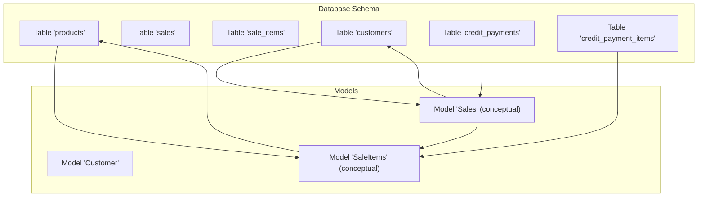
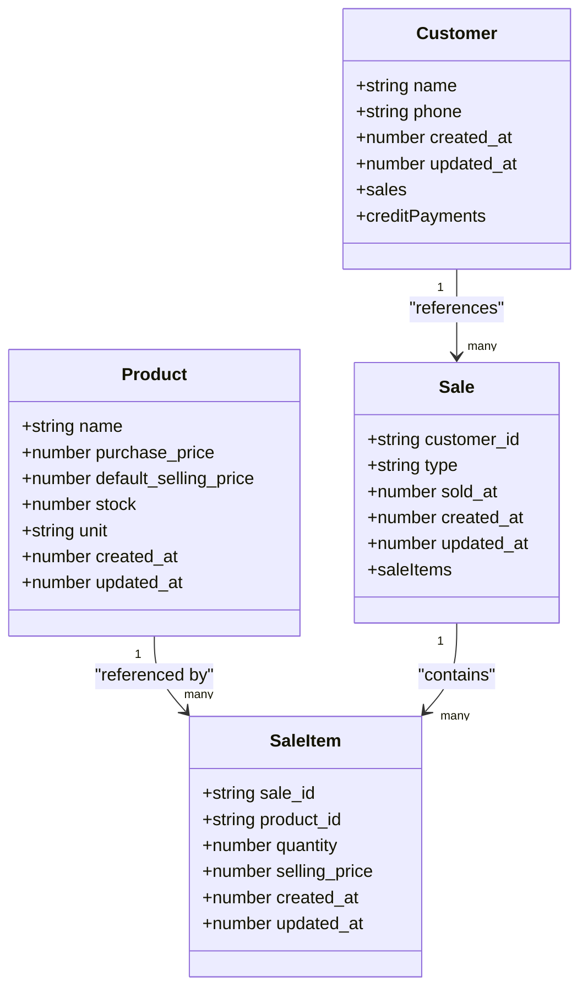
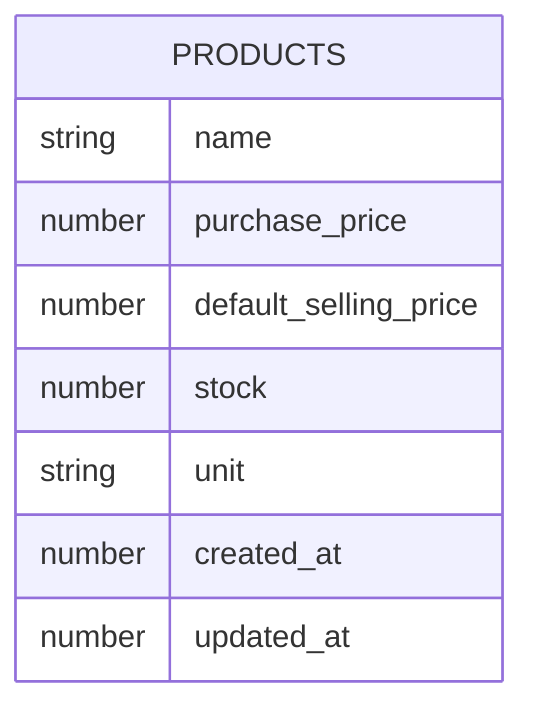
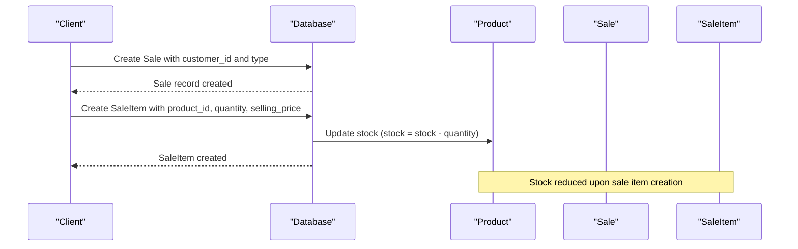
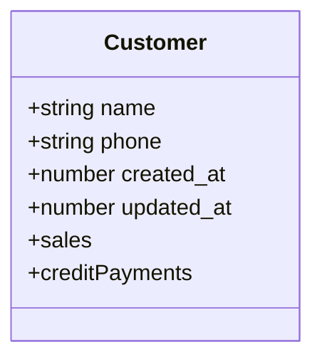
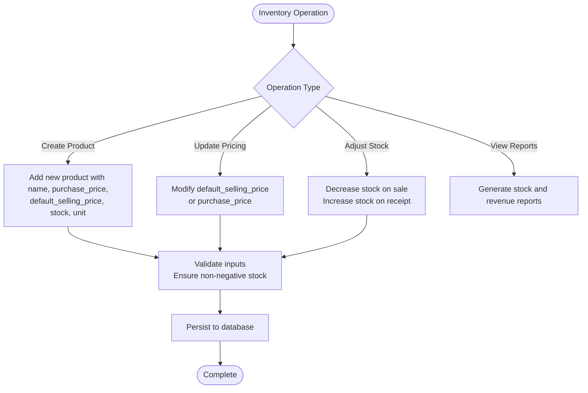
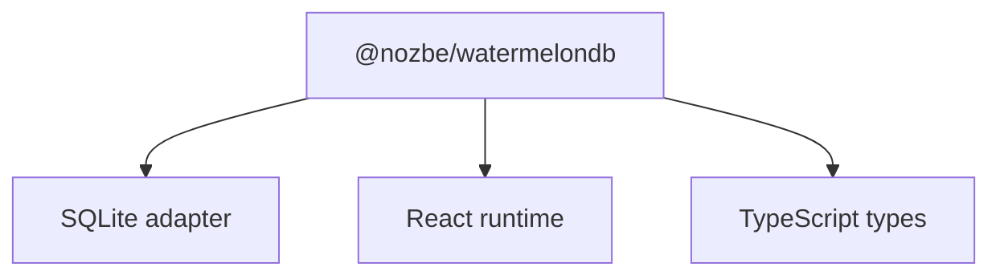

# Product and Inventory Model

<cite>
**Referenced Files in This Document**
- [schema.js](file://src/database/schema.js)
- [Customer.js](file://src/models/Customer.js)
- [package.json](file://package.json)
</cite>

## Table of Contents
1. [Introduction](#introduction)
2. [Project Structure](#project-structure)
3. [Core Components](#core-components)
4. [Architecture Overview](#architecture-overview)
5. [Detailed Component Analysis](#detailed-component-analysis)
6. [Dependency Analysis](#dependency-analysis)
7. [Performance Considerations](#performance-considerations)
8. [Troubleshooting Guide](#troubleshooting-guide)
9. [Conclusion](#conclusion)

## Introduction
This document provides comprehensive documentation for the Product model and inventory management system implemented in the React Native application using WatermelonDB. It focuses on the product table schema, pricing strategy with separate purchase and selling prices, stock tracking mechanisms, unit of measurement handling, and the relationships with related entities such as sales and customers. The goal is to enable both technical and non-technical users to understand how products are modeled, how inventory is tracked, and how pricing is managed within the system.

## Project Structure
The project uses WatermelonDB for local database modeling and persistence. The schema defines the database structure, while models expose typed access to records. The product domain is centered around the products table and its relationships with sales and customers.

**Diagram sources**
- [schema.js](file://src/database/schema.js#L19-L31)
- [schema.js](file://src/database/schema.js#L33-L48)
- [schema.js](file://src/database/schema.js#L50-L61)
- [schema.js](file://src/database/schema.js#L63-L73)
- [schema.js](file://src/database/schema.js#L75-L85)
- [Customer.js](file://src/models/Customer.js#L4-L17)

**Section sources**
- [schema.js](file://src/database/schema.js#L1-L89)
- [Customer.js](file://src/models/Customer.js#L1-L20)
- [package.json](file://package.json#L13-L45)

## Core Components
This section documents the Product model and inventory management capabilities derived from the schema definition and model structure.

- Product table schema
  - Fields: name, purchase_price, default_selling_price, stock, unit, created_at, updated_at
  - Types: name and unit are strings; purchase_price, default_selling_price, and stock are numbers; timestamps are numbers
  - Indexes: none explicitly declared for products, but indexes exist on foreign keys in related tables (e.g., sale_items.product_id, sales.customer_id)
  - Purpose: stores product metadata, pricing, stock levels, and unit of measurement

- Pricing strategy
  - Separate purchase and selling prices: purchase_price tracks cost, default_selling_price tracks recommended retail price
  - Price calculation logic: profit margin can be computed as (default_selling_price - purchase_price) / default_selling_price
  - Flexibility: individual sale items can override the default selling price during transactions

- Stock tracking mechanisms
  - Stock levels: tracked per product via the stock column
  - Unit of measurement: unit column supports granular units (e.g., pieces, kilograms, liters)
  - Validation: stock should remain non-negative; negative values indicate invalid states
  - Adjustments: stock decreases on sale item creation and increases on inventory corrections (conceptual)

- Timestamp fields
  - created_at and updated_at: numeric timestamps for auditability and consistency
  - updated_at pattern: present across multiple tables for uniformity

- Related entities
  - Sales: link customers to transactions
  - Sale items: connect products to sales with quantity and price at time of sale
  - Credit payments and credit payment items: handle credit transactions and their allocations

**Section sources**
- [schema.js](file://src/database/schema.js#L19-L31)
- [schema.js](file://src/database/schema.js#L33-L48)
- [schema.js](file://src/database/schema.js#L50-L61)
- [schema.js](file://src/database/schema.js#L63-L73)
- [schema.js](file://src/database/schema.js#L75-L85)
- [Customer.js](file://src/models/Customer.js#L4-L17)

## Architecture Overview
The system architecture centers on WatermelonDB models and schema definitions. The product domain integrates with sales and customer entities to support inventory updates and revenue tracking.

**Diagram sources**
- [schema.js](file://src/database/schema.js#L19-L31)
- [schema.js](file://src/database/schema.js#L33-L48)
- [schema.js](file://src/database/schema.js#L50-L61)
- [Customer.js](file://src/models/Customer.js#L4-L17)

## Detailed Component Analysis

### Product Model and Schema
The Product model encapsulates product attributes and inventory metadata. The schema enforces data types and relationships that underpin inventory operations.

- Field definitions and roles
  - name: product identifier for display and search
  - purchase_price: cost price for inventory valuation
  - default_selling_price: suggested retail price for sales
  - stock: current inventory quantity
  - unit: unit of measurement (e.g., pcs, kg, L)
  - created_at/updated_at: audit timestamps

- Pricing strategy
  - Purchase vs selling price separation enables profit margin calculations
  - default_selling_price serves as baseline; individual sale items may override during transactions

- Stock tracking
  - Non-negative stock validation is essential to prevent overselling
  - Unit normalization ensures consistent inventory accounting across measurements

- Timestamp fields
  - Numeric timestamps support efficient indexing and sorting
  - updated_at pattern aligns with other tables for consistency

**Section sources**
- [schema.js](file://src/database/schema.js#L19-L31)

### Sales and Sale Items Integration
Sales and sale items connect products to transactions, enabling stock and revenue tracking.

- Stock adjustment logic
  - On sale item creation, product stock is decremented by the sold quantity
  - Negative stock indicates overselling and requires intervention

- Pricing overrides
  - selling_price in sale items allows dynamic pricing during sales
  - default_selling_price remains unchanged in the product record

**Section sources**
- [schema.js](file://src/database/schema.js#L50-L61)
- [schema.js](file://src/database/schema.js#L33-L48)

### Customer Model and Relationships
The Customer model demonstrates how higher-level entities relate to sales and payments.

- Relationships
  - One-to-many with Sales via customer_id
  - One-to-many with Credit Payments via customer_id

- Implications for inventory
  - While customers do not directly modify stock, their purchases drive sale items that update product stock

**Section sources**
- [Customer.js](file://src/models/Customer.js#L4-L17)

### Conceptual Overview
The following conceptual flow illustrates typical inventory operations without mapping to specific source files.

## Dependency Analysis
The system relies on WatermelonDB for database modeling and persistence. Dependencies are declared in the project configuration.

**Diagram sources**
- [package.json](file://package.json#L13-L45)

**Section sources**
- [package.json](file://package.json#L13-L45)

## Performance Considerations
- Indexes
  - Foreign key columns in related tables (e.g., sale_items.product_id, sales.customer_id) are indexed to improve join performance
  - Consider adding indexes on frequently queried product fields if needed (e.g., name, unit)

- Data types
  - Numeric timestamps and prices enable efficient comparisons and calculations
  - Using integers or decimals consistently prevents precision loss

- Queries
  - Prefer filtered queries on indexed columns for product lookup and transaction history
  - Batch operations for bulk stock updates or pricing changes

## Troubleshooting Guide
- Negative stock values
  - Symptom: stock becomes negative after sales
  - Resolution: validate stock before creating sale items; implement pre-sale checks; adjust stock on returns or reversals

- Pricing discrepancies
  - Symptom: default_selling_price differs from actual sale price
  - Resolution: confirm whether selling_price was overridden in sale items; reconcile differences during reporting

- Data type mismatches
  - Symptom: unexpected errors when saving numeric fields
  - Resolution: ensure numeric values are passed for purchase_price, default_selling_price, stock, and timestamps

- Relationship integrity
  - Symptom: orphaned sale items or missing customer associations
  - Resolution: verify foreign key constraints and cascading rules; ensure proper creation order for related records

## Conclusion
The Product model and inventory management system leverage WatermelonDB to maintain accurate product data, pricing, and stock levels. The schema supports a clear separation of concerns: products define pricing and inventory, sales capture transactions, and related entities track customer and payment details. By adhering to non-negative stock validation, leveraging indexes, and maintaining consistent timestamp patterns, the system provides a robust foundation for inventory operations and reporting.