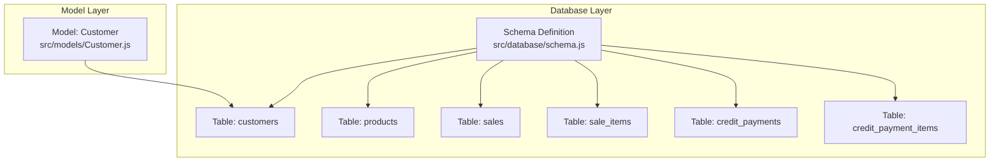
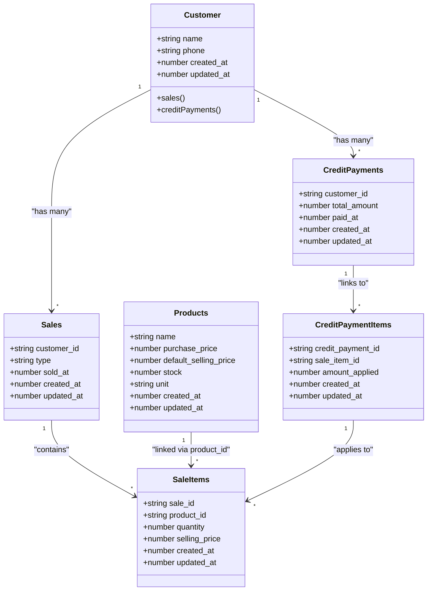
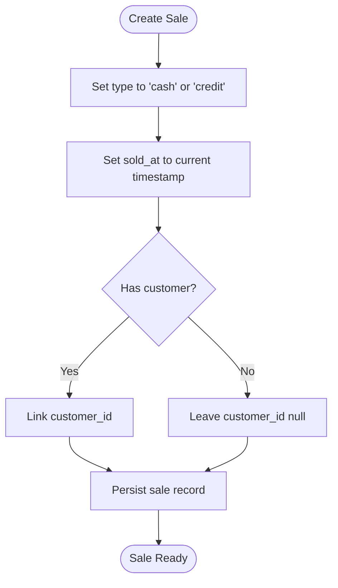
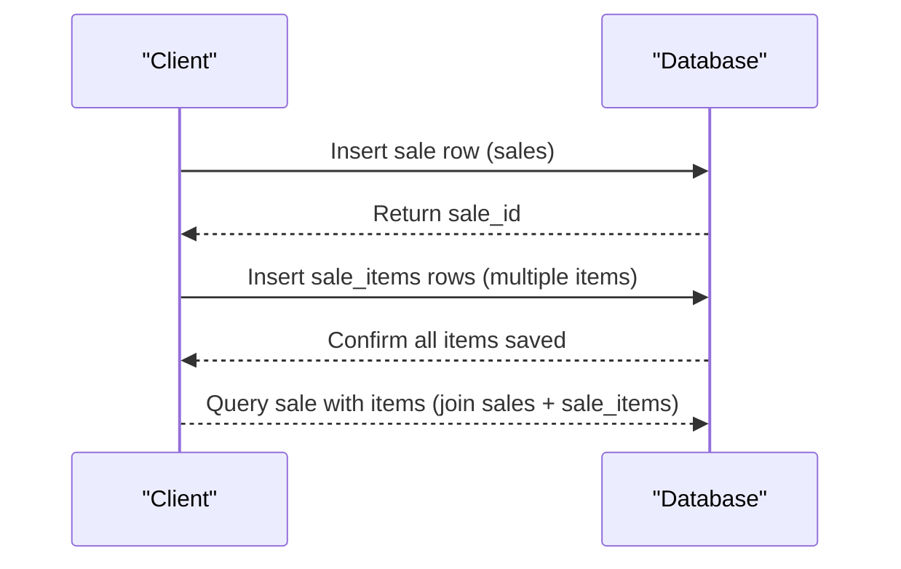
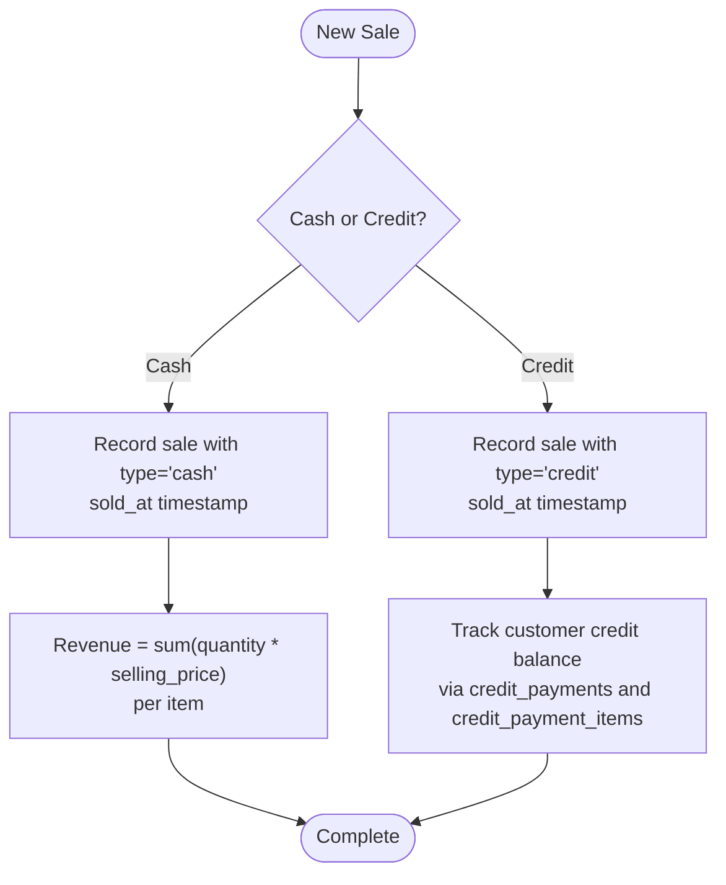
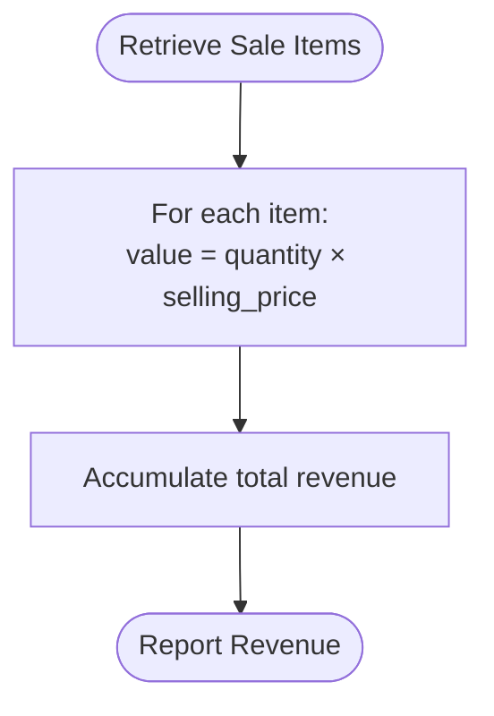
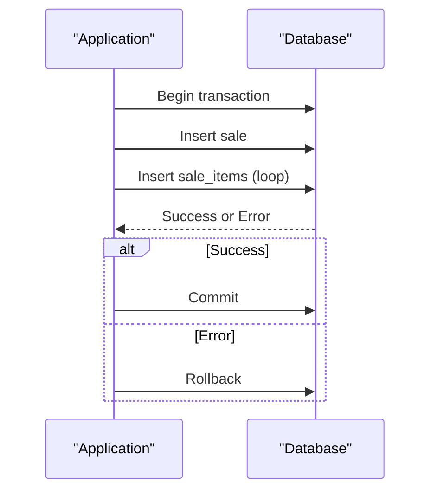
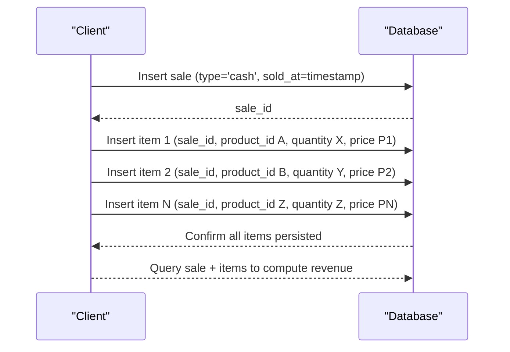
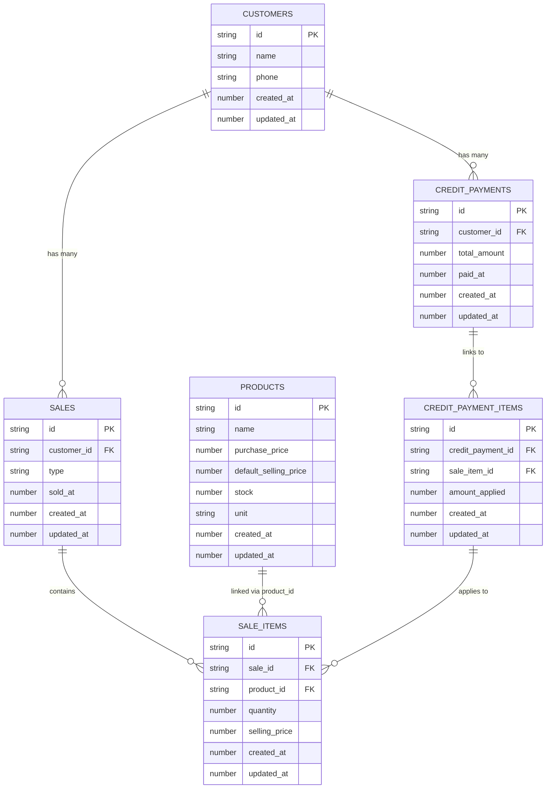

# Sales and Transaction Model

<cite>
**Referenced Files in This Document**
- [schema.js](file://src/database/schema.js)
- [Customer.js](file://src/models/Customer.js)
- [README.md](file://README.md)
</cite>

## Table of Contents
1. [Introduction](#introduction)
2. [Project Structure](#project-structure)
3. [Core Components](#core-components)
4. [Architecture Overview](#architecture-overview)
5. [Detailed Component Analysis](#detailed-component-analysis)
6. [Dependency Analysis](#dependency-analysis)
7. [Performance Considerations](#performance-considerations)
8. [Troubleshooting Guide](#troubleshooting-guide)
9. [Conclusion](#conclusion)

## Introduction
This document describes the Sales and Transaction Model system implemented in the project. It focuses on the sales table with customer linkage, the sale_items junction table for multi-item sales, and the indexing strategy designed to optimize performance for timestamp and foreign key queries. The documentation also outlines the conceptual workflow for cash and credit sales, revenue calculation, and transaction rollback considerations.

## Project Structure
The project uses WatermelonDB for local database modeling. The schema defines the core tables and indexes, while models define relationships between entities. The current repository snapshot includes the database schema and a customer model with related associations.

**Diagram sources**
- [schema.js](file://src/database/schema.js#L1-L90)
- [Customer.js](file://src/models/Customer.js#L1-L20)

**Section sources**
- [schema.js](file://src/database/schema.js#L1-L90)
- [Customer.js](file://src/models/Customer.js#L1-L20)
- [README.md](file://README.md#L1-L51)

## Core Components
This section documents the primary tables and their roles in the sales and transaction system.

- Sales table
  - Purpose: Records individual sales transactions.
  - Key fields:
    - customer_id: Foreign key to customers (indexed).
    - type: Transaction type ("cash" or "credit").
    - sold_at: Timestamp of sale (indexed).
    - created_at and updated_at: Consistency timestamps.
  - Notes: customer_id is optional to support walk-in or anonymous sales.

- Sale Items junction table
  - Purpose: Links sales to products and captures per-item details.
  - Key fields:
    - sale_id: Foreign key to sales (indexed).
    - product_id: Foreign key to products (indexed).
    - quantity: Number of units sold.
    - selling_price: Price per unit at time of sale.
    - created_at and updated_at: Consistency timestamps.

- Credit Payments and Credit Payment Items
  - Purpose: Track payments applied against credit sales and link payments to specific sale items.
  - Fields include indexed foreign keys and timestamps for efficient querying.

**Section sources**
- [schema.js](file://src/database/schema.js#L33-L61)
- [schema.js](file://src/database/schema.js#L63-L85)

## Architecture Overview
The sales transaction architecture centers around the sales table and the sale_items junction table. The Customer model exposes relationships to sales and credit payments, enabling navigation from customer to their purchase history and outstanding balances.

**Diagram sources**
- [schema.js](file://src/database/schema.js#L8-L85)
- [Customer.js](file://src/models/Customer.js#L4-L17)

## Detailed Component Analysis

### Sales Table
- Purpose: Capture each sale event with customer association, transaction type, and timing.
- Indexing strategy:
  - customer_id is indexed to accelerate joins and filtering by customer.
  - sold_at is indexed to support chronological queries and reporting.
- Optional customer_id enables walk-in sales without requiring a customer record.

**Diagram sources**
- [schema.js](file://src/database/schema.js#L33-L48)

**Section sources**
- [schema.js](file://src/database/schema.js#L33-L48)

### Sale Items Junction Table
- Purpose: Store per-item details for a sale, including quantity and selling price.
- Indexing strategy:
  - sale_id is indexed to efficiently fetch all items in a sale.
  - product_id is indexed to quickly locate items for a given product.
- Multi-item sales: Multiple rows in sale_items correspond to a single sale_id.

**Diagram sources**
- [schema.js](file://src/database/schema.js#L50-L61)

**Section sources**
- [schema.js](file://src/database/schema.js#L50-L61)

### Cash vs Credit Sale Handling
- Cash sale:
  - Mark type as "cash".
  - Record sold_at timestamp.
  - Persist immediately; no immediate credit balance.
- Credit sale:
  - Mark type as "credit".
  - Persist sale and sale_items.
  - Track customer credit balance via credit_payments and credit_payment_items.

**Diagram sources**
- [schema.js](file://src/database/schema.js#L43-L44)
- [schema.js](file://src/database/schema.js#L63-L85)

**Section sources**
- [schema.js](file://src/database/schema.js#L43-L44)
- [schema.js](file://src/database/schema.js#L63-L85)

### Revenue Calculation
- Total sale value: Sum of (quantity × selling_price) for all items in a sale.
- This calculation is performed client-side after retrieving sale and sale_items records.

**Diagram sources**
- [schema.js](file://src/database/schema.js#L56-L57)
- [schema.js](file://src/database/schema.js#L50-L61)

**Section sources**
- [schema.js](file://src/database/schema.js#L50-L61)

### Transaction Rollback Scenarios
- Conceptual guidance:
  - Use a transaction wrapper to group sale and sale_items inserts.
  - On failure, roll back the entire set of inserts to maintain consistency.
  - Ensure rollback handles partial failures (e.g., sale insert succeeds but sale_items fail).
- Implementation note: The schema and model files demonstrate the data model; transaction semantics are typically handled by the database layer (WatermelonDB) during batch operations.

**Diagram sources**
- [schema.js](file://src/database/schema.js#L33-L61)

**Section sources**
- [schema.js](file://src/database/schema.js#L33-L61)

### Multi-Item Sales Example
- Steps:
  - Create a sale row with type and sold_at.
  - Insert multiple sale_items rows with the same sale_id but different product_id values.
  - Calculate revenue as the sum of (quantity × selling_price) across all items.

**Diagram sources**
- [schema.js](file://src/database/schema.js#L33-L61)

**Section sources**
- [schema.js](file://src/database/schema.js#L33-L61)

## Dependency Analysis
This section maps the relationships among tables and models.

**Diagram sources**
- [schema.js](file://src/database/schema.js#L8-L85)
- [Customer.js](file://src/models/Customer.js#L4-L17)

**Section sources**
- [schema.js](file://src/database/schema.js#L8-L85)
- [Customer.js](file://src/models/Customer.js#L4-L17)

## Performance Considerations
Indexing strategy rationale:
- sales.customer_id is indexed to speed up customer-specific queries and joins.
- sales.sold_at is indexed to optimize chronological reports and range queries.
- sale_items.sale_id is indexed to efficiently fetch all items in a sale.
- sale_items.product_id is indexed to quickly locate items for a given product.
- Additional indexed fields (e.g., credit_payments.customer_id, credit_payments.paid_at, credit_payment_items.credit_payment_id, credit_payment_items.sale_item_id) support efficient credit payment tracking and reconciliation.

These indexes collectively improve query performance for:
- Retrieving a customer's sales history.
- Generating daily/weekly/monthly sales reports.
- Looking up items for a specific product.
- Tracking credit payments and applying them to sale items.

**Section sources**
- [schema.js](file://src/database/schema.js#L38-L44)
- [schema.js](file://src/database/schema.js#L54-L55)
- [schema.js](file://src/database/schema.js#L67-L69)
- [schema.js](file://src/database/schema.js#L79-L80)

## Troubleshooting Guide
Common issues and resolutions:
- Missing indexes causing slow queries:
  - Verify that customer_id, sold_at, sale_id, product_id, customer_id (credit_payments), paid_at (credit_payments), credit_payment_id, and sale_item_id (credit_payment_items) are indexed as defined in the schema.
- Incorrect revenue totals:
  - Ensure all sale_items rows are inserted for a sale and that revenue is calculated as the sum of (quantity × selling_price).
- Data inconsistency after errors:
  - Wrap sale and sale_items inserts in a transaction and roll back on failure to prevent partial writes.

**Section sources**
- [schema.js](file://src/database/schema.js#L38-L44)
- [schema.js](file://src/database/schema.js#L54-L55)
- [schema.js](file://src/database/schema.js#L67-L69)
- [schema.js](file://src/database/schema.js#L79-L80)

## Conclusion
The Sales and Transaction Model leverages a clean relational design with targeted indexes to support fast queries and reliable reporting. The sales table captures essential transaction metadata, while the sale_items junction table enables flexible multi-item sales. Cash and credit flows are supported conceptually through the type field and credit payment tables. Proper indexing and transactional integrity ensure performance and data consistency across typical retail operations.