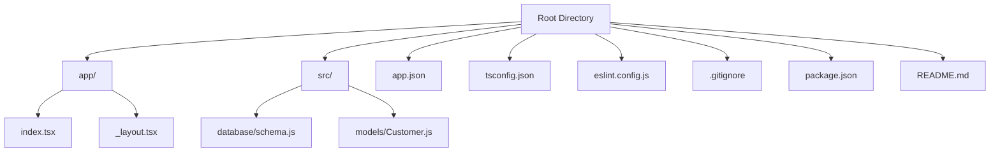
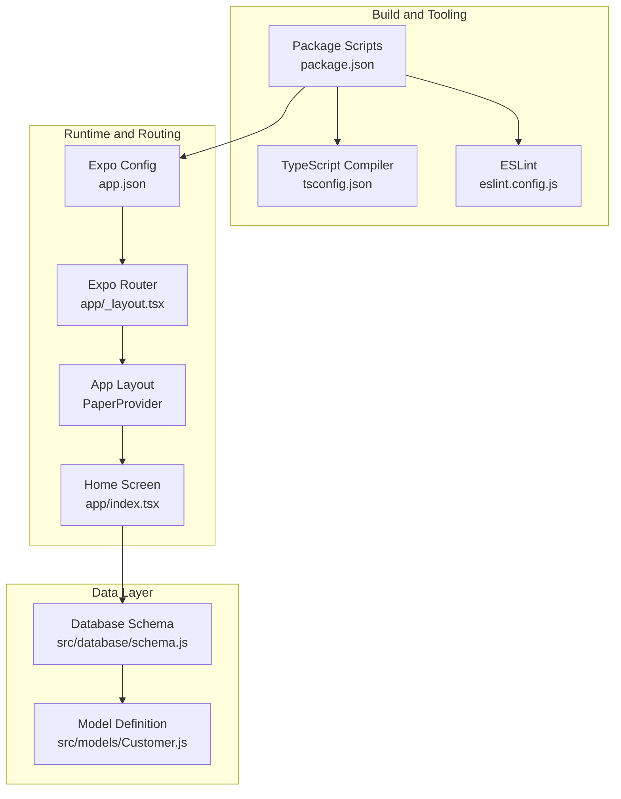
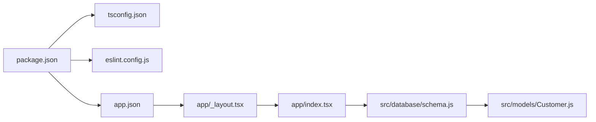

# Development Setup and Configuration

<cite>
**Referenced Files in This Document**
- [package.json](file://package.json)
- [tsconfig.json](file://tsconfig.json)
- [eslint.config.js](file://eslint.config.js)
- [app.json](file://app.json)
- [.gitignore](file://.gitignore)
- [README.md](file://README.md)
- [app/_layout.tsx](file://app/_layout.tsx)
- [app/index.tsx](file://app/index.tsx)
- [src/database/schema.js](file://src/database/schema.js)
- [src/models/Customer.js](file://src/models/Customer.js)
</cite>

## Table of Contents
1. [Introduction](#introduction)
2. [Project Structure](#project-structure)
3. [Core Components](#core-components)
4. [Architecture Overview](#architecture-overview)
5. [Detailed Component Analysis](#detailed-component-analysis)
6. [Dependency Analysis](#dependency-analysis)
7. [Performance Considerations](#performance-considerations)
8. [Troubleshooting Guide](#troubleshooting-guide)
9. [Conclusion](#conclusion)
10. [Appendices](#appendices)

## Introduction
This document provides comprehensive development setup and configuration guidance for ZemenawiDefter, a React Native application built with Expo Router. It covers TypeScript configuration (including path mapping and strict mode), ESLint setup for code quality, Expo configuration options and platform-specific settings, Git ignore patterns and version control best practices, debugging and hot reload configuration, environment variable management, and troubleshooting for common development issues.

## Project Structure
The project follows an Expo Router-based file-based routing convention with a minimal app scaffold and a dedicated src directory for database schema and models. Key configuration files define the build, linting, and runtime behavior.

**Diagram sources**
- [app/_layout.tsx](file://app/_layout.tsx#L1-L9)
- [app/index.tsx](file://app/index.tsx#L1-L16)
- [src/database/schema.js](file://src/database/schema.js#L1-L90)
- [src/models/Customer.js](file://src/models/Customer.js#L1-L20)

**Section sources**
- [README.md](file://README.md#L1-L51)
- [package.json](file://package.json#L1-L55)

## Core Components
This section documents the foundational configuration components that enable development and build processes.

- TypeScript configuration
  - Extends Expo's base tsconfig to inherit recommended defaults.
  - Enables strict type checking for improved reliability.
  - Configures path mapping for clean module resolution using a workspace alias.
  - Includes TypeScript files, Expo type generation, and typed environment declarations.

- ESLint configuration
  - Uses the official Expo flat config for React Native and Expo projects.
  - Ignores distribution artifacts to keep linting focused on source files.

- Expo configuration
  - Defines app metadata, platform-specific settings, and plugins.
  - Enables new architecture support and React experiments.
  - Configures router plugin, splash screen, and web output.

- Package scripts and dependencies
  - Provides standardized scripts for starting, building, and linting.
  - Declares Expo, React Navigation, WatermelonDB, and related libraries.

**Section sources**
- [tsconfig.json](file://tsconfig.json#L1-L18)
- [eslint.config.js](file://eslint.config.js#L1-L11)
- [app.json](file://app.json#L1-L50)
- [package.json](file://package.json#L1-L55)

## Architecture Overview
The development stack integrates Expo Router for navigation, TypeScript for type safety, ESLint for code quality, and WatermelonDB for local persistence. The configuration files coordinate build-time and runtime behavior across platforms.

**Diagram sources**
- [tsconfig.json](file://tsconfig.json#L1-L18)
- [eslint.config.js](file://eslint.config.js#L1-L11)
- [package.json](file://package.json#L1-L55)
- [app.json](file://app.json#L1-L50)
- [app/_layout.tsx](file://app/_layout.tsx#L1-L9)
- [app/index.tsx](file://app/index.tsx#L1-L16)
- [src/database/schema.js](file://src/database/schema.js#L1-L90)
- [src/models/Customer.js](file://src/models/Customer.js#L1-L20)

## Detailed Component Analysis

### TypeScript Configuration
- Path mapping
  - Workspace alias enables importing from "@/*" to resolve files relative to the project root.
  - This simplifies imports and improves maintainability across the codebase.

- Strict mode
  - Enforces stricter type checking to catch potential runtime errors early.

- Included files
  - Targets TypeScript files, Expo type generation, and typed environment declarations for accurate IDE support.

- Recommendations
  - Keep path aliases consistent across the project.
  - Add type declaration files for third-party modules if needed.
  - Use explicit types for props and state to maximize benefit from strict mode.

**Section sources**
- [tsconfig.json](file://tsconfig.json#L1-L18)

### ESLint Configuration
- Flat config
  - Leverages the official Expo flat configuration for React Native projects.
  - Ensures compatibility with Expo tooling and modern JavaScript/TypeScript practices.

- Ignored patterns
  - Excludes distribution artifacts to avoid unnecessary linting overhead.

- Recommendations
  - Run the linter regularly via the provided script.
  - Configure editor integrations to surface issues during development.
  - Customize rules sparingly to maintain team-wide consistency.

**Section sources**
- [eslint.config.js](file://eslint.config.js#L1-L11)
- [package.json](file://package.json#L47-L52)

### Expo Configuration
- Metadata and behavior
  - App name, slug, version, orientation, icon, scheme, and interface style are defined centrally.
  - Enables new architecture and React experiments for future-ready builds.

- Platform-specific settings
  - iOS supports tablet form factors.
  - Android includes adaptive icons, edge-to-edge rendering, predictive back gesture preferences, and package identifier.
  - Web output targets a static build with a favicon.

- Plugins and experiments
  - Router plugin for file-based routing.
  - Splash screen plugin with light and dark variants.
  - Typed routes and React compiler experiments enabled.

- Recommendations
  - Keep platform-specific settings aligned with target devices and OS capabilities.
  - Review experiment flags periodically as they evolve.
  - Validate splash screen assets and adaptive icons across device densities.

**Section sources**
- [app.json](file://app.json#L1-L50)

### Package Scripts and Dependencies
- Scripts
  - start: Launches the Expo development server.
  - android and ios: Build and run on respective platforms.
  - web: Starts the web development server.
  - lint: Runs ESLint across the project.

- Dependencies
  - Expo and React Native versions are pinned to match the project’s toolchain.
  - Navigation, UI, and state management libraries are included.
  - WatermelonDB and SQLite storage support local data persistence.

- Recommendations
  - Use the provided scripts to ensure consistent behavior across environments.
  - Keep dependencies updated according to Expo release notes.
  - Prefer monorepo-style path aliases for internal modules to simplify imports.

**Section sources**
- [package.json](file://package.json#L5-L12)
- [package.json](file://package.json#L13-L46)

### Data Layer Configuration
- Database schema
  - Defines tables and columns for customers, products, sales, sale items, credit payments, and credit payment items.
  - Includes timestamps and indexing for performance and consistency.

- Model definition
  - Maps JavaScript classes to database tables using decorators.
  - Establishes relationships between entities (e.g., customer-sales, customer-credit payments).

- Recommendations
  - Maintain schema versioning carefully when evolving data models.
  - Add indexes for frequently queried columns to improve query performance.
  - Use transactions for batch operations to preserve data integrity.

**Section sources**
- [src/database/schema.js](file://src/database/schema.js#L1-L90)
- [src/models/Customer.js](file://src/models/Customer.js#L1-L20)

### App Routing and UI Provider
- Root layout
  - Wraps the navigation stack with a UI provider for consistent theming and components.
  - Disables headers globally for a cleaner interface.

- Home screen
  - Serves as the entry point for the application with centered content.

- Recommendations
  - Extend the layout to include global UI providers and theme configurations.
  - Use file-based routing conventions to organize screens and nested stacks.

**Section sources**
- [app/_layout.tsx](file://app/_layout.tsx#L1-L9)
- [app/index.tsx](file://app/index.tsx#L1-L16)

## Dependency Analysis
The project’s configuration coordinates tooling and runtime behavior across platforms. The following diagram illustrates how key files depend on each other.

**Diagram sources**
- [package.json](file://package.json#L1-L55)
- [tsconfig.json](file://tsconfig.json#L1-L18)
- [eslint.config.js](file://eslint.config.js#L1-L11)
- [app.json](file://app.json#L1-L50)
- [app/_layout.tsx](file://app/_layout.tsx#L1-L9)
- [app/index.tsx](file://app/index.tsx#L1-L16)
- [src/database/schema.js](file://src/database/schema.js#L1-L90)
- [src/models/Customer.js](file://src/models/Customer.js#L1-L20)

**Section sources**
- [package.json](file://package.json#L1-L55)
- [app.json](file://app.json#L1-L50)

## Performance Considerations
- Enable strict TypeScript checks to catch performance-related issues early.
- Use indexed columns in the database schema for frequent queries.
- Keep platform-specific settings optimized for target devices (e.g., adaptive icons, edge-to-edge rendering).
- Leverage Expo’s experiments judiciously and evaluate their impact on bundle size and runtime performance.

[No sources needed since this section provides general guidance]

## Troubleshooting Guide
- TypeScript path mapping issues
  - Ensure the path alias is correctly configured and matches import statements.
  - Verify that included files in the TypeScript configuration encompass all source files.

- ESLint errors
  - Run the linter script to identify and fix issues.
  - Confirm that ignored patterns align with your build output.

- Expo development server problems
  - Clear caches and health checks if the dev server fails to start.
  - Validate platform-specific settings in the Expo configuration.

- Database schema migration
  - Increment schema versions carefully and test migrations thoroughly.
  - Re-index columns after adding new indexes to improve query performance.

- Environment variables and secrets
  - Use secure secret management practices and avoid committing sensitive data.
  - Define environment variables per environment and load them appropriately during development and CI.

**Section sources**
- [tsconfig.json](file://tsconfig.json#L1-L18)
- [eslint.config.js](file://eslint.config.js#L1-L11)
- [app.json](file://app.json#L1-L50)
- [src/database/schema.js](file://src/database/schema.js#L1-L90)

## Conclusion
ZemenawiDefter’s development setup leverages modern tooling and configuration to streamline development across platforms. By adhering to the documented TypeScript and ESLint settings, maintaining Expo configuration consistency, and following version control best practices, contributors can efficiently build and iterate on the application while preserving code quality and performance.

[No sources needed since this section summarizes without analyzing specific files]

## Appendices

### Version Control Best Practices
- Use .gitignore patterns to exclude generated files, native build artifacts, and local environment files.
- Commit environment-specific configuration separately from secrets.
- Maintain clear commit messages and use feature branches for collaborative development.

**Section sources**
- [.gitignore](file://.gitignore#L1-L44)

### Development Workflow
- Start the development server using the provided script.
- Use platform-specific scripts to run on Android or iOS simulators/emulators.
- Run the linter regularly to enforce code quality and team standards.

**Section sources**
- [package.json](file://package.json#L5-L12)
- [README.md](file://README.md#L13-L26)

### Debugging and Hot Reload
- Expo’s development server supports hot reload and live reload.
- Use logging and breakpoints in your IDE to debug application logic.
- For platform-specific debugging, connect device logs and use platform-specific developer tools.

**Section sources**
- [README.md](file://README.md#L13-L26)

### Environment Variables and Secrets Management
- Define environment variables per environment (development, staging, production).
- Store secrets securely and avoid committing them to version control.
- Use typed environment declarations if needed for type-safe access.

**Section sources**
- [tsconfig.json](file://tsconfig.json#L14-L16)