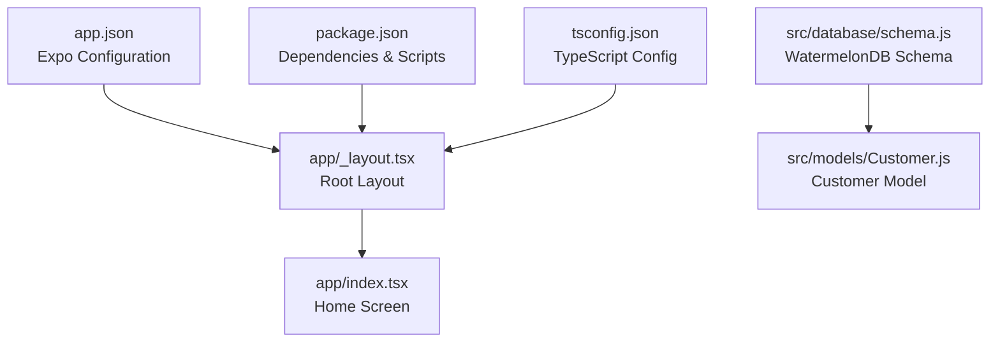

# Getting Started

<cite>
**Referenced Files in This Document**
- [README.md](file://README.md)
- [package.json](file://package.json)
- [app.json](file://app.json)
- [tsconfig.json](file://tsconfig.json)
- [eslint.config.js](file://eslint.config.js)
- [app/_layout.tsx](file://app/_layout.tsx)
- [app/index.tsx](file://app/index.tsx)
- [src/database/schema.js](file://src/database/schema.js)
- [src/models/Customer.js](file://src/models/Customer.js)
</cite>

## Table of Contents
1. [Introduction](#introduction)
2. [Prerequisites](#prerequisites)
3. [Installation](#installation)
4. [Development Environment Setup](#development-environment-setup)
5. [Running the Application](#running-the-application)
6. [Project Structure Overview](#project-structure-overview)
7. [Verification Steps](#verification-steps)
8. [Troubleshooting](#troubleshooting)
9. [Deployment Preparation](#deployment-preparation)
10. [Next Steps](#next-steps)

## Introduction
Welcome to ZemenawiDefter, a React Native application built with Expo Router. This guide will help you set up your development environment, install dependencies, configure the project, and run the application on emulators or physical devices. The project uses modern React Native tooling with TypeScript support, WatermelonDB for local database operations, and React Navigation for routing.

## Prerequisites
Before installing ZemenawiDefter, ensure your system meets the following requirements:

### Node.js and Package Managers
- **Node.js**: Version 18 or higher recommended
- **npm**: Version 8 or higher (comes with Node.js)
- **Alternative**: yarn or pnpm (supported via scripts)

### Platform-Specific Requirements

#### iOS Development
- macOS: Latest version recommended
- Xcode: Latest version with iOS Simulator support
- Command Line Tools: Install via `xcode-select --install`
- iOS Simulator: Pre-installed with Xcode

#### Android Development
- Android Studio: Latest version with Android SDK
- Android Emulator: Configured via AVD Manager
- Android SDK: API level 21+ recommended
- USB Debugging: Enabled on physical devices

### Development Tools
- **Expo CLI**: Required for development builds and device connections
- **Git**: For version control and project updates
- **Code Editor**: VS Code with React Native extensions recommended

**Section sources**
- [README.md](file://README.md#L1-L51)
- [package.json](file://package.json#L1-L55)

## Installation

### Step 1: Clone and Navigate
Clone the repository and navigate to the project directory:
```bash
git clone <repository-url>
cd ZemenawiDefter
```

### Step 2: Install Dependencies
Install all project dependencies using your preferred package manager:
```bash
npm install
```

### Step 3: Configure TypeScript Paths
The project uses TypeScript with custom path mapping. Verify your TypeScript configuration:
```json
{
  "extends": "expo/tsconfig.base",
  "compilerOptions": {
    "strict": true,
    "paths": {
      "@/*": ["./*"]
    }
  }
}
```

### Step 4: Verify ESLint Configuration
The project includes ESLint with Expo configuration:
```javascript
const { defineConfig } = require('eslint/config');
const expoConfig = require('eslint-config-expo/flat');

module.exports = defineConfig([
  expoConfig,
  {
    ignores: ['dist/*'],
  },
]);
```

**Section sources**
- [README.md](file://README.md#L7-L17)
- [package.json](file://package.json#L13-L46)
- [tsconfig.json](file://tsconfig.json#L1-L18)
- [eslint.config.js](file://eslint.config.js#L1-L11)

## Development Environment Setup

### Install Expo CLI
Install Expo CLI globally for development workflow:
```bash
npm install -g @expo/cli
```

### Configure Expo Application
The project uses Expo Router with the following configuration:
- **Name**: ZemenawiDefter
- **Slug**: zemenawidefter
- **Version**: 1.0.0
- **Orientation**: Portrait
- **Scheme**: zemenawidefter

### Platform-Specific Configurations

#### iOS Settings
- Supports tablet interface
- New architecture enabled
- Adaptive icon support

#### Android Settings
- Edge-to-edge display support
- Predictive back gesture disabled
- Package name: com.local_apps.ZemenawiDefter

#### Web Configuration
- Static output generation
- Favicon support

**Section sources**
- [app.json](file://app.json#L1-L50)
- [package.json](file://package.json#L1-L55)

## Running the Application

### Start Development Server
Launch the Expo development server:
```bash
npx expo start
```

### Available Commands
The project includes several convenient scripts:
- `npm start` - Start the development server
- `npm run android` - Run on Android device/emulator
- `npm run ios` - Run on iOS simulator
- `npm run web` - Start web development server
- `npm run lint` - Run ESLint for code quality

### Device Connection Options
After starting the development server, you can:
1. **Scan QR Code**: Use Expo Go app on your mobile device
2. **Open in Browser**: Access the web version
3. **Connect Physical Device**: Enable USB debugging and connect via cable
4. **Use Emulators**: Launch Android Studio or Xcode simulators

### First-Time Setup Flow
When running for the first time:
1. Install dependencies with `npm install`
2. Start the development server with `npx expo start`
3. Choose your target platform from the development menu
4. Allow Expo to configure platform-specific settings

**Section sources**
- [README.md](file://README.md#L13-L26)
- [package.json](file://package.json#L5-L12)

## Project Structure Overview

### Application Entry Points
The project follows Expo Router's file-based routing system:



**Diagram sources**
- [app/_layout.tsx](file://app/_layout.tsx#L1-L9)
- [app/index.tsx](file://app/index.tsx#L1-L16)
- [src/database/schema.js](file://src/database/schema.js#L1-L90)
- [src/models/Customer.js](file://src/models/Customer.js#L1-L20)
- [app.json](file://app.json#L1-L50)
- [package.json](file://package.json#L1-L55)

### Core Components Analysis

#### Layout Provider
The root layout wraps the entire application with React Native Paper provider, enabling Material Design components throughout the app.

#### Database Schema
The WatermelonDB schema defines the application's data model with tables for customers, products, sales, and related entities. Each table includes standard fields for timestamps and proper indexing for performance.

**Section sources**
- [app/_layout.tsx](file://app/_layout.tsx#L1-L9)
- [app/index.tsx](file://app/index.tsx#L1-L16)
- [src/database/schema.js](file://src/database/schema.js#L1-L90)
- [src/models/Customer.js](file://src/models/Customer.js#L1-L20)

## Verification Steps

### Local Database Setup
Verify WatermelonDB integration by checking the schema configuration:
1. Confirm schema version is set to 2
2. Verify all required tables are defined
3. Check that indexed columns are properly configured
4. Ensure timestamp fields exist for all tables

### Navigation Configuration
Verify routing setup:
1. Check that Stack navigation is configured in `_layout.tsx`
2. Confirm PaperProvider is wrapping the application
3. Verify header options are properly set

### TypeScript Configuration
Ensure TypeScript is properly configured:
1. Path mapping resolves `@/*` to project root
2. Strict mode is enabled for better type safety
3. Include patterns cover all necessary file types

**Section sources**
- [src/database/schema.js](file://src/database/schema.js#L1-L90)
- [app/_layout.tsx](file://app/_layout.tsx#L1-L9)
- [tsconfig.json](file://tsconfig.json#L1-L18)

## Troubleshooting

### Common Installation Issues

#### Dependency Installation Problems
**Issue**: npm install fails with peer dependency errors
**Solution**: 
1. Clear npm cache: `npm cache clean --force`
2. Delete node_modules and package-lock.json
3. Reinstall dependencies: `npm install --legacy-peer-deps`

#### Metro Bundler Issues
**Issue**: Development server fails to start
**Solution**:
1. Clear Metro cache: `npx expo start -c`
2. Restart terminal session
3. Check for port conflicts (default: 19000)

#### Platform-Specific Issues

**iOS Simulator Problems**:
1. Ensure Xcode is properly installed
2. Accept Xcode license: `sudo xcodebuild -license`
3. Reset simulator: `npx expo client:ios --reset-bridge-cache`

**Android Emulator Issues**:
1. Verify Android SDK is properly installed
2. Create new AVD if existing ones fail
3. Enable hardware acceleration in Android Studio

### Development Server Connection

#### QR Code Not Scanning
1. Ensure device and computer are on same network
2. Try `npx expo start --tunnel` for remote debugging
3. Use LAN option instead of tunnel if available

#### Device Not Appearing
1. Enable Developer Mode on Android devices
2. Verify USB debugging is enabled
3. Check ADB connection: `adb devices`

**Section sources**
- [README.md](file://README.md#L13-L26)
- [package.json](file://package.json#L5-L12)

## Deployment Preparation

### Development Build Preparation
For testing on physical devices during development:
```bash
# iOS development build
npx expo run:ios --configuration Debug

# Android development build  
npx expo run:android --variant Debug
```

### Production Build Preparation
Before releasing to stores:
1. **Update app.json**: Set proper version numbers and bundle identifiers
2. **Configure icons and splash screens**: Ensure assets meet store requirements
3. **Test on multiple devices**: Verify compatibility across different screen sizes
4. **Optimize performance**: Remove development-only features and logs

### Environment Variables
Set up environment-specific configurations:
- Create `.env` files for different environments
- Configure API endpoints for production
- Set up analytics and crash reporting

### Code Quality Checks
Run pre-deployment checks:
```bash
npm run lint
npm run test  # if tests are configured
```

**Section sources**
- [app.json](file://app.json#L1-L50)
- [package.json](file://package.json#L5-L12)

## Next Steps

### Development Workflow
1. **Start Development**: `npx expo start`
2. **Edit Files**: Modify components in the `app` directory
3. **Test Changes**: Use hot reload for immediate feedback
4. **Debug**: Use React DevTools and Expo DevTools

### Feature Implementation
1. **Add Screens**: Create new files in the `app` directory for additional pages
2. **Database Operations**: Use WatermelonDB models for data persistence
3. **Navigation**: Add new routes following Expo Router conventions
4. **Styling**: Utilize React Native Paper components for consistent UI

### Advanced Configuration
1. **Custom Fonts**: Add font files and configure in `app.json`
2. **Push Notifications**: Integrate Expo Push Notifications service
3. **Offline Support**: Leverage WatermelonDB's offline-first architecture
4. **Performance Monitoring**: Implement React Native Performance Monitor

### Team Collaboration
1. **Code Reviews**: Establish review processes for new features
2. **Documentation**: Maintain up-to-date documentation for new components
3. **Testing**: Implement unit and integration tests
4. **CI/CD**: Set up automated testing and deployment pipelines

**Section sources**
- [README.md](file://README.md#L26-L51)
- [app/_layout.tsx](file://app/_layout.tsx#L1-L9)
- [src/database/schema.js](file://src/database/schema.js#L1-L90)