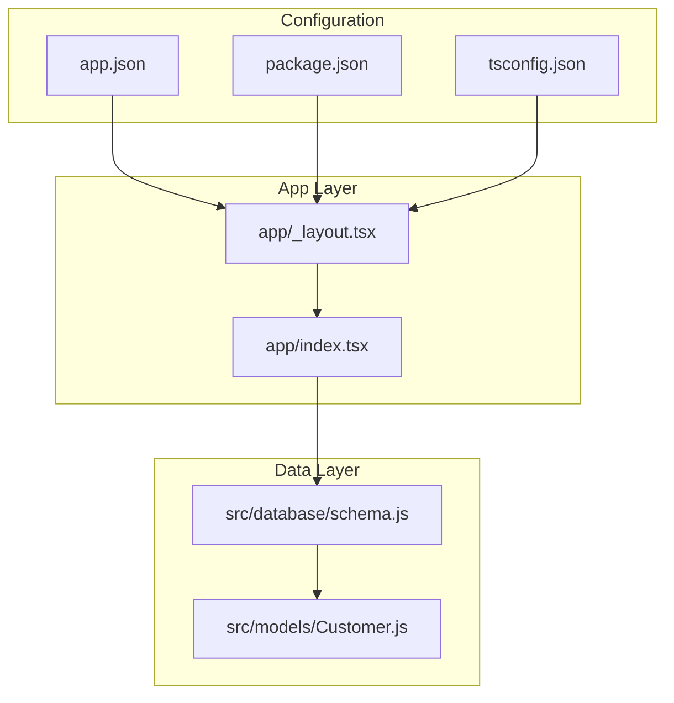
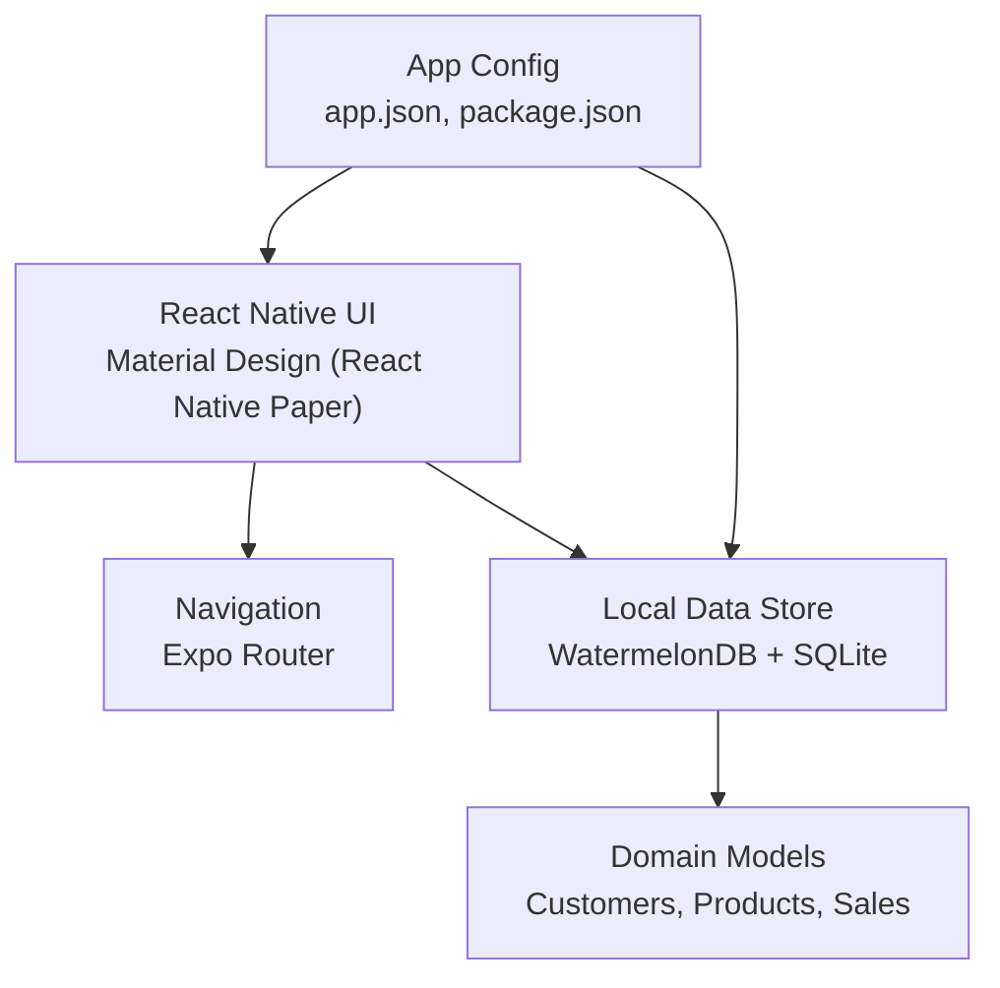
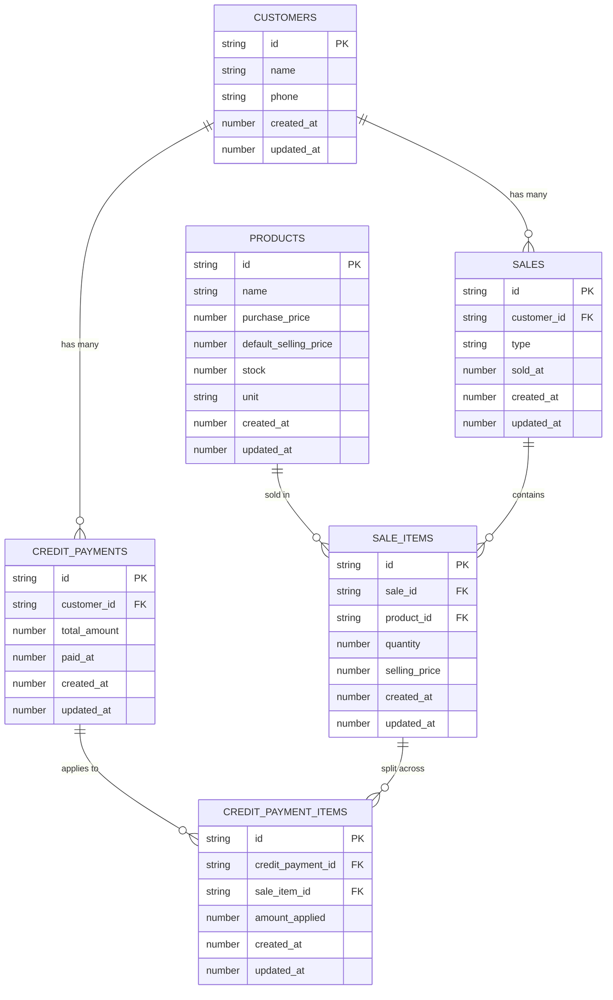
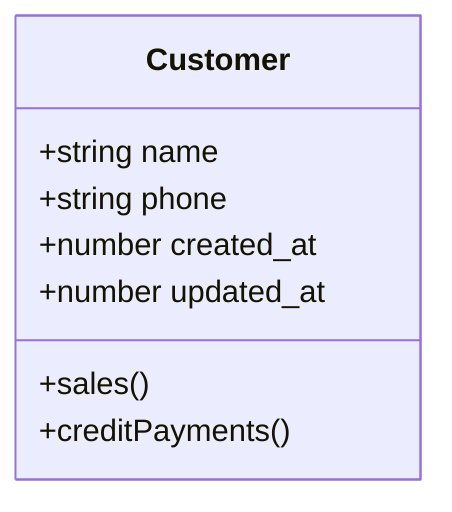
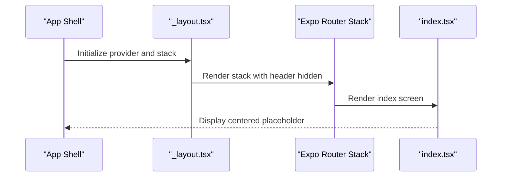
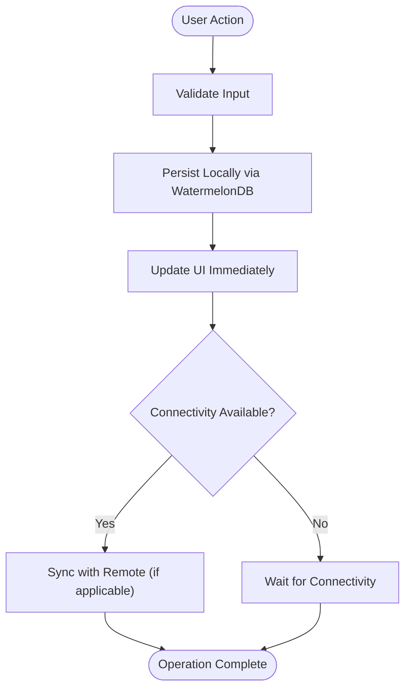
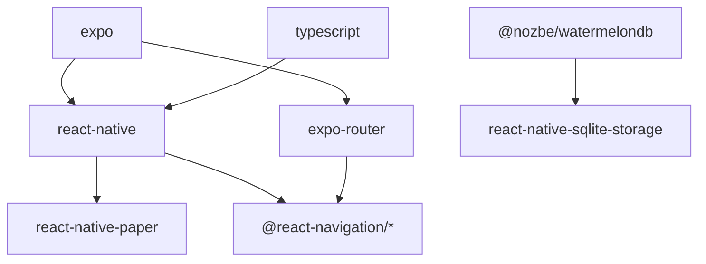

# Project Overview

<cite>
**Referenced Files in This Document**
- [README.md](file://README.md)
- [package.json](file://package.json)
- [app.json](file://app.json)
- [tsconfig.json](file://tsconfig.json)
- [app/_layout.tsx](file://app/_layout.tsx)
- [app/index.tsx](file://app/index.tsx)
- [src/database/schema.js](file://src/database/schema.js)
- [src/models/Customer.js](file://src/models/Customer.js)
</cite>

## Table of Contents
1. [Introduction](#introduction)
2. [Project Structure](#project-structure)
3. [Core Components](#core-components)
4. [Architecture Overview](#architecture-overview)
5. [Detailed Component Analysis](#detailed-component-analysis)
6. [Dependency Analysis](#dependency-analysis)
7. [Performance Considerations](#performance-considerations)
8. [Troubleshooting Guide](#troubleshooting-guide)
9. [Conclusion](#conclusion)

## Introduction
ZemenawiDefter is an Ethiopian point-of-sale (POS) application designed to modernize retail operations for small businesses across Ethiopia. It provides a comprehensive solution for managing customers, inventory, sales, and financial accounting with an emphasis on reliability, simplicity, and local relevance. Built with React Native and powered by Expo, the app targets Ethiopian retailers who need a robust, offline-capable, and cross-platform POS system that works consistently in diverse connectivity environments.

Key value propositions:
- Offline-first architecture ensures uninterrupted operation during power outages or weak network coverage.
- Cross-platform availability (Android, iOS, Web) enables unified deployment across devices commonly used by Ethiopian small businesses.
- Localized UI/UX aligned with Ethiopian retail workflows and preferences.
- Financial transparency through integrated customer credit management and sales tracking.

Target audience:
- Ethiopian small and medium-sized retailers, including grocery stores, kiosks, markets, and service providers requiring a reliable POS system.

## Project Structure
The project follows a modular, file-based routing structure typical of Expo applications. The frontend UI is organized under the app directory, while the backend data layer is encapsulated in the src directory with a dedicated database schema and model definitions.

**Diagram sources**
- [app/_layout.tsx](file://app/_layout.tsx#L1-L9)
- [app/index.tsx](file://app/index.tsx#L1-L16)
- [app.json](file://app.json#L1-L50)
- [package.json](file://package.json#L1-L55)
- [tsconfig.json](file://tsconfig.json#L1-L18)
- [src/database/schema.js](file://src/database/schema.js#L1-L90)
- [src/models/Customer.js](file://src/models/Customer.js#L1-L20)

**Section sources**
- [app/_layout.tsx](file://app/_layout.tsx#L1-L9)
- [app/index.tsx](file://app/index.tsx#L1-L16)
- [app.json](file://app.json#L1-L50)
- [package.json](file://package.json#L1-L55)
- [tsconfig.json](file://tsconfig.json#L1-L18)
- [src/database/schema.js](file://src/database/schema.js#L1-L90)
- [src/models/Customer.js](file://src/models/Customer.js#L1-L20)

## Core Components
ZemenawiDefter’s core components revolve around a clean separation of concerns:
- Application shell and navigation: Managed via a root layout provider and Expo Router stack.
- UI framework: Material Design–inspired components provided by React Native Paper.
- Data persistence: Local-first storage using WatermelonDB with SQLite-backed engine.
- Domain models: Strongly typed models for customers, products, sales, and related entities.

Technology stack highlights:
- React Native and Expo for cross-platform mobile and web deployment.
- WatermelonDB for reactive, offline-first data modeling and synchronization readiness.
- React Navigation for structured navigation.
- React Native Paper for Material Design–aligned UI components.
- TypeScript for type safety and developer productivity.

**Section sources**
- [app/_layout.tsx](file://app/_layout.tsx#L1-L9)
- [package.json](file://package.json#L13-L46)
- [src/database/schema.js](file://src/database/schema.js#L1-L90)
- [src/models/Customer.js](file://src/models/Customer.js#L1-L20)

## Architecture Overview
The system adopts an offline-first, local-first architecture. Data is stored locally using WatermelonDB, enabling immediate responsiveness and resilience. The UI is built with React Native and styled using Material Design components from React Native Paper. Navigation is handled by Expo Router, and the app is configured for Android, iOS, and Web platforms.

**Diagram sources**
- [app/_layout.tsx](file://app/_layout.tsx#L1-L9)
- [package.json](file://package.json#L13-L46)
- [app.json](file://app.json#L1-L50)
- [src/database/schema.js](file://src/database/schema.js#L1-L90)

## Detailed Component Analysis

### Database Schema and Models
The schema defines core entities and relationships essential for a POS system:
- Customers: Stores customer identity and timestamps.
- Products: Tracks product metadata, pricing, stock, and unit of measure.
- Sales: Captures sale records with customer linkage, sale type (cash/credit), and timestamps.
- Sale Items: Links products sold in each transaction with quantities and prices.
- Credit Payments: Records payments against customer credit balances with timestamps.
- Credit Payment Items: Associates payments to specific sale items.

**Diagram sources**
- [src/database/schema.js](file://src/database/schema.js#L1-L90)

**Section sources**
- [src/database/schema.js](file://src/database/schema.js#L1-L90)

### Customer Model
The Customer model demonstrates WatermelonDB’s decorator-based approach to define fields and relationships. It exposes fields for name, phone, and timestamps, and declares relationships to sales and credit payments.

**Diagram sources**
- [src/models/Customer.js](file://src/models/Customer.js#L1-L20)

**Section sources**
- [src/models/Customer.js](file://src/models/Customer.js#L1-L20)

### Application Shell and Routing
The root layout integrates the Material Design theme provider and sets up a stack navigator with hidden headers. The index route currently serves as a placeholder screen, indicating the application’s scaffolding for future screens.

**Diagram sources**
- [app/_layout.tsx](file://app/_layout.tsx#L1-L9)
- [app/index.tsx](file://app/index.tsx#L1-L16)

**Section sources**
- [app/_layout.tsx](file://app/_layout.tsx#L1-L9)
- [app/index.tsx](file://app/index.tsx#L1-L16)

### Data Flow and Offline-First Behavior
Offline-first architecture ensures that all user actions—creating customers, recording sales, applying payments—are persisted locally immediately. The WatermelonDB schema and model definitions support eventual consistency and synchronization readiness, enabling seamless operation when connectivity improves.

[No sources needed since this diagram shows conceptual workflow, not actual code structure]

## Dependency Analysis
The project’s dependencies align with a modern React Native/Expo setup emphasizing navigation, UI, data persistence, and cross-platform compatibility.

**Diagram sources**
- [package.json](file://package.json#L13-L46)

**Section sources**
- [package.json](file://package.json#L13-L46)

## Performance Considerations
- Local-first design minimizes network latency and improves responsiveness in low-connectivity environments.
- Indexed columns in the schema (for foreign keys and timestamps) help optimize query performance for sales, payments, and related entities.
- Using lightweight, reactive data access patterns reduces unnecessary re-renders and memory overhead.
- Cross-platform builds leverage native modules where appropriate to maintain smooth UI interactions.

[No sources needed since this section provides general guidance]

## Troubleshooting Guide
Common setup and runtime issues:
- Development server startup: Use the documented commands to install dependencies and launch the development server.
- Platform-specific builds: Use the scripts to run on Android, iOS, or Web as needed.
- Routing and navigation: Verify that the root layout and stack configuration match the intended navigation behavior.
- Database initialization: Ensure the WatermelonDB schema is correctly registered and migrations are handled as the schema evolves.

Operational tips:
- Keep dependencies updated per the package manifest.
- Test offline scenarios by simulating connectivity loss and verifying local persistence.
- Validate Material Design theming and navigation behavior across Android, iOS, and Web.

**Section sources**
- [README.md](file://README.md#L1-L51)
- [package.json](file://package.json#L5-L11)
- [app/_layout.tsx](file://app/_layout.tsx#L1-L9)
- [app.json](file://app.json#L1-L50)

## Conclusion
ZemenawiDefter positions itself as a practical, offline-first POS solution tailored to the needs of Ethiopian small businesses. By combining React Native and Expo for cross-platform reach, WatermelonDB for resilient local data storage, and Material Design components for intuitive UX, the application delivers a solid foundation for customer management, inventory tracking, sales processing, and financial accounting. Its architecture supports scalability and future enhancements while remaining accessible and reliable in real-world Ethiopian retail environments.