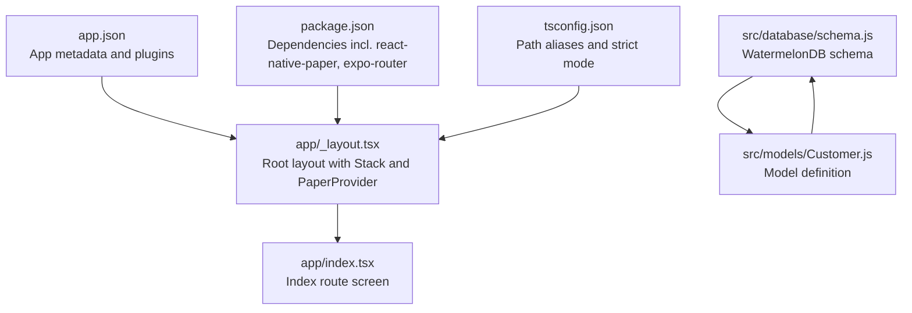
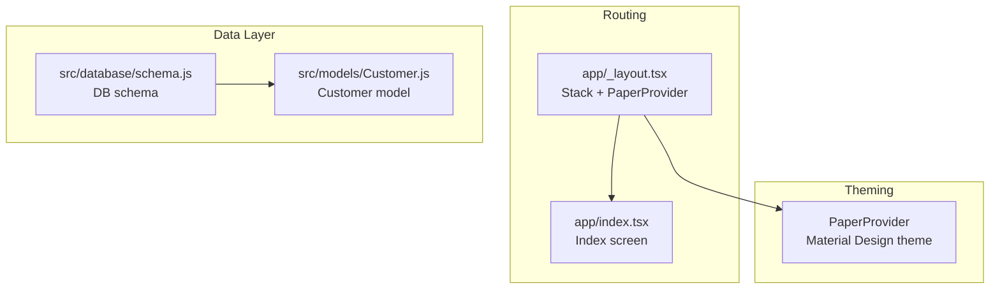
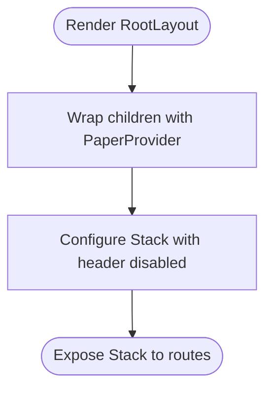
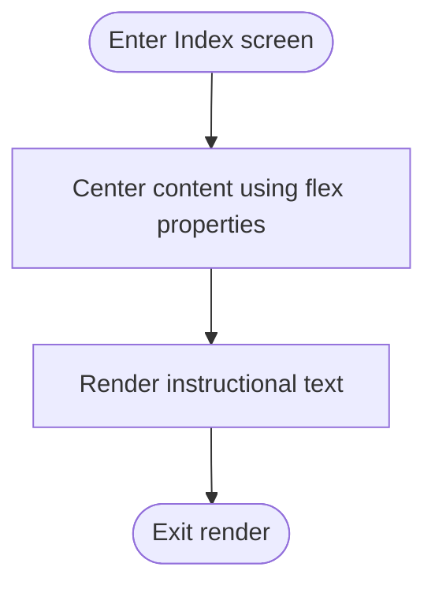
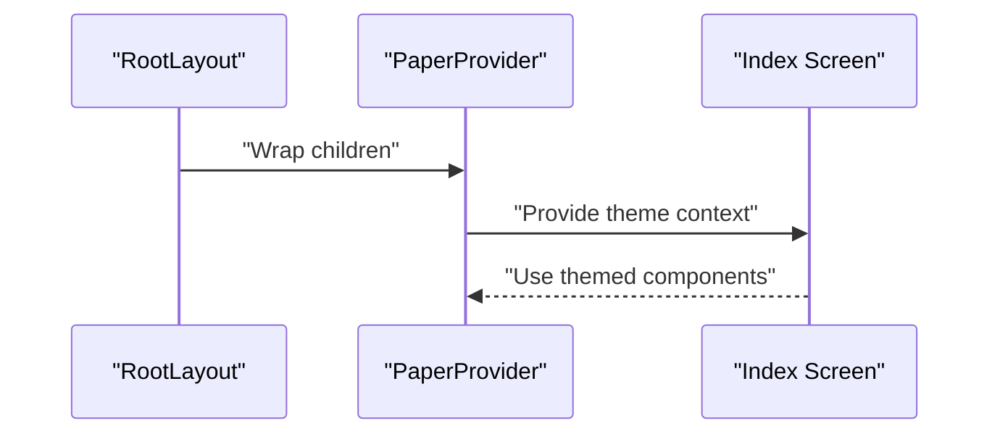
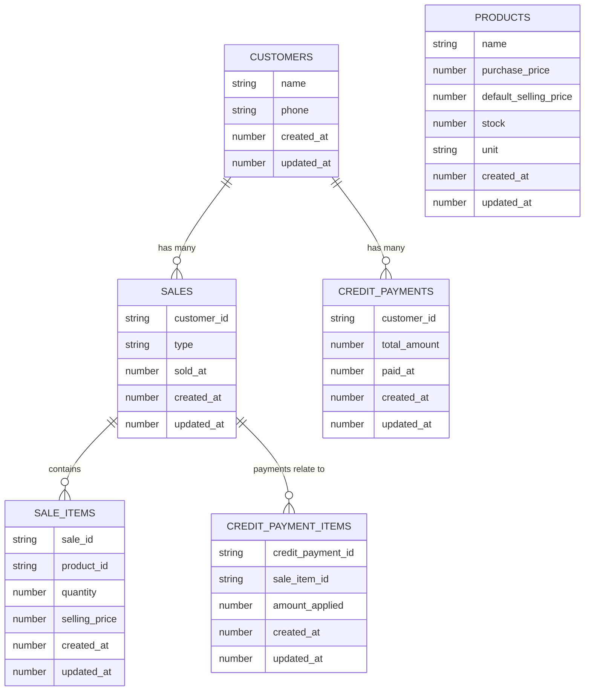
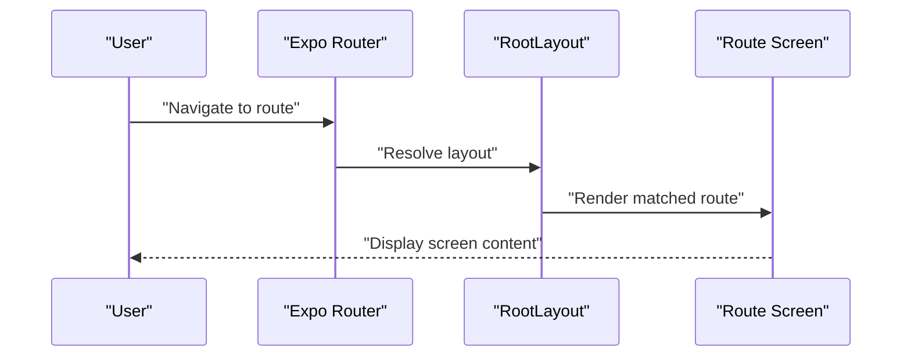
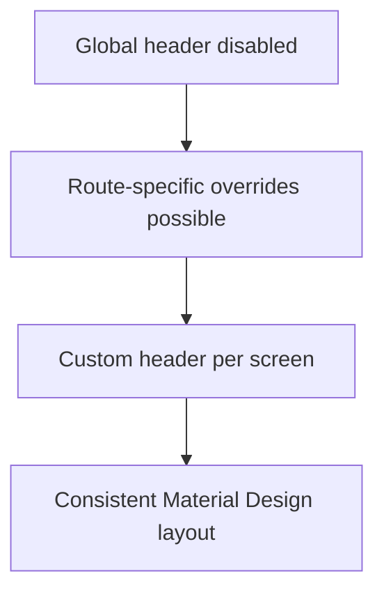
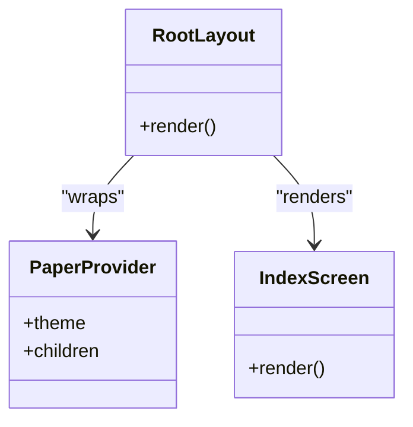
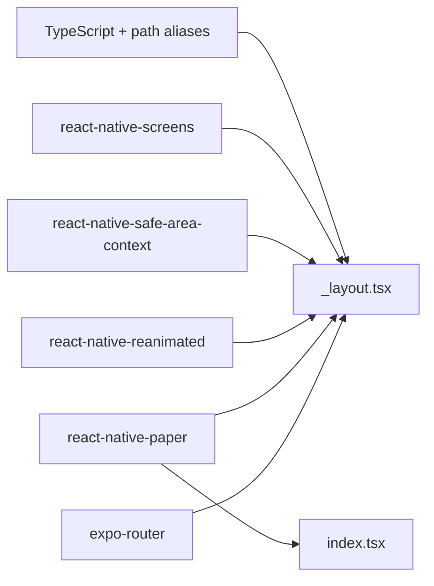

# User Interface and Components

<cite>
**Referenced Files in This Document**
- [app/_layout.tsx](file://app/_layout.tsx)
- [app/index.tsx](file://app/index.tsx)
- [package.json](file://package.json)
- [app.json](file://app.json)
- [tsconfig.json](file://tsconfig.json)
- [src/database/schema.js](file://src/database/schema.js)
- [src/models/Customer.js](file://src/models/Customer.js)
- [README.md](file://README.md)
</cite>

## Table of Contents
1. [Introduction](#introduction)
2. [Project Structure](#project-structure)
3. [Core Components](#core-components)
4. [Architecture Overview](#architecture-overview)
5. [Detailed Component Analysis](#detailed-component-analysis)
6. [Dependency Analysis](#dependency-analysis)
7. [Performance Considerations](#performance-considerations)
8. [Troubleshooting Guide](#troubleshooting-guide)
9. [Conclusion](#conclusion)
10. [Appendices](#appendices)

## Introduction
This document describes the user interface and component architecture of ZemenawiDefter, focusing on the navigation structure via Expo Router’s file-based routing, Material Design integration through React Native Paper, and foundational layout patterns. It also covers theme management, styling approaches, component composition, accessibility and cross-platform considerations, performance characteristics, and debugging techniques grounded in the current repository state.

## Project Structure
The project follows Expo Router’s convention where route files live under the app directory. The root layout configures a stack navigator and wraps the app with a PaperProvider to enable Material Design components and theme support. The index route defines the initial screen. Additional directories include a database schema and WatermelonDB models for data persistence.

**Diagram sources**
- [app/_layout.tsx](file://app/_layout.tsx#L1-L9)
- [app/index.tsx](file://app/index.tsx#L1-L16)
- [app.json](file://app.json#L1-L50)
- [package.json](file://package.json#L1-L55)
- [tsconfig.json](file://tsconfig.json#L1-L18)
- [src/database/schema.js](file://src/database/schema.js#L1-L90)
- [src/models/Customer.js](file://src/models/Customer.js#L1-L20)

**Section sources**
- [README.md](file://README.md#L26-L26)
- [app/_layout.tsx](file://app/_layout.tsx#L1-L9)
- [app/index.tsx](file://app/index.tsx#L1-L16)
- [app.json](file://app.json#L1-L50)
- [package.json](file://package.json#L13-L46)
- [tsconfig.json](file://tsconfig.json#L1-L18)
- [src/database/schema.js](file://src/database/schema.js#L1-L90)
- [src/models/Customer.js](file://src/models/Customer.js#L1-L20)

## Core Components
- Root layout and navigation
  - The root layout initializes a Stack navigator and disables the default header globally. It wraps the entire app with PaperProvider to make Material Design theming and components available.
  - Reference: [app/_layout.tsx](file://app/_layout.tsx#L1-L9)

- Index route screen
  - The index route renders a centered view with a text instruction. It demonstrates a minimal layout pattern suitable for building out screens later.
  - Reference: [app/index.tsx](file://app/index.tsx#L1-L16)

- Theme and provider integration
  - React Native Paper is integrated via PaperProvider at the root, enabling Material Design components and theme-aware rendering across the app.
  - Reference: [package.json](file://package.json#L38-L38), [app/_layout.tsx](file://app/_layout.tsx#L2-L2)

- Routing and navigation
  - The project uses Expo Router’s file-based routing. The README confirms this routing model.
  - Reference: [README.md](file://README.md#L26-L26)

**Section sources**
- [app/_layout.tsx](file://app/_layout.tsx#L1-L9)
- [app/index.tsx](file://app/index.tsx#L1-L16)
- [package.json](file://package.json#L38-L38)
- [README.md](file://README.md#L26-L26)

## Architecture Overview
The UI architecture centers on:
- Navigation: Stack-based routing managed by Expo Router.
- Theming: Global Material Design theming via React Native Paper’s PaperProvider.
- Layout: A single index screen currently; future routes can be added under the app directory following Expo Router conventions.
- Data layer: WatermelonDB schema and models define the domain and persistence contracts.

**Diagram sources**
- [app/_layout.tsx](file://app/_layout.tsx#L1-L9)
- [app/index.tsx](file://app/index.tsx#L1-L16)
- [src/database/schema.js](file://src/database/schema.js#L1-L90)
- [src/models/Customer.js](file://src/models/Customer.js#L1-L20)

## Detailed Component Analysis

### Root Layout and Navigation
- Purpose: Configure global navigation and theming.
- Implementation highlights:
  - Stack navigator configured with header hidden globally.
  - PaperProvider installed at the root to propagate theme and components.
- Composition pattern: Stateless layout component returning a Stack with provider wrapping.
- Accessibility and cross-platform: Header disabled here; future screens can customize headers per platform and accessibility needs.

**Diagram sources**
- [app/_layout.tsx](file://app/_layout.tsx#L4-L8)

**Section sources**
- [app/_layout.tsx](file://app/_layout.tsx#L1-L9)

### Index Screen
- Purpose: Initial screen demonstrating a centered layout.
- Implementation highlights:
  - Uses Flexbox centering for vertical and horizontal alignment.
  - Renders a text instruction to guide edits.
- Composition pattern: Stateless functional component returning a View and Text.
- Prop interfaces: None in this component; props can be introduced as needed for dynamic content.
- Event handling: None in this component; interactions can be added via Paper components and gesture handlers.

**Diagram sources**
- [app/index.tsx](file://app/index.tsx#L3-L15)

**Section sources**
- [app/index.tsx](file://app/index.tsx#L1-L16)

### Material Design Integration and Theme Management
- Provider setup: PaperProvider is used at the root to enable Material Design components and theme-aware rendering.
- Theme propagation: Components from React Native Paper automatically consume the theme context established by PaperProvider.
- Theme customization: While not shown in the current code, typical patterns involve passing a theme object to PaperProvider or using the theming utilities provided by React Native Paper.

**Diagram sources**
- [app/_layout.tsx](file://app/_layout.tsx#L2-L7)
- [package.json](file://package.json#L38-L38)

**Section sources**
- [app/_layout.tsx](file://app/_layout.tsx#L1-L9)
- [package.json](file://package.json#L38-L38)

### Data Layer and UI Implications
- Schema: Defines tables and columns for customers, products, sales, sale items, credit payments, and credit payment items.
- Models: Define relationships and fields for domain entities (e.g., Customer model exposes fields and relationships).
- UI implications: These definitions inform how screens present lists, forms, and analytics related to these entities.

**Diagram sources**
- [src/database/schema.js](file://src/database/schema.js#L1-L90)
- [src/models/Customer.js](file://src/models/Customer.js#L1-L20)

**Section sources**
- [src/database/schema.js](file://src/database/schema.js#L1-L90)
- [src/models/Customer.js](file://src/models/Customer.js#L1-L20)

### Navigation Structure Using Expo Router
- File-based routing: Route files under app map to URLs; nested folders create nested routes.
- Global configuration: The root layout configures the Stack navigator and disables the default header.
- Future expansion: Add new route files under app to introduce new screens and stacks.

**Diagram sources**
- [README.md](file://README.md#L26-L26)
- [app/_layout.tsx](file://app/_layout.tsx#L1-L9)

**Section sources**
- [README.md](file://README.md#L26-L26)
- [app/_layout.tsx](file://app/_layout.tsx#L1-L9)

### Header Customization and Screen Layouts
- Current state: The root layout hides the default header globally.
- Customization approach: To add custom headers, configure screen options per route or override defaults in specific screens using React Native Paper’s Appbar or navigation bar utilities.
- Layout patterns: Use Flexbox and responsive units for consistent layouts across devices.

**Diagram sources**
- [app/_layout.tsx](file://app/_layout.tsx#L6-L6)

**Section sources**
- [app/_layout.tsx](file://app/_layout.tsx#L1-L9)

### Component Composition Patterns, Props, and Events
- Composition patterns:
  - Stateless functional components for views (e.g., index screen).
  - Provider-based composition for theming (PaperProvider).
- Prop interfaces:
  - Introduce typed props for dynamic content and actions.
  - Use TypeScript path aliases for modular imports.
- Event handling:
  - Add press handlers, form submissions, and gestures as needed.
  - Combine with Paper components (buttons, inputs) for consistent UX.

**Diagram sources**
- [app/_layout.tsx](file://app/_layout.tsx#L4-L8)
- [app/index.tsx](file://app/index.tsx#L3-L15)

**Section sources**
- [app/_layout.tsx](file://app/_layout.tsx#L1-L9)
- [app/index.tsx](file://app/index.tsx#L1-L16)
- [tsconfig.json](file://tsconfig.json#L5-L9)

### Responsive Design and Cross-Platform UI Consistency
- Responsive patterns:
  - Use Flexbox and percentage-based sizes for adaptive layouts.
  - Prefer scalable typography and spacing tokens.
- Cross-platform:
  - Expo Router and React Native Paper provide consistent behavior across iOS, Android, and Web.
  - Respect platform-specific guidelines while maintaining a unified design language.

[No sources needed since this section provides general guidance]

### Animations, Transitions, and Interaction Patterns
- Animations:
  - Consider integrating animated components from React Native Paper and Reanimated for smooth transitions.
- Transitions:
  - Customize stack transitions per route using Expo Router’s screen options.
- Interaction patterns:
  - Use Paper buttons, cards, and inputs to align with Material Design touch targets and feedback.

[No sources needed since this section provides general guidance]

## Dependency Analysis
Key UI-related dependencies and their roles:
- Expo Router: File-based routing and navigation.
- React Native Paper: Material Design components and theming.
- React Native Reanimated: Animation engine for gestures and transitions.
- React Native Safe Area Context and Screens: Platform-safe areas and optimized screen rendering.
- TypeScript and path aliases: Type safety and modular imports.

**Diagram sources**
- [package.json](file://package.json#L13-L46)
- [app/_layout.tsx](file://app/_layout.tsx#L1-L9)
- [app/index.tsx](file://app/index.tsx#L1-L16)
- [tsconfig.json](file://tsconfig.json#L5-L9)

**Section sources**
- [package.json](file://package.json#L13-L46)
- [tsconfig.json](file://tsconfig.json#L1-L18)

## Performance Considerations
- Rendering:
  - Keep screens lightweight; defer heavy computations to background threads or WatermelonDB queries.
- Navigation:
  - Use lazy loading for route files and avoid unnecessary re-renders.
- Theming:
  - Minimize deep theme overrides; prefer centralized theme adjustments.
- Animations:
  - Offload animations to native drivers (Reanimated) for smoother performance.
- Bundle size:
  - Tree-shake unused components and rely on platform-specific builds.

[No sources needed since this section provides general guidance]

## Troubleshooting Guide
- Theming issues:
  - Ensure PaperProvider is present at the root and not shadowed by nested providers.
- Routing problems:
  - Verify route file placement under app and correct file naming conventions.
- Build and runtime errors:
  - Confirm plugin configurations in app.json and dependency versions in package.json.
- Debugging UI:
  - Use React DevTools and Flipper for component inspection and network tracing.
  - Leverage TypeScript diagnostics and ESLint for type and style checks.

**Section sources**
- [app/_layout.tsx](file://app/_layout.tsx#L1-L9)
- [app.json](file://app.json#L29-L47)
- [package.json](file://package.json#L13-L46)
- [README.md](file://README.md#L13-L25)

## Conclusion
ZemenawiDefter establishes a solid foundation for a Material Design–aligned UI using Expo Router and React Native Paper. The root layout centralizes navigation and theming, while the index screen provides a starting point for building feature screens. The WatermelonDB schema and models define the data backbone for future UI components. By following the composition patterns, accessibility guidelines, and performance recommendations outlined here, the team can scale the UI consistently across platforms.

[No sources needed since this section summarizes without analyzing specific files]

## Appendices
- Path aliases and strict TypeScript:
  - Path aliases simplify imports and improve maintainability.
  - Strict mode enforces type safety across the codebase.

**Section sources**
- [tsconfig.json](file://tsconfig.json#L3-L10)